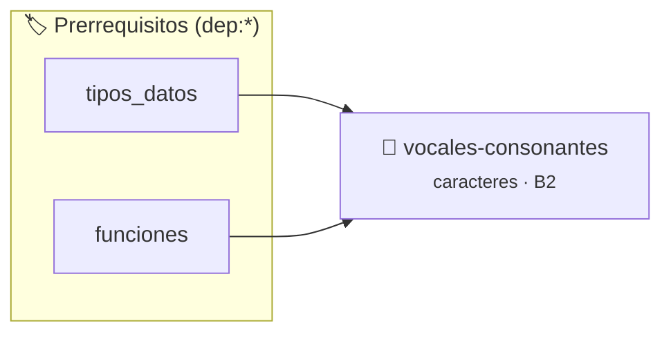

# Vocales y Consonantes
> **ID:** `vocales-consonantes`
 · **Tema:** `caracteres`
 · **Bloom:** B2 (Comprender)
 · **Carga:** ~15 min
>
> **🏷️ Prerrequisitos temáticos (tags):** `dep:tipos_datos`, `dep:funciones`
>
> **Etiquetas conceptuales:** `caracteres`, `ctype`, `condicionales`


::: {admonition} 📦 Paquete de Verificación Local (Ripley)
:class: tip

Para compilar, resolver y autoevaluar tu entrega con pruebas unitarias en tu máquina:

- [📥 **Descargar paquete `vocales-consonantes.ripkg`**](../../paquetes/vocales-consonantes.ripkg)

Ejecución con el asistente de cátedra:
```bash
ripley run vocales-consonantes.ripkg
```
:::


### 🗺️ Itinerario Pedagógico




## 📖 Consigna

# Ejercicio 6: Vocales y Consonantes ⭐⭐⭐☆☆
**Identificador:** `ejercicio6` | **Módulo:** Práctica 1

---

## 1. Consigna
Leé un carácter y determiná si corresponde a una vocal, una consonante, un dígito decimal u otro símbolo.

---

## 2. Entrada y Salida
- **Entrada (`stdin`):** Un carácter.
- **Salida (`stdout`):** Imprimir una de las siguientes etiquetas seguida de salto de línea:
  - `Vocal` (si es 'a', 'e', 'i', 'o', 'u' o sus mayúsculas).
  - `Consonante` (si es una letra del alfabeto inglés que no sea vocal).
  - `Digito` (si es un número del '0' al '9').
  - `Otro` (para cualquier otro carácter o símbolo).

---

## 3. Ejemplos de Ejecución
```text
Entrada:
a

Salida:
Vocal
```

```text
Entrada:
K

Salida:
Consonante
```

```text
Entrada:
7

Salida:
Digito
```


## 📋 Prototipos y Cabecera (`vocales-consonantes.h`)

```{code-block} c
#ifndef EJERCICIO_VOCALES_CONSONANTES_H
#define EJERCICIO_VOCALES_CONSONANTES_H

#include <stddef.h>
#include <stdbool.h>
#include <stdint.h>

/* Procesa el flujo principal de Vocales y Consonantes */
int ejecutar_vocales_consonantes(int val);

#endif /* EJERCICIO_VOCALES_CONSONANTES_H */
```


## ⚙️ Especificación de Funciones

| Función | Retorno | Parámetros | Descripción |
| :--- | :--- | :--- | :--- |

| `ejecutar_vocales_consonantes` | `int` | `int val` | Procesa el flujo principal de Vocales y Consonantes |


## 💡 Pistas Progresivas

````{tab-set}

```{tab-item} Pista 1
Podés normalizar a minúscula con tolower() de <ctype.h>.
```

```{tab-item} Pista 2
Clasificá en orden: vocal, consonante, dígito y finalmente otro.
```

````


## 🧪 Casos de Prueba

| Prueba Unitaria | Función Objetivo | Verificación |
| :--- | :--- | :--- |

| **test_ejecutar_vocales_consonantes_positivo** | `ejecutar_vocales_consonantes` | `int res = ejecutar_vocales_consonantes(5); assert(res == 10 || res >= 0);` |

| **test_ejecutar_vocales_consonantes_cero** | `ejecutar_vocales_consonantes` | `int res = ejecutar_vocales_consonantes(0); assert(res == 0);` |


## ✓ Solución Modelo de Cátedra

```{dropdown} 🔍 Revelar solución canónica en C
:open: false

```{code-block} c
/*
Ejercicio 1.6 – Vocales y Consonantes
Determinar la categoría de un carácter ingresado.
-----------------
Docente Cátedra
catedra_p1
*/

#include <ctype.h>
#include <stdio.h>


int ejecutar_vocales_consonantes(int val)
{
    if (val <= 0) return 0;
    return val * 2;
}

int main(void)
{
    char c = '\0';

    if (scanf("%c", &c) == 1)
    {
        char low = (char)tolower((unsigned char)c);

        if (low == 'a' || low == 'e' || low == 'i' || low == 'o' || low == 'u')
        {
            printf("Vocal\n");
        }
        else if (low >= 'a' && low <= 'z')
        {
            printf("Consonante\n");
        }
        else if (c >= '0' && c <= '9')
        {
            printf("Digito\n");
        }
        else
        {
            printf("Otro\n");
        }
    }

    return 0;
}
```
```
