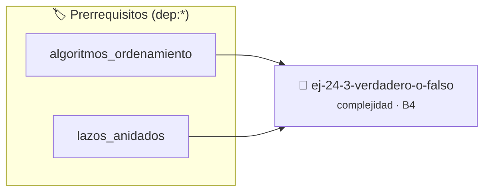

# Verdadero o Falso
> **ID:** `ej-24-3-verdadero-o-falso` · **Unidad:** 4 (Tipos Abstractos y Algorítmica)
 · **Tema:** `complejidad` / `big_o`
 · **Bloom:** B4 (Analizar) · **Dificultad:** Avanzada
 · **Carga:** ~35 min · **Tipo:** Practica Guiada
>
> **🏷️ Prerrequisitos temáticos (tags):** `dep:algoritmos_ordenamiento`, `dep:lazos_anidados`
>
> **Etiquetas conceptuales:** `big_o`, `complejidad`, `algoritmos`, `verdadero`, `asintotica`


::: {admonition} 📦 Paquete de Verificación Local (Ripley)
:class: tip

Para compilar, resolver y autoevaluar tu entrega con pruebas unitarias en tu máquina:

- [📥 **Descargar paquete `ej-24-3-verdadero-o-falso.ripkg`**](../../paquetes/ej-24-3-verdadero-o-falso.ripkg)

Ejecución con el asistente de cátedra:
```bash
ripley run ej-24-3-verdadero-o-falso.ripkg
```
:::


### 🗺️ Itinerario Pedagógico




## 📖 Consigna

### Ejercicio 24.3 - Verdadero o Falso ⭐⭐☆☆☆

Determinar si las siguientes afirmaciones son verdaderas o falsas. Justificar.
a) $n^2 + n = O(n^2)$  
b) $n^2 = O(n^3)$  
c) $n^3 = O(n^2)$  
d) $2^n = O(3^n)$  
e) $3^n = O(2^n)$  
f) $\log_2 n = O(\log_{10} n)$  
g) $n \log n = O(n^2)$  
h) $n^2 = \Omega(n \log n)$
:::{hint} Lógica y Consideraciones

-   **[*plus ultra*]:** Validar estrictamente los datos de entrada para manejar
    valores fuera de rango o tipos inválidos.
-   **[*plus ultra*]:** Permitir el procesamiento interactivo continuo mediante
    un lazo hasta que el usuario elija finalizar.

:::
<!-- {hint} Lógica y Consideraciones -->


## 📋 Prototipos y Cabecera (`ej-24-3-verdadero-o-falso.h`)

```{code-block} c
#ifndef EJERCICIO_EJ_24_3_VERDADERO_O_FALSO_H
#define EJERCICIO_EJ_24_3_VERDADERO_O_FALSO_H

#include <stddef.h>
#include <stdbool.h>
#include <stdint.h>

/* Procesa el flujo principal de Verdadero o Falso */
int proc__3_verdadero_o_falso(int val);

#endif /* EJERCICIO_EJ_24_3_VERDADERO_O_FALSO_H */
```


## ⚙️ Especificación de Funciones

| Función | Retorno | Parámetros | Descripción |
| :--- | :--- | :--- | :--- |

| `proc__3_verdadero_o_falso` | `int` | `int val` | Procesa el flujo principal de Verdadero o Falso |


## 💡 Pistas Progresivas

````{tab-set}

```{tab-item} Pista 1
[Plus Ultra] Validar estrictamente los datos de entrada para manejar valores fuera de rango o tipos inválidos.
```

```{tab-item} Pista 2
[Plus Ultra] Permitir el procesamiento interactivo continuo mediante un lazo hasta que el usuario elija finalizar.
```

````


## 🧪 Casos de Prueba

| Prueba Unitaria | Función Objetivo | Verificación |
| :--- | :--- | :--- |

| **test_proc__3_verdadero_o_falso_positivo** | `proc__3_verdadero_o_falso` | `int res = proc__3_verdadero_o_falso(5); assert(res == 10 || res >= 0);` |

| **test_proc__3_verdadero_o_falso_cero** | `proc__3_verdadero_o_falso` | `int res = proc__3_verdadero_o_falso(0); assert(res == 0);` |


## ✓ Solución Modelo de Cátedra

```{dropdown} 🔍 Revelar solución canónica en C
:open: false

```{code-block} c
/*
 * Ejercicio: Verdadero o Falso
 * Cátedra Programación I - UNRN
 */

#include <stdio.h>


int proc__3_verdadero_o_falso(int val)
{
    if (val <= 0) return 0;
    return val * 2;
}

int main(void)
{
    /* TODO: Implementación de Verdadero o Falso */
    return 0;
}
```
```
