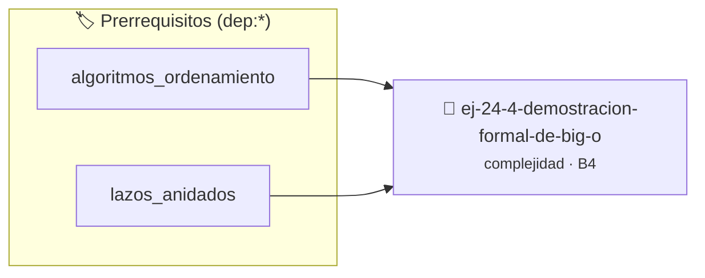

# Demostración Formal de Big-O
> **ID:** `ej-24-4-demostracion-formal-de-big-o`
 · **Tema:** `complejidad`
 · **Bloom:** B4 (Analizar)
 · **Carga:** ~35 min
>
> **🏷️ Prerrequisitos temáticos (tags):** `dep:algoritmos_ordenamiento`, `dep:lazos_anidados`
>
> **Etiquetas conceptuales:** `big_o`, `demostracion`, `complejidad`, `formal`, `big-o`


::: {admonition} 📦 Paquete de Verificación Local (Ripley)
:class: tip

Para compilar, resolver y autoevaluar tu entrega con pruebas unitarias en tu máquina:

- [📥 **Descargar paquete `ej-24-4-demostracion-formal-de-big-o.ripkg`**](../../paquetes/ej-24-4-demostracion-formal-de-big-o.ripkg)

Ejecución con el asistente de cátedra:
```bash
ripley run ej-24-4-demostracion-formal-de-big-o.ripkg
```
:::


### 🗺️ Itinerario Pedagógico




## 📖 Consigna

### Ejercicio 24.4 - Demostración Formal de Big-O ⭐⭐☆☆☆

Demostrar formalmente que $f(n) = 3n^2 + 5n + 2$ es $O(n^2)$ encontrando
constantes $c$ y $n_0$ que satisfagan la definición.


:::{hint} Lógica y Consideraciones

-   **[*plus ultra*]:** Garantizar la terminación con `\0` y prevenir
    desbordamientos de búfer validando la capacidad máxima.
-   **[*plus ultra*]:** Soportar la lectura de cadenas con espacios y múltiples
    líneas de manera robusta.

:::
<!-- {hint} Lógica y Consideraciones -->

---

## Análisis de Lazos Simples


## 📋 Prototipos y Cabecera (`ej-24-4-demostracion-formal-de-big-o.h`)

```{code-block} c
#ifndef EJERCICIO_EJ_24_4_DEMOSTRACION_FORMAL_DE_BIG_O_H
#define EJERCICIO_EJ_24_4_DEMOSTRACION_FORMAL_DE_BIG_O_H

#include <stddef.h>
#include <stdbool.h>
#include <stdint.h>

/* Procesa el flujo principal de Demostración Formal de Big-O */
int proc_cion_formal_de_big_o(int val);

#endif /* EJERCICIO_EJ_24_4_DEMOSTRACION_FORMAL_DE_BIG_O_H */
```


## ⚙️ Especificación de Funciones

| Función | Retorno | Parámetros | Descripción |
| :--- | :--- | :--- | :--- |

| `proc_cion_formal_de_big_o` | `int` | `int val` | Procesa el flujo principal de Demostración Formal de Big-O |


## 💡 Pistas Progresivas

````{tab-set}

```{tab-item} Pista 1
[Plus Ultra] Garantizar la terminación con `\0` y prevenir desbordamientos de búfer validando la capacidad máxima.
```

```{tab-item} Pista 2
[Plus Ultra] Soportar la lectura de cadenas con espacios y múltiples líneas de manera robusta.
```

````


## 🧪 Casos de Prueba

| Prueba Unitaria | Función Objetivo | Verificación |
| :--- | :--- | :--- |

| **test_proc_cion_formal_de_big_o_positivo** | `proc_cion_formal_de_big_o` | `int res = proc_cion_formal_de_big_o(5); assert(res == 10 || res >= 0);` |

| **test_proc_cion_formal_de_big_o_cero** | `proc_cion_formal_de_big_o` | `int res = proc_cion_formal_de_big_o(0); assert(res == 0);` |


## ✓ Solución Modelo de Cátedra

```{dropdown} 🔍 Revelar solución canónica en C
:open: false

```{code-block} c
/*
 * Ejercicio: Demostración Formal de Big-O
 * Cátedra Programación I - UNRN
 */

#include <stdio.h>


int proc_cion_formal_de_big_o(int val)
{
    if (val <= 0) return 0;
    return val * 2;
}

int main(void)
{
    /* TODO: Implementación de Demostración Formal de Big-O */
    return 0;
}
```
```
