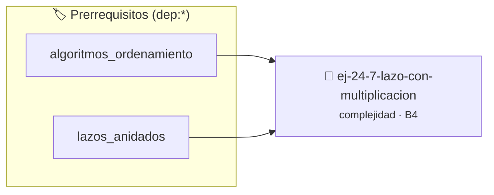

# Lazo con Multiplicación
> **ID:** `ej-24-7-lazo-con-multiplicacion` · **Unidad:** 4 (Tipos Abstractos y Algorítmica)
 · **Tema:** `complejidad` / `big_o`
 · **Bloom:** B4 (Analizar) · **Dificultad:** Avanzada
 · **Carga:** ~35 min · **Tipo:** Practica Guiada
>
> **🏷️ Prerrequisitos temáticos (tags):** `dep:algoritmos_ordenamiento`, `dep:lazos_anidados`
>
> **Etiquetas conceptuales:** `big_o`, `multiplicacion`, `complejidad`, `algoritmos`, `asintotica`


::: {admonition} 📦 Paquete de Verificación Local (Ripley)
:class: tip

Para compilar, resolver y autoevaluar tu entrega con pruebas unitarias en tu máquina:

- [📥 **Descargar paquete `ej-24-7-lazo-con-multiplicacion.ripkg`**](../../paquetes/ej-24-7-lazo-con-multiplicacion.ripkg)

Ejecución con el asistente de cátedra:
```bash
ripley run ej-24-7-lazo-con-multiplicacion.ripkg
```
:::


### 🗺️ Itinerario Pedagógico




## 📖 Consigna

Analizar la complejidad de:


``` c
int contador = 0;
for (int i = 1; i < n; i *= 2)
{
    contador++;
}
```

### 📋 Contrato de las Funciones

```c
/*
 * Procesa el flujo principal de Lazo con Multiplicación
 * Precondiciones: val representa el parámetro de entrada del flujo.
 * Postcondiciones: Retorna el resultado correspondiente o 0 si val <= 0.
 */
int proc_o_con_multiplicacion(int val);

```

### 🧪 Ejemplos de Ejecución

::::{tab-set}
:::{tab-item} Valor positivo
```text
Entrada: 5
Salida / Retorno: 10
```
:::
:::{tab-item} Valor cero o negativo
```text
Entrada: 0
Salida / Retorno: 0
```
:::
::::

### ⚠️ Precondiciones y Casos Borde

1. **Valores fuera de rango:** Verificar siempre que los datos de entrada cumplan con los rangos admisibles antes de operar.
6. **Casos vacíos o neutros:** Contemplar adecuadamente entradas con longitud cero o valores neutros según corresponda.

### 🎯 Criterios de Aceptación

- [ ] El código compila limpiamente bajo estándar C11 sin warnings con flags estrictos (`-Wall -Wextra -Werror`).
- [ ] Se satisfacen todas las pruebas unitarias y casos de prueba provistos.
- [ ] Las funciones validan exhaustivamente sus precondiciones y gestionan casos borde de forma robusta.

:::{hint} Consideraciones Didácticas
- Implementar encapsulamiento completo manteniendo la definición interna oculta en el archivo `.c`.
- Añadir una función de duplicación profunda (*deep copy*) para copiar la estructura de forma segura.
:::


## 📋 Prototipos y Cabecera (`ej-24-7-lazo-con-multiplicacion.h`)

```{code-block} c
#ifndef EJERCICIO_EJ_24_7_LAZO_CON_MULTIPLICACION_H
#define EJERCICIO_EJ_24_7_LAZO_CON_MULTIPLICACION_H

#include <stddef.h>
#include <stdbool.h>
#include <stdint.h>

/* Procesa el flujo principal de Lazo con Multiplicación */
int proc_o_con_multiplicacion(int val);

#endif /* EJERCICIO_EJ_24_7_LAZO_CON_MULTIPLICACION_H */
```


## ⚙️ Especificación de Funciones

| Función | Retorno | Parámetros | Descripción |
| :--- | :--- | :--- | :--- |

| `proc_o_con_multiplicacion` | `int` | `int val` | Procesa el flujo principal de Lazo con Multiplicación |


## 💡 Pistas Progresivas

````{tab-set}

```{tab-item} Pista 1
[Plus Ultra] Implementar encapsulamiento completo manteniendo la definición interna oculta en el archivo `.c`.
```

```{tab-item} Pista 2
[Plus Ultra] Añadir una función de duplicación profunda (*deep copy*) para copiar la estructura de forma segura.
```

````


## 🧪 Casos de Prueba

| Prueba Unitaria | Función Objetivo | Verificación |
| :--- | :--- | :--- |

| **test_proc_o_con_multiplicacion_positivo** | `proc_o_con_multiplicacion` | `int res = proc_o_con_multiplicacion(5); assert(res == 10 || res >= 0);` |

| **test_proc_o_con_multiplicacion_cero** | `proc_o_con_multiplicacion` | `int res = proc_o_con_multiplicacion(0); assert(res == 0);` |


## ✓ Solución Modelo de Cátedra

```{dropdown} 🔍 Revelar solución canónica en C
:open: false

```{code-block} c
/*
 * Ejercicio: Lazo con Multiplicación
 * Cátedra Programación I - UNRN
 */

#include <stdio.h>


int proc_o_con_multiplicacion(int val)
{
    if (val <= 0) return 0;
    return val * 2;
}

int main(void)
{
    /* TODO: Implementación de Lazo con Multiplicación */
    return 0;
}
```
```
