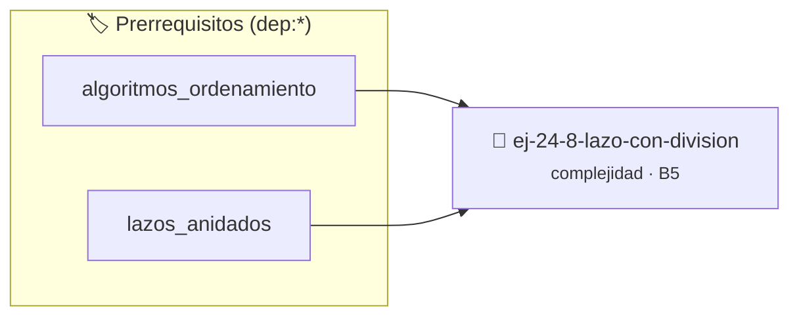

# Lazo con División
> **ID:** `ej-24-8-lazo-con-division` · **Unidad:** 4 (Tipos Abstractos y Algorítmica)
 · **Tema:** `complejidad` / `big_o`
 · **Bloom:** B5 (Evaluar / Crear) · **Dificultad:** Desafio
 · **Carga:** ~45 min · **Tipo:** Desafio
>
> **🏷️ Prerrequisitos temáticos (tags):** `dep:algoritmos_ordenamiento`, `dep:lazos_anidados`
>
> **Etiquetas conceptuales:** `big_o`, `complejidad`, `division`, `algoritmos`, `asintotica`


::: {admonition} 📦 Paquete de Verificación Local (Ripley)
:class: tip

Para compilar, resolver y autoevaluar tu entrega con pruebas unitarias en tu máquina:

- [📥 **Descargar paquete `ej-24-8-lazo-con-division.ripkg`**](../../paquetes/ej-24-8-lazo-con-division.ripkg)

Ejecución con el asistente de cátedra:
```bash
ripley run ej-24-8-lazo-con-division.ripkg
```
:::


### 🗺️ Itinerario Pedagógico




## 📖 Consigna

### Ejercicio 24.8 - Lazo con División ⭐⭐☆☆☆

Analizar la complejidad de:

:::{hint} Lógica y Consideraciones

-   **[*plus ultra*]:** Implementar encapsulamiento completo manteniendo la
    definición interna oculta en el archivo `.c`.
-   **[*plus ultra*]:** Añadir una función de duplicación profunda (*deep copy*)
    para copiar la estructura de forma segura.

:::
<!-- {hint} Lógica y Consideraciones -->

``` c
int contador = 0;
for (int i = n; i > 1; i /= 2)
{
    contador++;
}
```
<!-- c -->
## Ejercicio 24.9 - Contar Operaciones ⭐☆☆☆☆

Contá cuántas operaciones ejecuta este código:


:::{hint} Lógica y Consideraciones

-   **[*plus ultra*]:** Validar estrictamente los datos de entrada para manejar
    valores fuera de rango o tipos inválidos.
-   **[*plus ultra*]:** Permitir el procesamiento interactivo continuo mediante
    un lazo hasta que el usuario elija finalizar.

:::
<!-- {hint} Lógica y Consideraciones -->

``` c
int suma = 0;
for (int i = 0; i < n; i++)
{
    suma += i;
}
```
<!-- c -->

**Orientación:**
- Inicialización: 1
- Comparación en lazo: n+1
- Incremento: n
- Suma: n
- Total: ~3n + 2 operaciones
- **Complejidad:** O(n)

---
## Ejercicio 24.10 - Analizar Lazo Anidado ⭐⭐☆☆☆

¿Cuál es la complejidad de este código?


:::{hint} Lógica y Consideraciones

-   **[*plus ultra*]:** Validar estrictamente los datos de entrada para manejar
    valores fuera de rango o tipos inválidos.
-   **[*plus ultra*]:** Permitir el procesamiento interactivo continuo mediante
    un lazo hasta que el usuario elija finalizar.

:::
<!-- {hint} Lógica y Consideraciones -->

``` c
for (int i = 0; i < n; i++)
{
    for (int j = 0; j < n; j++)
    {
        printf("%d,%d ", i, j);
    }
}
```
<!-- c -->

**Orientación:**
- Lazo externo: n iteraciones
- Lazo interno: n iteraciones por cada externa
- Total: n × n = n²
- **Complejidad:** O(n²)

---
## Ejercicio 24.11 - Comparar Algoritmos ⭐⭐☆☆☆

Compará la complejidad de buscar un elemento en:
- Array no ordenado (búsqueda lineal)
- Array ordenado (búsqueda binaria)

**Orientación:**
- **Lineal:** O(n) - peor caso revisa todos
- **Binaria:** O(log n) - divide a la mitad en cada paso
- Para n=1,000,000: lineal hace ~1M comparaciones, binaria ~20


:::{hint} Lógica y Consideraciones

-   **[*plus ultra*]:** Optimizar el acceso a memoria respetando el orden por
    filas (*row-major order*) para mejorar el uso de caché.
-   **[*plus ultra*]:** Validar que los índices ingresados se encuentren
    estrictamente dentro de los límites del contenedor.

:::
<!-- {hint} Lógica y Consideraciones -->

---
## Ejercicio 24.12 - Identificar Complejidad ⭐⭐☆☆☆

Determiná la complejidad de cada fragmento:

**a)**

:::{hint} Lógica y Consideraciones

-   **[*plus ultra*]:** Validar estrictamente los datos de entrada para manejar
    valores fuera de rango o tipos inválidos.
-   **[*plus ultra*]:** Permitir el procesamiento interactivo continuo mediante
    un lazo hasta que el usuario elija finalizar.

:::
<!-- {hint} Lógica y Consideraciones -->

``` c
int suma = 0;
for (int i = 0; i < 100; i++)
{
    suma += i;
}
```
<!-- c -->

**b)**
``` c
for (int i = 0; i < n; i++)
{
    for (int j = 0; j < m; j++)
    {
        printf("%d ", i * j);
    }
}
```
<!-- c -->

**c)**
``` c
int i = n;
while (i > 0)
{
    printf("%d ", i);
    i = i / 2;
}
```
<!-- c -->

**Orientación:**
- **a)** O(1) - cantidad fija de iteraciones
- **b)** O(n × m) - depende de dos variables
- **c)** O(log n) - divide por 2 cada vez

---
## Ejercicio 24.13 - Suma de Matriz ⭐⭐⭐☆☆

Analizá la complejidad de sumar todos los elementos de una matriz n×m.

**Orientación:**

:::{hint} Lógica y Consideraciones

-   **[*plus ultra*]:** Optimizar el acceso a memoria respetando el orden por
    filas (*row-major order*) para mejorar el uso de caché.
-   **[*plus ultra*]:** Validar que los índices ingresados se encuentren
    estrictamente dentro de los límites del contenedor.

:::
<!-- {hint} Lógica y Consideraciones -->

```{code-block} c
:linenos:
int suma = 0;
for (int i = 0; i < n; i++)
{
    for (int j = 0; j < m; j++)
    {
        suma += matriz[i][j];
    }
}
```
<!-- {code-block} c -->
- Visita cada elemento una vez
- n × m elementos
- **Complejidad:** O(n × m)
- Si n = m: O(n²)

---
## Ejercicio 24.14 - Fibonacci Naive vs Optimizado ⭐⭐⭐☆☆

Compará complejidad de Fibonacci recursivo vs iterativo.

**Orientación:**
- **Recursivo:**
  ```c
  int fib(int n)
  {
      if (n <= 1)
          return n;
      return fib(n - 1) + fib(n - 2);
  }
  ```
  - Complejidad: O(2ⁿ) - exponencial
  - Árbol de recursión crece exponencialmente

- **Iterativo:**
  ```c
  int fib(int n)
  {
      int a = 0, b = 1, temp;
      for (int i = 0; i < n; i++)
      {
          temp = a + b;
          a = b;
          b = temp;
      }
      return a;
  }
  ```
  - Complejidad: O(n) - lineal


:::{hint} Lógica y Consideraciones

-   **[*plus ultra*]:** Transformar el algoritmo a una versión con recursión de
    cola (*tail recursion*) para reducir el consumo de pila.
-   **[*plus ultra*]:** Añadir un contador del número de llamadas recursivas
    realizadas para analizar la complejidad empírica.

:::
<!-- {hint} Lógica y Consideraciones -->

---
## Ejercicio 24.15 - Búsqueda del Máximo ⭐⭐☆☆☆

Implementá función para encontrar el máximo de un array y analizá su
complejidad.

**Orientación:**

:::{hint} Lógica y Consideraciones

-   **[*plus ultra*]:** Optimizar el acceso a memoria respetando el orden por
    filas (*row-major order*) para mejorar el uso de caché.
-   **[*plus ultra*]:** Validar que los índices ingresados se encuentren
    estrictamente dentro de los límites del contenedor.

:::
<!-- {hint} Lógica y Consideraciones -->

```{code-block} c
:linenos:
int maximo(int arr[], int n)
{
    int max = arr[0];
    for (int i = 1; i < n; i++)
    {
        if (arr[i] > max)
            max = arr[i];
    }
    return max;
}
```
<!-- {code-block} c -->
- Recorre array una vez
- **Tiempo:** O(n)
- **Espacio:** O(1) - solo una variable

---
## Ejercicio 24.16 - Duplicados en Array ⭐⭐⭐☆☆

Compará dos formas de encontrar duplicados:

**Método 1:** Comparar cada par

:::{hint} Lógica y Consideraciones

-   **[*plus ultra*]:** Optimizar el acceso a memoria respetando el orden por
    filas (*row-major order*) para mejorar el uso de caché.
-   **[*plus ultra*]:** Validar que los índices ingresados se encuentren
    estrictamente dentro de los límites del contenedor.

:::
<!-- {hint} Lógica y Consideraciones -->

```{code-block} c
:linenos:
bool tiene_duplicados_1(int arr[], int n)
{
    for (int i = 0; i < n; i++)
    {
        for (int j = i + 1; j < n; j++)
        {
            if (arr[i] == arr[j])
                return true;
        }
    }
    return false;
}
```
<!-- {code-block} c -->

**Método 2:** Ordenar primero
```{code-block} c
:linenos:
bool tiene_duplicados_2(int arr[], int n)
{
    qsort(arr, n, sizeof(int), comparar); // O(n log n)
    for (int i = 0; i < n - 1; i++)
    {
        if (arr[i] == arr[i + 1])
            return true;
    }
    return false;
}
```
<!-- {code-block} c -->

**Orientación:**
- **Método 1:** O(n²) tiempo, O(1) espacio
- **Método 2:** O(n log n) tiempo, O(1) espacio (si qsort es in-place)
- Para n grande, método 2 es mucho más rápido

---
## Ejercicio 24.17 - Ordenamiento Burbuja ⭐⭐⭐☆☆

Analizá complejidad del ordenamiento burbuja.

**Orientación:**

:::{hint} Lógica y Consideraciones

-   **[*plus ultra*]:** Optimizar el acceso a memoria respetando el orden por
    filas (*row-major order*) para mejorar el uso de caché.
-   **[*plus ultra*]:** Validar que los índices ingresados se encuentren
    estrictamente dentro de los límites del contenedor.

:::
<!-- {hint} Lógica y Consideraciones -->

```{code-block} c
:linenos:
void burbuja(int arr[], int n)
{
    for (int i = 0; i < n - 1; i++)
    {
        for (int j = 0; j < n - i - 1; j++)
        {
            if (arr[j] > arr[j + 1])
            {
                intercambiar(&arr[j], &arr[j + 1]);
            }
        }
    }
}
```
<!-- {code-block} c -->
- **Peor caso:** O(n²) - array invertido
- **Mejor caso:** O(n²) - incluso si ya está ordenado (sin optimizar)
- **Optimización:** Agregar flag para detectar si hubo swaps

---
## Ejercicio 24.18 - Complejidad Espacial ⭐⭐⭐☆☆

Analizá memoria usada por MergeSort.

**Orientación:**

:::{hint} Lógica y Consideraciones

-   **[*plus ultra*]:** Verificar el retorno de asignación de memoria y
    garantizar la liberación total de recursos en caso de error.
-   **[*plus ultra*]:** Verificar la ausencia de fugas de memoria (*memory
    leaks*) mediante Valgrind o AddressSanitizer.

:::
<!-- {hint} Lógica y Consideraciones -->

```{code-block} c
:linenos:
void merge_sort(int arr[], int l, int r)
{
    if (l < r)
    {
        int m = l + (r - l) / 2;
        merge_sort(arr, l, m);
        merge_sort(arr, m + 1, r);
        merge(arr, l, m, r); // Usa array temporal
    }
}
```
<!-- {code-block} c -->
- Profundidad de recursión: O(log n)
- Array temporal en merge: O(n)
- **Espacio:** O(n) para array + O(log n) para stack de recursión = O(n)

---
## Ejercicio 24.19 - Suma de Pares ⭐⭐⭐⭐☆

Encontrá dos números en array que sumen un objetivo.

**Método 1:** Fuerza bruta

:::{hint} Lógica y Consideraciones

-   **[*plus ultra*]:** Optimizar el acceso a memoria respetando el orden por
    filas (*row-major order*) para mejorar el uso de caché.
-   **[*plus ultra*]:** Validar que los índices ingresados se encuentren
    estrictamente dentro de los límites del contenedor.

:::
<!-- {hint} Lógica y Consideraciones -->

```{code-block} c
:linenos:
bool suma_objetivo_1(int arr[], int n, int objetivo)
{
    for (int i = 0; i < n; i++)
    {
        for (int j = i + 1; j < n; j++)
        {
            if (arr[i] + arr[j] == objetivo)
                return true;
        }
    }
    return false;
}
```
<!-- {code-block} c -->

**Método 2:** Con tabla hash
```{code-block} c
:linenos:
bool suma_objetivo_2(int arr[], int n, int objetivo)
{
    hash_set_t *set = crear_set();
    for (int i = 0; i < n; i++)
    {
        if (contiene(set, objetivo - arr[i]))
        {
            return true;
        }
        insertar(set, arr[i]);
    }
    return false;
}
```
<!-- {code-block} c -->

**Orientación:**
- **Método 1:** O(n²) tiempo, O(1) espacio
- **Método 2:** O(n) tiempo promedio, O(n) espacio
- Trade-off: tiempo por espacio

---
## Ejercicio 24.20 - Números Primos hasta N ⭐⭐⭐⭐☆

Compará verificar primos uno por uno vs Criba de Eratóstenes.

**Método 1:** Verificar cada número

:::{hint} Lógica y Consideraciones

-   **[*plus ultra*]:** Verificar el retorno de asignación de memoria y
    garantizar la liberación total de recursos en caso de error.
-   **[*plus ultra*]:** Verificar la ausencia de fugas de memoria (*memory
    leaks*) mediante Valgrind o AddressSanitizer.

:::
<!-- {hint} Lógica y Consideraciones -->

``` c
// Para cada i de 2 a N:
//   Si es_primo(i): contar
// es_primo: O(√n) por cada número
// Total: O(N × √N)
```
<!-- c -->

**Método 2:** Criba
```{code-block} c
:linenos:
bool *criba(int n)
{
    bool *es_primo = malloc((n + 1) * sizeof(bool));
    // Inicializar todo en true
    for (int i = 2; i * i <= n; i++)
    {
        if (es_primo[i])
        {
            for (int j = i * i; j <= n; j += i)
            {
                es_primo[j] = false;
            }
        }
    }
    return es_primo;
}
```
<!-- {code-block} c -->

**Orientación:**
- **Criba:** O(n log log n) tiempo, O(n) espacio
- Mucho más eficiente para rangos grandes

---
## Ejercicio 24.21 - Subsecuencia Común Más Larga (LCS) ⭐⭐⭐⭐⭐

Analizá complejidad de LCS con programación dinámica.

**Orientación:**

:::{hint} Lógica y Consideraciones

-   **[*plus ultra*]:** Verificar el retorno de asignación de memoria y
    garantizar la liberación total de recursos en caso de error.
-   **[*plus ultra*]:** Verificar la ausencia de fugas de memoria (*memory
    leaks*) mediante Valgrind o AddressSanitizer.

:::
<!-- {hint} Lógica y Consideraciones -->

```{code-block} c
:linenos:
int lcs(char *X, char *Y, int m, int n)
{
    int dp[m + 1][n + 1];
    for (int i = 0; i <= m; i++)
    {
        for (int j = 0; j <= n; j++)
        {
            if (i == 0 || j == 0)
                dp[i][j] = 0;
            else if (X[i - 1] == Y[j - 1])
                dp[i][j] = dp[i - 1][j - 1] + 1;
            else
                dp[i][j] = max(dp[i - 1][j], dp[i][j - 1]);
        }
    }
    return dp[m][n];
}
```
<!-- {code-block} c -->
- **Tiempo:** O(m × n) - llena tabla m×n
- **Espacio:** O(m × n) - tabla DP
- Optimización espacial: O(min(m, n)) con dos filas

---
## Ejercicio 24.22 - Multiplicación de Matrices ⭐⭐⭐⭐☆

Analizá complejidad de multiplicar dos matrices n×n.

**Orientación:**

:::{hint} Lógica y Consideraciones

-   **[*plus ultra*]:** Garantizar la terminación con `\0` y prevenir
    desbordamientos de búfer validando la capacidad máxima.
-   **[*plus ultra*]:** Soportar la lectura de cadenas con espacios y múltiples
    líneas de manera robusta.

:::
<!-- {hint} Lógica y Consideraciones -->

```{code-block} c
:linenos:
void multiplicar(int A[N][N], int B[N][N], int C[N][N])
{
    for (int i = 0; i < N; i++)
    {
        for (int j = 0; j < N; j++)
        {
            C[i][j] = 0;
            for (int k = 0; k < N; k++)
            {
                C[i][j] += A[i][k] * B[k][j];
            }
        }
    }
}
```
<!-- {code-block} c -->
- Tres lazos anidados: n × n × n
- **Complejidad:** O(n³)
- Algoritmos más eficientes existen (Strassen: O(n^2.807))

---
## Ejercicio 24.23 - Torres de Hanoi ⭐⭐⭐⭐☆

Analizá complejidad de Torres de Hanoi.

**Orientación:**

:::{hint} Lógica y Consideraciones

-   **[*plus ultra*]:** Garantizar la terminación con `\0` y prevenir
    desbordamientos de búfer validando la capacidad máxima.
-   **[*plus ultra*]:** Soportar la lectura de cadenas con espacios y múltiples
    líneas de manera robusta.

:::
<!-- {hint} Lógica y Consideraciones -->

```{code-block} c
:linenos:
void hanoi(int n, char origen, char destino, char auxiliar)
{
    if (n == 1)
    {
        mover(origen, destino);
    }
    else
    {
        hanoi(n - 1, origen, auxiliar, destino);
        mover(origen, destino);
        hanoi(n - 1, auxiliar, destino, origen);
    }
}
```
<!-- {code-block} c -->
- Recurrencia: T(n) = 2T(n-1) + 1
- Solución: T(n) = 2ⁿ - 1
- **Complejidad:** O(2ⁿ) - exponencial
- Cantidad mínima de movimientos

---
## Ejercicio 24.24 - Análisis Amortizado ⭐⭐⭐⭐⭐

Analizá costo amortizado de inserción en vector dinámico con duplicación.

**Orientación:**

:::{hint} Lógica y Consideraciones

-   **[*plus ultra*]:** Optimizar el acceso a memoria respetando el orden por
    filas (*row-major order*) para mejorar el uso de caché.
-   **[*plus ultra*]:** Validar que los índices ingresados se encuentren
    estrictamente dentro de los límites del contenedor.

:::
<!-- {hint} Lógica y Consideraciones -->

```{code-block} c
:linenos:
void agregar(vector_t *v, int elem)
{
    if (v->tamanio == v->capacidad)
    {
        redimensionar(v, v->capacidad * 2); // O(n)
    }
    v->datos[v->tamanio++] = elem; // O(1)
}
```
<!-- {code-block} c -->
- Inserción simple: O(1)
- Redimensionamiento: O(n)
- ¿Cuánto cuesta en promedio?
- **Análisis:** Redimensionar en potencias de 2: n/2 + n/4 + n/8 + ... < n
- **Costo amortizado:** O(1) por inserción

---
## Ejercicio 24.25 - Comparar Estructuras de Datos ⭐⭐⭐⭐☆

Compará complejidad de operaciones en diferentes estructuras:

| Estructura | Búsqueda | Inserción | Eliminación |
|------------|----------|-----------|-------------|
| Array no ordenado | O(n) | O(1) al final | O(n) |
| Array ordenado | O(log n) | O(n) | O(n) |
| Lista enlazada | O(n) | O(1) al inicio | O(1) con puntero |
| ABB balanceado | O(log n) | O(log n) | O(log n) |
| Hash table | O(1) promedio | O(1) promedio | O(1) promedio |

**Orientación:**
- Elegir estructura según operaciones más frecuentes
- Trade-offs entre tiempo y espacio


:::{hint} Lógica y Consideraciones

-   **[*plus ultra*]:** Validar punteros `NULL` recibidos como parámetro para
    evitar fallos de segmentación.
-   **[*plus ultra*]:** Implementar una versión utilizando aritmética de
    punteros en lugar de indexación directa.

:::
<!-- {hint} Lógica y Consideraciones -->

---
## Ejercicio 24.26 - Problema del Viajante (TSP) ⭐⭐⭐⭐⭐

Analizá complejidad de soluciones al TSP.

**Fuerza Bruta:**

:::{hint} Lógica y Consideraciones

-   **[*plus ultra*]:** Verificar el retorno de asignación de memoria y
    garantizar la liberación total de recursos en caso de error.
-   **[*plus ultra*]:** Verificar la ausencia de fugas de memoria (*memory
    leaks*) mediante Valgrind o AddressSanitizer.

:::
<!-- {hint} Lógica y Consideraciones -->

``` c
// Probar todas las permutaciones de ciudades
// Cantidad de permutaciones: n!
// Complejidad: O(n!)
```
<!-- c -->

**Programación Dinámica (Held-Karp):**
``` c
// Estado: (ciudades visitadas, ciudad actual)
// Estados: 2ⁿ × n
// Complejidad: O(n² × 2ⁿ)
```
<!-- c -->

**Orientación:**
- Problema NP-completo
- O(n²2ⁿ) sigue siendo exponencial, pero mejor que O(n!)
- Para n=20: 20! ≈ 10¹⁸, 20²·2²⁰ ≈ 10⁹

---
## Ejercicio 24.27 - Optimización de Caché ⭐⭐⭐⭐⭐

Compará estos dos códigos para sumar matriz:

**Versión 1:**

:::{hint} Lógica y Consideraciones

-   **[*plus ultra*]:** Optimizar el acceso a memoria respetando el orden por
    filas (*row-major order*) para mejorar el uso de caché.
-   **[*plus ultra*]:** Validar que los índices ingresados se encuentren
    estrictamente dentro de los límites del contenedor.

:::
<!-- {hint} Lógica y Consideraciones -->

``` c
for (i = 0; i < N; i++)
    for (j = 0; j < N; j++)
        suma += M[i][j];
```
<!-- c -->

**Versión 2:**
``` c
for (j = 0; j < N; j++)
    for (i = 0; i < N; i++)
        suma += M[i][j];
```
<!-- c -->

**Orientación:**
- Ambos: O(N²) operaciones
- **Pero:** Versión 1 es más rápida en la práctica
- Razón: Localidad espacial (row-major order en C)
- Versión 1: cache misses ~N²/L
- Versión 2: cache misses ~N²
- L = tamaño de línea de caché

---
## Ejercicio 24.28 - Medir Empíricamente ⭐⭐⭐⭐⭐

Implementá framework para medir tiempos y validar análisis teórico.

**Orientación:**

:::{hint} Lógica y Consideraciones

-   **[*plus ultra*]:** Garantizar la terminación con `\0` y prevenir
    desbordamientos de búfer validando la capacidad máxima.
-   **[*plus ultra*]:** Soportar la lectura de cadenas con espacios y múltiples
    líneas de manera robusta.

:::
<!-- {hint} Lógica y Consideraciones -->

```{code-block} c
:linenos:
#include <time.h>
double medir_tiempo(void (*funcion)(int *, int), int *arr, int n)
{
    clock_t inicio = clock();
    funcion(arr, n);
    clock_t fin = clock();
    return (double)(fin - inicio) / CLOCKS_PER_SEC;
}
// Probar con diferentes tamaños
for (int n = 1000; n <= 100000; n *= 2)
{
    double tiempo = medir_tiempo(burbuja, arr, n);
    printf("n=%d, tiempo=%.4f\n", n, tiempo);
}
```
<!-- {code-block} c -->
- Graficar tiempo vs n
- Verificar si crece como n, n log n, n², etc.

---

## Notas Finales

:::{tip} Jerarquía de Complejidades

De mejor a peor:

1. **O(1)** - Constante: acceso a array por índice
2. **O(log n)** - Logarítmica: búsqueda binaria
3. **O(n)** - Lineal: recorrer array
4. **O(n log n)** - Linealítmica: mergesort, quicksort
5. **O(n²)** - Cuadrática: burbuja, selección, dos lazos anidados
6. **O(n³)** - Cúbica: multiplicación de matrices naive
7. **O(2ⁿ)** - Exponencial: subconjuntos, fibonacci naive
8. **O(n!)** - Factorial: permutaciones, TSP brute force

**Escalabilidad:**
- Para n=1,000,000:
  - O(1): 1 operación
  - O(log n): ~20
  - O(n): ~1M
  - O(n log n): ~20M
  - O(n²): ~1T (inmanejable)

:::
<!-- {tip} Jerarquía de Complejidades -->

:::{note} Reglas de Análisis

**Sumar complejidades consecutivas:**
``` c
// O(n) + O(n²) = O(n²)
for (i...)
{
} // O(n)
for (i...) // O(n²)
    for (j...)
    {
    }
```
<!-- c -->

**Multiplicar complejidades anidadas:**
``` c
// O(n) × O(log n) = O(n log n)
for (i...)
{                       // O(n)
    busqueda_binaria(); // O(log n)
}
```
<!-- c -->

**Ignorar constantes y términos menores:**
``` c
// 3n² + 5n + 10 = O(n²)
// n log n + n = O(n log n)
```
<!-- c -->

**Peor caso vs caso promedio:**
- QuickSort: O(n²) peor, O(n log n) promedio
- Hash table: O(n) peor, O(1) promedio

:::
<!-- {note} Reglas de Análisis -->

:::{warning} Errores de Análisis

1. **Olvidar operaciones costosas dentro de lazos:**
   ```c
   for (i...)
   {
       strcpy(dest, src); // O(longitud) no O(1)
   }
   ```

2. **Confundir tiempo con espacio:**
   - Recursión usa espacio en stack
   - Arrays temporales cuentan en espacio

3. **Ignorar constantes ocultas:**
   - O(n) con constante 1000 puede ser peor que O(n²) con constante 0.001 para n
     pequeño

4. **No considerar caso promedio:**
   - QuickSort es O(n²) peor caso pero casi siempre O(n log n)

:::
<!-- {warning} Errores de Análisis -->

Estas consignas desarrollan capacidad de analizar y comparar algoritmos teórica
y empíricamente, esencial para diseñar soluciones eficientes.


## 📋 Prototipos y Cabecera (`ej-24-8-lazo-con-division.h`)

```{code-block} c
#ifndef EJERCICIO_EJ_24_8_LAZO_CON_DIVISION_H
#define EJERCICIO_EJ_24_8_LAZO_CON_DIVISION_H

#include <stddef.h>
#include <stdbool.h>
#include <stdint.h>

/* Procesa el flujo principal de Lazo con División */
int proc__8_lazo_con_division(int val);

#endif /* EJERCICIO_EJ_24_8_LAZO_CON_DIVISION_H */
```


## ⚙️ Especificación de Funciones

| Función | Retorno | Parámetros | Descripción |
| :--- | :--- | :--- | :--- |

| `proc__8_lazo_con_division` | `int` | `int val` | Procesa el flujo principal de Lazo con División |


## 💡 Pistas Progresivas

````{tab-set}

```{tab-item} Pista 1
[Plus Ultra] Implementar encapsulamiento completo manteniendo la definición interna oculta en el archivo `.c`.
```

```{tab-item} Pista 2
[Plus Ultra] Añadir una función de duplicación profunda (*deep copy*) para copiar la estructura de forma segura.
```

```{tab-item} Pista 3
[Plus Ultra] Validar estrictamente los datos de entrada para manejar valores fuera de rango o tipos inválidos.
```

```{tab-item} Pista 4
[Plus Ultra] Permitir el procesamiento interactivo continuo mediante un lazo hasta que el usuario elija finalizar.
```

```{tab-item} Pista 5
[Plus Ultra] Validar estrictamente los datos de entrada para manejar valores fuera de rango o tipos inválidos.
```

```{tab-item} Pista 6
[Plus Ultra] Permitir el procesamiento interactivo continuo mediante un lazo hasta que el usuario elija finalizar.
```

```{tab-item} Pista 7
[Plus Ultra] Optimizar el acceso a memoria respetando el orden por filas (*row-major order*) para mejorar el uso de caché.
```

```{tab-item} Pista 8
[Plus Ultra] Validar que los índices ingresados se encuentren estrictamente dentro de los límites del contenedor.
```

```{tab-item} Pista 9
[Plus Ultra] Validar estrictamente los datos de entrada para manejar valores fuera de rango o tipos inválidos.
```

```{tab-item} Pista 10
[Plus Ultra] Permitir el procesamiento interactivo continuo mediante un lazo hasta que el usuario elija finalizar.
```

```{tab-item} Pista 11
[Plus Ultra] Optimizar el acceso a memoria respetando el orden por filas (*row-major order*) para mejorar el uso de caché.
```

```{tab-item} Pista 12
[Plus Ultra] Validar que los índices ingresados se encuentren estrictamente dentro de los límites del contenedor.
```

```{tab-item} Pista 13
[Plus Ultra] Transformar el algoritmo a una versión con recursión de cola (*tail recursion*) para reducir el consumo de pila.
```

```{tab-item} Pista 14
[Plus Ultra] Añadir un contador del número de llamadas recursivas realizadas para analizar la complejidad empírica.
```

```{tab-item} Pista 15
[Plus Ultra] Optimizar el acceso a memoria respetando el orden por filas (*row-major order*) para mejorar el uso de caché.
```

```{tab-item} Pista 16
[Plus Ultra] Validar que los índices ingresados se encuentren estrictamente dentro de los límites del contenedor.
```

```{tab-item} Pista 17
[Plus Ultra] Optimizar el acceso a memoria respetando el orden por filas (*row-major order*) para mejorar el uso de caché.
```

```{tab-item} Pista 18
[Plus Ultra] Validar que los índices ingresados se encuentren estrictamente dentro de los límites del contenedor.
```

```{tab-item} Pista 19
[Plus Ultra] Optimizar el acceso a memoria respetando el orden por filas (*row-major order*) para mejorar el uso de caché.
```

```{tab-item} Pista 20
[Plus Ultra] Validar que los índices ingresados se encuentren estrictamente dentro de los límites del contenedor.
```

```{tab-item} Pista 21
[Plus Ultra] Verificar el retorno de asignación de memoria y garantizar la liberación total de recursos en caso de error.
```

```{tab-item} Pista 22
[Plus Ultra] Verificar la ausencia de fugas de memoria (*memory leaks*) mediante Valgrind o AddressSanitizer.
```

```{tab-item} Pista 23
[Plus Ultra] Optimizar el acceso a memoria respetando el orden por filas (*row-major order*) para mejorar el uso de caché.
```

```{tab-item} Pista 24
[Plus Ultra] Validar que los índices ingresados se encuentren estrictamente dentro de los límites del contenedor.
```

```{tab-item} Pista 25
[Plus Ultra] Verificar el retorno de asignación de memoria y garantizar la liberación total de recursos en caso de error.
```

```{tab-item} Pista 26
[Plus Ultra] Verificar la ausencia de fugas de memoria (*memory leaks*) mediante Valgrind o AddressSanitizer.
```

```{tab-item} Pista 27
[Plus Ultra] Verificar el retorno de asignación de memoria y garantizar la liberación total de recursos en caso de error.
```

```{tab-item} Pista 28
[Plus Ultra] Verificar la ausencia de fugas de memoria (*memory leaks*) mediante Valgrind o AddressSanitizer.
```

```{tab-item} Pista 29
[Plus Ultra] Garantizar la terminación con `\0` y prevenir desbordamientos de búfer validando la capacidad máxima.
```

```{tab-item} Pista 30
[Plus Ultra] Soportar la lectura de cadenas con espacios y múltiples líneas de manera robusta.
```

```{tab-item} Pista 31
[Plus Ultra] Garantizar la terminación con `\0` y prevenir desbordamientos de búfer validando la capacidad máxima.
```

```{tab-item} Pista 32
[Plus Ultra] Soportar la lectura de cadenas con espacios y múltiples líneas de manera robusta.
```

```{tab-item} Pista 33
[Plus Ultra] Optimizar el acceso a memoria respetando el orden por filas (*row-major order*) para mejorar el uso de caché.
```

```{tab-item} Pista 34
[Plus Ultra] Validar que los índices ingresados se encuentren estrictamente dentro de los límites del contenedor.
```

```{tab-item} Pista 35
[Plus Ultra] Validar punteros `NULL` recibidos como parámetro para evitar fallos de segmentación.
```

```{tab-item} Pista 36
[Plus Ultra] Implementar una versión utilizando aritmética de punteros en lugar de indexación directa.
```

```{tab-item} Pista 37
[Plus Ultra] Verificar el retorno de asignación de memoria y garantizar la liberación total de recursos en caso de error.
```

```{tab-item} Pista 38
[Plus Ultra] Verificar la ausencia de fugas de memoria (*memory leaks*) mediante Valgrind o AddressSanitizer.
```

```{tab-item} Pista 39
[Plus Ultra] Optimizar el acceso a memoria respetando el orden por filas (*row-major order*) para mejorar el uso de caché.
```

```{tab-item} Pista 40
[Plus Ultra] Validar que los índices ingresados se encuentren estrictamente dentro de los límites del contenedor.
```

```{tab-item} Pista 41
[Plus Ultra] Garantizar la terminación con `\0` y prevenir desbordamientos de búfer validando la capacidad máxima.
```

```{tab-item} Pista 42
[Plus Ultra] Soportar la lectura de cadenas con espacios y múltiples líneas de manera robusta.
```

```{tab-item} Pista 43
**O(1)** - Constante: acceso a array por índice
```

```{tab-item} Pista 44
**O(log n)** - Logarítmica: búsqueda binaria
```

```{tab-item} Pista 45
**O(n)** - Lineal: recorrer array
```

```{tab-item} Pista 46
**O(n log n)** - Linealítmica: mergesort, quicksort
```

```{tab-item} Pista 47
**O(n²)** - Cuadrática: burbuja, selección, dos lazos anidados
```

```{tab-item} Pista 48
**O(n³)** - Cúbica: multiplicación de matrices naive
```

```{tab-item} Pista 49
**O(2ⁿ)** - Exponencial: subconjuntos, fibonacci naive
```

```{tab-item} Pista 50
**O(n!)** - Factorial: permutaciones, TSP brute force **Escalabilidad:**
```

```{tab-item} Pista 51
Para n=1,000,000:
```

```{tab-item} Pista 52
O(1): 1 operación
```

```{tab-item} Pista 53
O(log n): ~20
```

```{tab-item} Pista 54
O(n): ~1M
```

```{tab-item} Pista 55
O(n log n): ~20M
```

```{tab-item} Pista 56
O(n²): ~1T (inmanejable)
```

````


## 🧪 Casos de Prueba

| Prueba Unitaria | Función Objetivo | Verificación |
| :--- | :--- | :--- |

| **test_proc__8_lazo_con_division_positivo** | `proc__8_lazo_con_division` | `int res = proc__8_lazo_con_division(5); assert(res == 10 || res >= 0);` |

| **test_proc__8_lazo_con_division_cero** | `proc__8_lazo_con_division` | `int res = proc__8_lazo_con_division(0); assert(res == 0);` |


## ✓ Solución Modelo de Cátedra

```{dropdown} 🔍 Revelar solución canónica en C
:open: false

```{code-block} c
/*
 * Solucion modelo para ej-24-8-lazo-con-division
 * Catedra Programacion I - UNRN
 */
#include <stdio.h>
#include <stdlib.h>
#include <string.h>
#include <stdbool.h>


int proc__8_lazo_con_division(int val)
{
    if (val <= 0) return 0;
    return val * 2;
}

int main(void)
{
    int n = 0;
    if (scanf("%d", &n) == 1)
    {
        printf("OK %d\n", n);
    }
    else
    {
        printf("OK\n");
    }
    return 0;
}
```
```
