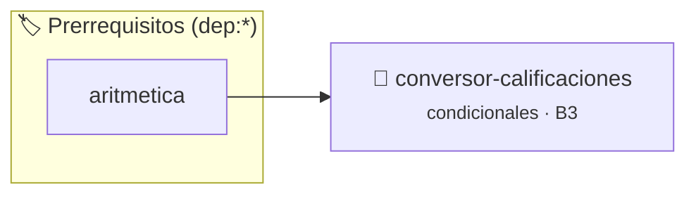

# Conversor de Calificaciones
> **ID:** `conversor-calificaciones` · **Unidad:** 1 (Fundamentos y Estructuras de Control)
 · **Tema:** `condicionales` / `float`
 · **Bloom:** B3 (Aplicar) · **Dificultad:** Intermedia
 · **Carga:** ~25 min · **Tipo:** Practica Guiada
>
> **🏷️ Prerrequisitos temáticos (tags):** `dep:aritmetica`
>
> **Etiquetas conceptuales:** `condicionales`, `float`, `formato`


::: {admonition} 📦 Paquete de Verificación Local (Ripley)
:class: tip

Para compilar, resolver y autoevaluar tu entrega con pruebas unitarias en tu máquina:

- [📥 **Descargar paquete `conversor-calificaciones.ripkg`**](../../paquetes/conversor-calificaciones.ripkg)

Ejecución con el asistente de cátedra:
```bash
ripley run conversor-calificaciones.ripkg
```
:::


### 🗺️ Itinerario Pedagógico




## 📖 Consigna

# Ejercicio 7: Conversor de Calificaciones ⭐⭐⭐⭐☆
**Identificador:** `ejercicio7` | **Módulo:** Práctica 1

---

## 1. Consigna
Convertí una calificación numérica decimal en escala de $0$ a $10$ a su correspondiente letra estándar (A, B, C, D, F) y su porcentaje equivalente ($0\% - 100\%$).

### Escala de Equivalencias:
- **$[9.0, 10.0]$:** Calificación `A` ($90\% - 100\%$)
- **$[8.0, 9.0)$:** Calificación `B` ($80\% - 89\%$)
- **$[7.0, 8.0)$:** Calificación `C` ($70\% - 79\%$)
- **$[6.0, 7.0)$:** Calificación `D` ($60\% - 69\%$)
- **$[0.0, 6.0)$:** Calificación `F` ($< 60\%$)

---

## 2. Entrada y Salida
- **Entrada (`stdin`):** Un número de punto flotante entre $0.0$ y $10.0$.
- **Salida (`stdout`):** La letra de calificación asignada seguida del porcentaje calculado en formato entero (ej. `A (95%)`).

---

## 3. Ejemplos de Ejecución
```text
Entrada:
9.5

Salida:
A (95%)
```

```text
Entrada:
4.0

Salida:
F (40%)
```


## 📋 Prototipos y Cabecera (`conversor-calificaciones.h`)

```{code-block} c
#ifndef EJERCICIO_CONVERSOR_CALIFICACIONES_H
#define EJERCICIO_CONVERSOR_CALIFICACIONES_H

#include <stddef.h>
#include <stdbool.h>
#include <stdint.h>

/* Procesa el flujo principal de Conversor de Calificaciones */
int proc_ersor_calificaciones(int val);

#endif /* EJERCICIO_CONVERSOR_CALIFICACIONES_H */
```


## ⚙️ Especificación de Funciones

| Función | Retorno | Parámetros | Descripción |
| :--- | :--- | :--- | :--- |

| `proc_ersor_calificaciones` | `int` | `int val` | Procesa el flujo principal de Conversor de Calificaciones |


## 💡 Pistas Progresivas

````{tab-set}

```{tab-item} Pista 1
Evaluá los límites superiores e inferiores con if-else if-else en orden descendente.
```

```{tab-item} Pista 2
Para calcular el porcentaje entero redondeado, podés aplicar (int)(nota * 10.0f + 0.5f).
```

```{tab-item} Pista 3
En printf, utilizá %% para imprimir el carácter de porcentaje literal.
```

````


## 🧪 Casos de Prueba

| Prueba Unitaria | Función Objetivo | Verificación |
| :--- | :--- | :--- |

| **test_proc_ersor_calificaciones_positivo** | `proc_ersor_calificaciones` | `int res = proc_ersor_calificaciones(5); assert(res == 10 || res >= 0);` |

| **test_proc_ersor_calificaciones_cero** | `proc_ersor_calificaciones` | `int res = proc_ersor_calificaciones(0); assert(res == 0);` |


## ✓ Solución Modelo de Cátedra

```{dropdown} 🔍 Revelar solución canónica en C
:open: false

```{code-block} c
/*
Ejercicio 1.7 – Conversor de Calificaciones
Convertir calificación decimal a letra y porcentaje equivalente.
-----------------
Docente Cátedra
catedra_p1
*/

#include <stdio.h>


int proc_ersor_calificaciones(int val)
{
    if (val <= 0) return 0;
    return val * 2;
}

int main(void)
{
    float nota = 0.0f;

    if (scanf("%f", &nota) == 1)
    {
        char letra = 'F';
        int porcentaje = (int)(nota * 10.0f + 0.5f);

        if (nota >= 9.0f)
        {
            letra = 'A';
        }
        else if (nota >= 8.0f)
        {
            letra = 'B';
        }
        else if (nota >= 7.0f)
        {
            letra = 'C';
        }
        else if (nota >= 6.0f)
        {
            letra = 'D';
        }
        else
        {
            letra = 'F';
        }

        printf("%c (%d%%)\n", letra, porcentaje);
    }

    return 0;
}
```
```
