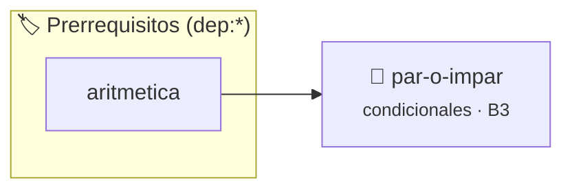

# Par o Impar
> **ID:** `par-o-impar` · **Unidad:** 1 (Fundamentos y Estructuras de Control)
 · **Tema:** `condicionales` / `aritmetica`
 · **Bloom:** B3 (Aplicar) · **Dificultad:** Intermedia
 · **Carga:** ~25 min · **Tipo:** Practica Guiada
>
> **🏷️ Prerrequisitos temáticos (tags):** `dep:aritmetica`
>
> **Etiquetas conceptuales:** `condicionales`, `if`, `aritmetica`


::: {admonition} 📦 Paquete de Verificación Local (Ripley)
:class: tip

Para compilar, resolver y autoevaluar tu entrega con pruebas unitarias en tu máquina:

- [📥 **Descargar paquete `par-o-impar.ripkg`**](../../paquetes/par-o-impar.ripkg)

Ejecución con el asistente de cátedra:
```bash
ripley run par-o-impar.ripkg
```
:::


### 🗺️ Itinerario Pedagógico




## 📖 Consigna

# Ejercicio 3: Par o Impar ⭐⭐☆☆☆
**Identificador:** `ejercicio3` | **Módulo:** Práctica 1

---

## 1. Consigna
Este es un ejercicio fundamental de lógica condicional. El programa debe solicitar un número entero al usuario y determinar si es par (divisible por 2) o impar.

---

## 2. Entrada y Salida
- **Entrada (`stdin`):** Un número entero $n$.
- **Salida (`stdout`):** `Par` si el número es divisible por 2, o `Impar` si no lo es, seguido de un salto de línea.

---

## 3. Ejemplos de Ejecución
```text
Entrada:
4

Salida:
Par
```

```text
Entrada:
7

Salida:
Impar
```


## 📋 Prototipos y Cabecera (`par-o-impar.h`)

```{code-block} c
#ifndef EJERCICIO_PAR_O_IMPAR_H
#define EJERCICIO_PAR_O_IMPAR_H

#include <stddef.h>
#include <stdbool.h>
#include <stdint.h>

/* Procesa el flujo principal de Par o Impar */
int ejecutar_par_o_impar(int val);

#endif /* EJERCICIO_PAR_O_IMPAR_H */
```


## ⚙️ Especificación de Funciones

| Función | Retorno | Parámetros | Descripción |
| :--- | :--- | :--- | :--- |

| `ejecutar_par_o_impar` | `int` | `int val` | Procesa el flujo principal de Par o Impar |


## 💡 Pistas Progresivas

````{tab-set}

```{tab-item} Pista 1
Un número entero es par si el resto de dividirlo por 2 es 0 (numero % 2 == 0).
```

```{tab-item} Pista 2
El operador módulo % calcula el resto de la división entera.
```

````


## 🧪 Casos de Prueba

| Prueba Unitaria | Función Objetivo | Verificación |
| :--- | :--- | :--- |

| **test_ejecutar_par_o_impar_positivo** | `ejecutar_par_o_impar` | `int res = ejecutar_par_o_impar(5); assert(res == 10 || res >= 0);` |

| **test_ejecutar_par_o_impar_cero** | `ejecutar_par_o_impar` | `int res = ejecutar_par_o_impar(0); assert(res == 0);` |


## ✓ Solución Modelo de Cátedra

```{dropdown} 🔍 Revelar solución canónica en C
:open: false

```{code-block} c
/*
Ejercicio 1.3 – Par o Impar
Solicitar un número entero y determinar si es par o impar.
-----------------
Docente Cátedra
catedra_p1
*/

#include <stdio.h>


int ejecutar_par_o_impar(int val)
{
    if (val <= 0) return 0;
    return val * 2;
}

int main(void)
{
    int numero = 0;

    if (scanf("%d", &numero) == 1)
    {
        if (numero % 2 == 0)
        {
            printf("Par\n");
        }
        else
        {
            printf("Impar\n");
        }
    }

    return 0;
}
```
```
