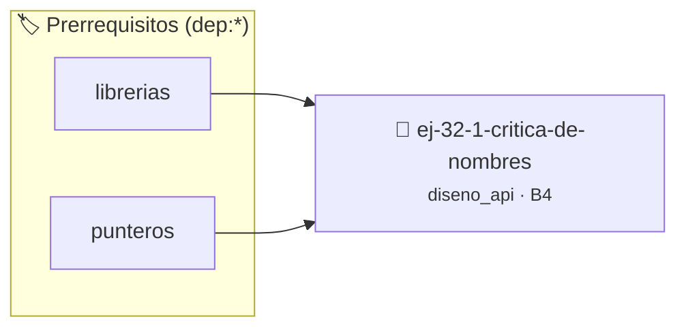

# Crítica de Nombres
> **ID:** `ej-32-1-critica-de-nombres` · **Unidad:** 5 (Ingeniería de Software y Calidad en C)
 · **Tema:** `diseno_api` / `nombres`
 · **Bloom:** B4 (Analizar) · **Dificultad:** Avanzada
 · **Carga:** ~35 min · **Tipo:** Practica Guiada
>
> **🏷️ Prerrequisitos temáticos (tags):** `dep:librerias`, `dep:punteros`
>
> **Etiquetas conceptuales:** `nombres`, `diseno`, `interfaces`, `critica`, `avanzados`


::: {admonition} 📦 Paquete de Verificación Local (Ripley)
:class: tip

Para compilar, resolver y autoevaluar tu entrega con pruebas unitarias en tu máquina:

- [📥 **Descargar paquete `ej-32-1-critica-de-nombres.ripkg`**](../../paquetes/ej-32-1-critica-de-nombres.ripkg)

Ejecución con el asistente de cátedra:
```bash
ripley run ej-32-1-critica-de-nombres.ripkg
```
:::


### 🗺️ Itinerario Pedagógico




## 📖 Consigna

### Ejercicio 32.1 - Crítica de Nombres ⭐⭐☆☆☆

Analizar estos nombres de funciones y proponer mejoras siguiendo las reglas de
estilo:


:::{hint} Lógica y Consideraciones

-   **[*plus ultra*]:** Diseñar la función para devolver un código de estado de
    error e informar el resultado mediante parámetros de salida.
-   **[*plus ultra*]:** Documentar la función con etiquetas Doxygen
    especificando precondiciones y postcondiciones.

:::
<!-- {hint} Lógica y Consideraciones -->

```{code-block} c
:linenos:
// Biblioteca de procesamiento de imágenes
void process(img *i);
int calc(img *i, int x, int y);
void update(img *i, void *d);
int check(img *i);
void fix(img *i);
```
<!-- {code-block} c -->

**Tareas:**
1. Identificar qué está mal con cada nombre
2. Proponer nombres descriptivos con prefijo apropiado
3. Agregar documentación de contrato para cada función

:::{tip} Nombres Descriptivos

Como se menciona en [claridad y expresividad](#1-claridad-y-expresividad), los
nombres deben comunicar claramente la acción que realizan. Usar verbos
específicos en lugar de genéricos como "process" o "update".

:::
<!-- {tip} Nombres Descriptivos -->


## 📋 Prototipos y Cabecera (`ej-32-1-critica-de-nombres.h`)

```{code-block} c
#ifndef EJERCICIO_EJ_32_1_CRITICA_DE_NOMBRES_H
#define EJERCICIO_EJ_32_1_CRITICA_DE_NOMBRES_H

#include <stddef.h>
#include <stdbool.h>
#include <stdint.h>

/* Procesa el flujo principal de Crítica de Nombres */
int proc_1_critica_de_nombres(int val);

#endif /* EJERCICIO_EJ_32_1_CRITICA_DE_NOMBRES_H */
```


## ⚙️ Especificación de Funciones

| Función | Retorno | Parámetros | Descripción |
| :--- | :--- | :--- | :--- |

| `proc_1_critica_de_nombres` | `int` | `int val` | Procesa el flujo principal de Crítica de Nombres |


## 💡 Pistas Progresivas

````{tab-set}

```{tab-item} Pista 1
[Plus Ultra] Diseñar la función para devolver un código de estado de error e informar el resultado mediante parámetros de salida.
```

```{tab-item} Pista 2
[Plus Ultra] Documentar la función con etiquetas Doxygen especificando precondiciones y postcondiciones.
```

````


## 🧪 Casos de Prueba

| Prueba Unitaria | Función Objetivo | Verificación |
| :--- | :--- | :--- |

| **test_proc_1_critica_de_nombres_positivo** | `proc_1_critica_de_nombres` | `int res = proc_1_critica_de_nombres(5); assert(res == 10 || res >= 0);` |

| **test_proc_1_critica_de_nombres_cero** | `proc_1_critica_de_nombres` | `int res = proc_1_critica_de_nombres(0); assert(res == 0);` |


## ✓ Solución Modelo de Cátedra

```{dropdown} 🔍 Revelar solución canónica en C
:open: false

```{code-block} c
/*
 * Solucion modelo para ej-32-1-critica-de-nombres
 * Catedra Programacion I - UNRN
 */
#include <stdio.h>
#include <stdlib.h>
#include <string.h>
#include <stdbool.h>


int proc_1_critica_de_nombres(int val)
{
    if (val <= 0) return 0;
    return val * 2;
}

int main(void)
{
    int n = 0;
    if (scanf("%d", &n) == 1)
    {
        printf("OK %d\n", n);
    }
    else
    {
        printf("OK\n");
    }
    return 0;
}
```
```
