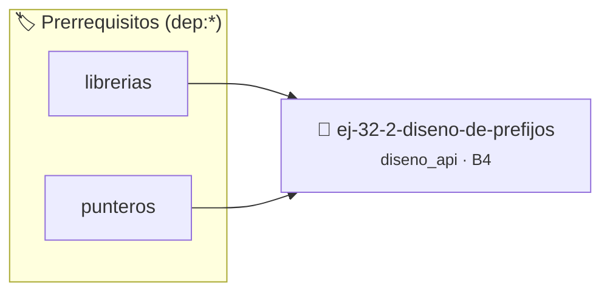

# Diseño de Prefijos
> **ID:** `ej-32-2-diseno-de-prefijos` · **Unidad:** 5 (Ingeniería de Software y Calidad en C)
 · **Tema:** `diseno_api` / `prefijos`
 · **Bloom:** B4 (Analizar) · **Dificultad:** Avanzada
 · **Carga:** ~35 min · **Tipo:** Practica Guiada
>
> **🏷️ Prerrequisitos temáticos (tags):** `dep:librerias`, `dep:punteros`
>
> **Etiquetas conceptuales:** `prefijos`, `diseno`, `interfaces`, `avanzados`, `api`


::: {admonition} 📦 Paquete de Verificación Local (Ripley)
:class: tip

Para compilar, resolver y autoevaluar tu entrega con pruebas unitarias en tu máquina:

- [📥 **Descargar paquete `ej-32-2-diseno-de-prefijos.ripkg`**](../../paquetes/ej-32-2-diseno-de-prefijos.ripkg)

Ejecución con el asistente de cátedra:
```bash
ripley run ej-32-2-diseno-de-prefijos.ripkg
```
:::


### 🗺️ Itinerario Pedagógico




## 📖 Consigna

### Ejercicio 32.2 - Diseño de Prefijos ⭐⭐☆☆☆

Diseñar esquemas de prefijos para estas librerías:

a) **Librería de gestión de base de datos**  
b) **Librería de compresión de archivos**  
c) **Librería de validación de entrada**  
d) **Librería de parseo JSON**

Para cada una:
- Proponer un prefijo corto pero descriptivo
- Listar 5 funciones típicas con el prefijo aplicado
- Justificar la elección del prefijo

**Ejemplo:**

:::{hint} Lógica y Consideraciones

-   **[*plus ultra*]:** Garantizar la terminación con `\0` y prevenir
    desbordamientos de búfer validando la capacidad máxima.
-   **[*plus ultra*]:** Soportar la lectura de cadenas con espacios y múltiples
    líneas de manera robusta.

:::
<!-- {hint} Lógica y Consideraciones -->

``` c
// Librería de parseo JSON - prefijo: json_
json_parser_t *json_parser_crear(void);
json_value_t *json_parser_parse_string(json_parser_t *parser, const char *str);
bool json_value_es_objeto(const json_value_t *value);
```
<!-- c -->


## 📋 Prototipos y Cabecera (`ej-32-2-diseno-de-prefijos.h`)

```{code-block} c
#ifndef EJERCICIO_EJ_32_2_DISENO_DE_PREFIJOS_H
#define EJERCICIO_EJ_32_2_DISENO_DE_PREFIJOS_H

#include <stddef.h>
#include <stdbool.h>
#include <stdint.h>

/* Procesa el flujo principal de Diseño de Prefijos */
int proc_2_diseno_de_prefijos(int val);

#endif /* EJERCICIO_EJ_32_2_DISENO_DE_PREFIJOS_H */
```


## ⚙️ Especificación de Funciones

| Función | Retorno | Parámetros | Descripción |
| :--- | :--- | :--- | :--- |

| `proc_2_diseno_de_prefijos` | `int` | `int val` | Procesa el flujo principal de Diseño de Prefijos |


## 💡 Pistas Progresivas

````{tab-set}

```{tab-item} Pista 1
[Plus Ultra] Garantizar la terminación con `\0` y prevenir desbordamientos de búfer validando la capacidad máxima.
```

```{tab-item} Pista 2
[Plus Ultra] Soportar la lectura de cadenas con espacios y múltiples líneas de manera robusta.
```

````


## 🧪 Casos de Prueba

| Prueba Unitaria | Función Objetivo | Verificación |
| :--- | :--- | :--- |

| **test_proc_2_diseno_de_prefijos_positivo** | `proc_2_diseno_de_prefijos` | `int res = proc_2_diseno_de_prefijos(5); assert(res == 10 || res >= 0);` |

| **test_proc_2_diseno_de_prefijos_cero** | `proc_2_diseno_de_prefijos` | `int res = proc_2_diseno_de_prefijos(0); assert(res == 0);` |


## ✓ Solución Modelo de Cátedra

```{dropdown} 🔍 Revelar solución canónica en C
:open: false

```{code-block} c
/*
 * Ejercicio: Diseño de Prefijos
 * Cátedra Programación I - UNRN
 */

#include <stdio.h>


int proc_2_diseno_de_prefijos(int val)
{
    if (val <= 0) return 0;
    return val * 2;
}

int main(void)
{
    /* TODO: Implementación de Diseño de Prefijos */
    return 0;
}
```
```
