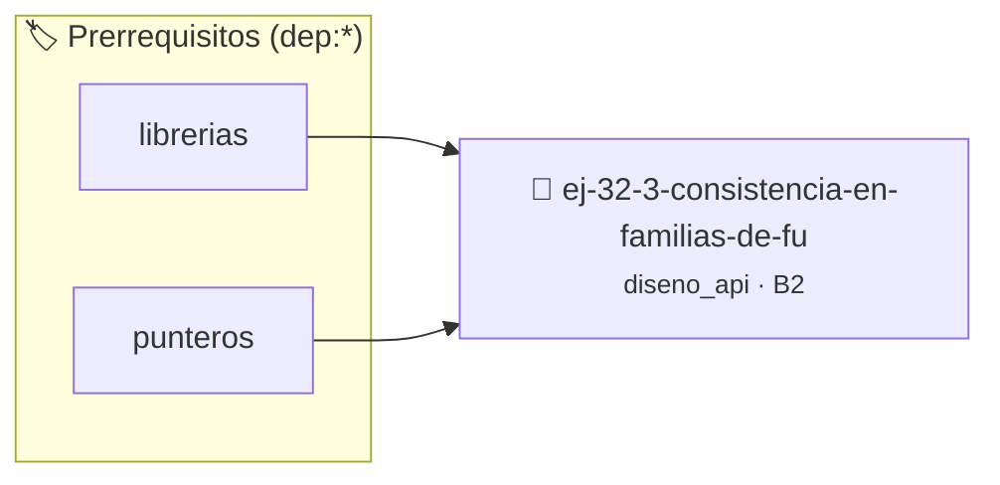

# Consistencia en Familias de Funciones
> **ID:** `ej-32-3-consistencia-en-familias-de-fu` · **Unidad:** 5 (Ingeniería de Software y Calidad en C)
 · **Tema:** `diseno_api` / `diseno`
 · **Bloom:** B2 (Comprender) · **Dificultad:** Inicial
 · **Carga:** ~15 min · **Tipo:** Practica Guiada
>
> **🏷️ Prerrequisitos temáticos (tags):** `dep:librerias`, `dep:punteros`
>
> **Etiquetas conceptuales:** `diseno`, `familias`, `interfaces`, `funciones`, `avanzados`


::: {admonition} 📦 Paquete de Verificación Local (Ripley)
:class: tip

Para compilar, resolver y autoevaluar tu entrega con pruebas unitarias en tu máquina:

- [📥 **Descargar paquete `ej-32-3-consistencia-en-familias-de-fu.ripkg`**](../../paquetes/ej-32-3-consistencia-en-familias-de-fu.ripkg)

Ejecución con el asistente de cátedra:
```bash
ripley run ej-32-3-consistencia-en-familias-de-fu.ripkg
```
:::


### 🗺️ Itinerario Pedagógico




## 📖 Consigna

### Ejercicio 32.3 - Consistencia en Familias de Funciones ⭐⭐☆☆☆

Completar estas familias de funciones con nombres consistentes:


:::{hint} Lógica y Consideraciones

-   **[*plus ultra*]:** Validar punteros `NULL` recibidos como parámetro para
    evitar fallos de segmentación.
-   **[*plus ultra*]:** Implementar una versión utilizando aritmética de
    punteros en lugar de indexación directa.

:::
<!-- {hint} Lógica y Consideraciones -->

```{code-block} c
:linenos:
// Familia de funciones para manejo de archivos de configuración
config_t *config_crear_vacio(void);
config_t *config_ ? ? ? _desde_archivo(const char *ruta); // Cargar
bool config_ ? ?
               ? _a_archivo(const config_t *cfg, const char *ruta); // Guardar
? ?   ?   // Obtener valor de clave
    ? ? ? // Establecer valor de clave
    ? ? ? // Verificar si existe una clave
    void config_destruir(config_t **ptr_config);
```
<!-- {code-block} c -->


## 📋 Prototipos y Cabecera (`ej-32-3-consistencia-en-familias-de-fu.h`)

```{code-block} c
#ifndef EJERCICIO_EJ_32_3_CONSISTENCIA_EN_FAMILIAS_DE_FU_H
#define EJERCICIO_EJ_32_3_CONSISTENCIA_EN_FAMILIAS_DE_FU_H

#include <stddef.h>
#include <stdbool.h>
#include <stdint.h>

/* Procesa el flujo principal de Consistencia en Familias de Funciones */
int proc_ia_en_familias_de_fu(int val);

#endif /* EJERCICIO_EJ_32_3_CONSISTENCIA_EN_FAMILIAS_DE_FU_H */
```


## ⚙️ Especificación de Funciones

| Función | Retorno | Parámetros | Descripción |
| :--- | :--- | :--- | :--- |

| `proc_ia_en_familias_de_fu` | `int` | `int val` | Procesa el flujo principal de Consistencia en Familias de Funciones |


## 💡 Pistas Progresivas

````{tab-set}

```{tab-item} Pista 1
[Plus Ultra] Validar punteros `NULL` recibidos como parámetro para evitar fallos de segmentación.
```

```{tab-item} Pista 2
[Plus Ultra] Implementar una versión utilizando aritmética de punteros en lugar de indexación directa.
```

````


## 🧪 Casos de Prueba

| Prueba Unitaria | Función Objetivo | Verificación |
| :--- | :--- | :--- |

| **test_proc_ia_en_familias_de_fu_positivo** | `proc_ia_en_familias_de_fu` | `int res = proc_ia_en_familias_de_fu(5); assert(res == 10 || res >= 0);` |

| **test_proc_ia_en_familias_de_fu_cero** | `proc_ia_en_familias_de_fu` | `int res = proc_ia_en_familias_de_fu(0); assert(res == 0);` |


## ✓ Solución Modelo de Cátedra

```{dropdown} 🔍 Revelar solución canónica en C
:open: false

```{code-block} c
/*
 * Solucion modelo para ej-32-3-consistencia-en-familias-de-fu
 * Catedra Programacion I - UNRN
 */
#include <stdio.h>
#include <stdlib.h>
#include <string.h>
#include <stdbool.h>


int proc_ia_en_familias_de_fu(int val)
{
    if (val <= 0) return 0;
    return val * 2;
}

int main(void)
{
    int n = 0;
    if (scanf("%d", &n) == 1)
    {
        printf("OK %d\n", n);
    }
    else
    {
        printf("OK\n");
    }
    return 0;
}
```
```
