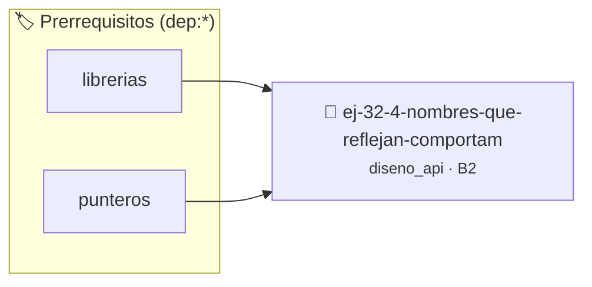

# Nombres que Reflejan Comportamiento
> **ID:** `ej-32-4-nombres-que-reflejan-comportam` · **Unidad:** 5 (Ingeniería de Software y Calidad en C)
 · **Tema:** `diseno_api` / `nombres`
 · **Bloom:** B2 (Comprender) · **Dificultad:** Inicial
 · **Carga:** ~15 min · **Tipo:** Practica Guiada
>
> **🏷️ Prerrequisitos temáticos (tags):** `dep:librerias`, `dep:punteros`
>
> **Etiquetas conceptuales:** `nombres`, `diseno`, `interfaces`, `avanzados`, `api`


::: {admonition} 📦 Paquete de Verificación Local (Ripley)
:class: tip

Para compilar, resolver y autoevaluar tu entrega con pruebas unitarias en tu máquina:

- [📥 **Descargar paquete `ej-32-4-nombres-que-reflejan-comportam.ripkg`**](../../paquetes/ej-32-4-nombres-que-reflejan-comportam.ripkg)

Ejecución con el asistente de cátedra:
```bash
ripley run ej-32-4-nombres-que-reflejan-comportam.ripkg
```
:::


### 🗺️ Itinerario Pedagógico




## 📖 Consigna

### Ejercicio 32.4 - Nombres que Reflejan Comportamiento ⭐⭐☆☆☆

Renombrar estas funciones para reflejar mejor su comportamiento real:


:::{hint} Lógica y Consideraciones

-   **[*plus ultra*]:** Garantizar la terminación con `\0` y prevenir
    desbordamientos de búfer validando la capacidad máxima.
-   **[*plus ultra*]:** Soportar la lectura de cadenas con espacios y múltiples
    líneas de manera robusta.

:::
<!-- {hint} Lógica y Consideraciones -->

```{code-block} c
:linenos:
// La función busca y reemplaza, no solo busca
char *buscar_texto(char *str, const char *patron, const char *reemplazo);
// La función no solo valida, también normaliza
bool validar_email(char *email);
// La función no solo obtiene, calcula en tiempo real
double obtener_promedio(const int *calificaciones, size_t n);
// La función no agrega, inserta ordenadamente
void agregar_elemento(lista_t *lista, int elemento);
```
<!-- {code-block} c -->

---

## Tipos Opacos y Encapsulamiento


## 📋 Prototipos y Cabecera (`ej-32-4-nombres-que-reflejan-comportam.h`)

```{code-block} c
#ifndef EJERCICIO_EJ_32_4_NOMBRES_QUE_REFLEJAN_COMPORTAM_H
#define EJERCICIO_EJ_32_4_NOMBRES_QUE_REFLEJAN_COMPORTAM_H

#include <stddef.h>
#include <stdbool.h>
#include <stdint.h>

/* Procesa el flujo principal de Nombres que Reflejan Comportamiento */
int proc_e_reflejan_comportam(int val);

#endif /* EJERCICIO_EJ_32_4_NOMBRES_QUE_REFLEJAN_COMPORTAM_H */
```


## ⚙️ Especificación de Funciones

| Función | Retorno | Parámetros | Descripción |
| :--- | :--- | :--- | :--- |

| `proc_e_reflejan_comportam` | `int` | `int val` | Procesa el flujo principal de Nombres que Reflejan Comportamiento |


## 💡 Pistas Progresivas

````{tab-set}

```{tab-item} Pista 1
[Plus Ultra] Garantizar la terminación con `\0` y prevenir desbordamientos de búfer validando la capacidad máxima.
```

```{tab-item} Pista 2
[Plus Ultra] Soportar la lectura de cadenas con espacios y múltiples líneas de manera robusta.
```

````


## 🧪 Casos de Prueba

| Prueba Unitaria | Función Objetivo | Verificación |
| :--- | :--- | :--- |

| **test_proc_e_reflejan_comportam_positivo** | `proc_e_reflejan_comportam` | `int res = proc_e_reflejan_comportam(5); assert(res == 10 || res >= 0);` |

| **test_proc_e_reflejan_comportam_cero** | `proc_e_reflejan_comportam` | `int res = proc_e_reflejan_comportam(0); assert(res == 0);` |


## ✓ Solución Modelo de Cátedra

```{dropdown} 🔍 Revelar solución canónica en C
:open: false

```{code-block} c
/*
 * Solucion modelo para ej-32-4-nombres-que-reflejan-comportam
 * Catedra Programacion I - UNRN
 */
#include <stdio.h>
#include <stdlib.h>
#include <string.h>
#include <stdbool.h>


int proc_e_reflejan_comportam(int val)
{
    if (val <= 0) return 0;
    return val * 2;
}

int main(void)
{
    int n = 0;
    if (scanf("%d", &n) == 1)
    {
        printf("OK %d\n", n);
    }
    else
    {
        printf("OK\n");
    }
    return 0;
}
```
```
