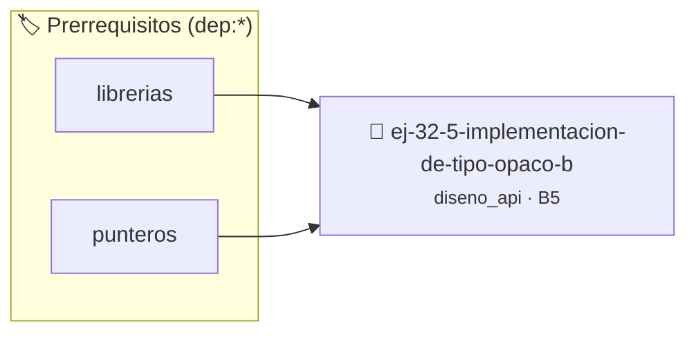

# Implementación de Tipo Opaco Básico
> **ID:** `ej-32-5-implementacion-de-tipo-opaco-b` · **Unidad:** 5 (Ingeniería de Software y Calidad en C)
 · **Tema:** `diseno_api` / `diseno`
 · **Bloom:** B5 (Evaluar / Crear) · **Dificultad:** Desafio
 · **Carga:** ~45 min · **Tipo:** Desafio
>
> **🏷️ Prerrequisitos temáticos (tags):** `dep:librerias`, `dep:punteros`
>
> **Etiquetas conceptuales:** `diseno`, `interfaces`, `basico`, `implementacion`, `avanzados`


::: {admonition} 📦 Paquete de Verificación Local (Ripley)
:class: tip

Para compilar, resolver y autoevaluar tu entrega con pruebas unitarias en tu máquina:

- [📥 **Descargar paquete `ej-32-5-implementacion-de-tipo-opaco-b.ripkg`**](../../paquetes/ej-32-5-implementacion-de-tipo-opaco-b.ripkg)

Ejecución con el asistente de cátedra:
```bash
ripley run ej-32-5-implementacion-de-tipo-opaco-b.ripkg
```
:::


### 🗺️ Itinerario Pedagógico




## 📖 Consigna

Implementar un stack usando tipo opaco completo en C11:

**`stack.h`** (interfaz pública):

```{code-block} c
:linenos:
#ifndef STACK_H
#define STACK_H
#include <stdbool.h>
#include <stddef.h>
typedef struct stack stack_t; // Declaración adelantada
stack_t *stack_crear(size_t capacidad_inicial);
void stack_destruir(stack_t **ptr_stack);
bool stack_push(stack_t *stack, int valor);
bool stack_pop(stack_t *stack, int *valor);
bool stack_peek(const stack_t *stack, int *valor);
size_t stack_tamano(const stack_t *stack);
bool stack_esta_vacio(const stack_t *stack);
#endif
```

**Tareas:**
1. Implementar `stack.c` con la estructura interna oculta.
2. Garantizar que el usuario no pueda acceder a los campos internos directamente.
3. Manejar correctamente los errores (stack vacío, punteros nulos o memoria agotada).

### 📋 Contrato de las Funciones

```c
/*
 * Procesa el flujo principal de Implementación de Tipo Opaco Básico
 * Precondiciones: val representa el parámetro de entrada del flujo.
 * Postcondiciones: Retorna el resultado correspondiente o 0 si val <= 0.
 */
int proc_cion_de_tipo_opaco_b(int val);
```

### 🧪 Ejemplos de Ejecución

::::{tab-set}
:::{tab-item} Valor positivo
```text
Entrada: 5
Salida / Retorno: 10
```
:::
:::{tab-item} Valor cero o negativo
```text
Entrada: 0
Salida / Retorno: 0
```
:::
::::

### ⚠️ Precondiciones y Casos Borde

1. **Valores fuera de rango:** Verificar siempre que los datos de entrada cumplan con los rangos admisibles antes de operar.
2. **Punteros nulos:** Validar que los punteros recibidos no sean `NULL` para prevenir fallos de segmentación (*SIGSEGV*).
3. **Gestión de memoria:** Toda memoria solicitada mediante `malloc`/`calloc` debe ser validada y eventualmente liberada con `free`.
4. **Casos vacíos o neutros:** Contemplar adecuadamente entradas con longitud cero o valores neutros según corresponda.

### 🎯 Criterios de Aceptación

- [ ] El código compila limpiamente bajo estándar C11 sin warnings con flags estrictos (`-Wall -Wextra -Werror`).
- [ ] Se satisfacen todas las pruebas unitarias y casos de prueba provistos.
- [ ] Las funciones validan exhaustivamente sus precondiciones y gestionan casos borde de forma robusta.
- [ ] No se registran fugas de memoria (*memory leaks*) comprobables mediante Valgrind o AddressSanitizer.

:::{hint} Consideraciones Didácticas
- Validar punteros `NULL` recibidos como parámetro para evitar fallos de segmentación.
- Implementar una versión utilizando aritmética de punteros en lugar de indexación directa.
:::


## 📋 Prototipos y Cabecera (`ej-32-5-implementacion-de-tipo-opaco-b.h`)

```{code-block} c
#ifndef EJERCICIO_EJ_32_5_IMPLEMENTACION_DE_TIPO_OPACO_B_H
#define EJERCICIO_EJ_32_5_IMPLEMENTACION_DE_TIPO_OPACO_B_H

#include <stddef.h>
#include <stdbool.h>
#include <stdint.h>

/* Procesa el flujo principal de Implementación de Tipo Opaco Básico */
int proc_cion_de_tipo_opaco_b(int val);

#endif /* EJERCICIO_EJ_32_5_IMPLEMENTACION_DE_TIPO_OPACO_B_H */
```


## ⚙️ Especificación de Funciones

| Función | Retorno | Parámetros | Descripción |
| :--- | :--- | :--- | :--- |

| `proc_cion_de_tipo_opaco_b` | `int` | `int val` | Procesa el flujo principal de Implementación de Tipo Opaco Básico |


## 💡 Pistas Progresivas

````{tab-set}

```{tab-item} Pista 1
[Plus Ultra] Validar punteros `NULL` recibidos como parámetro para evitar fallos de segmentación.
```

```{tab-item} Pista 2
[Plus Ultra] Implementar una versión utilizando aritmética de punteros en lugar de indexación directa.
```

````


## 🧪 Casos de Prueba

| Prueba Unitaria | Función Objetivo | Verificación |
| :--- | :--- | :--- |

| **test_proc_cion_de_tipo_opaco_b_positivo** | `proc_cion_de_tipo_opaco_b` | `int res = proc_cion_de_tipo_opaco_b(5); assert(res == 10 || res >= 0);` |

| **test_proc_cion_de_tipo_opaco_b_cero** | `proc_cion_de_tipo_opaco_b` | `int res = proc_cion_de_tipo_opaco_b(0); assert(res == 0);` |


## ✓ Solución Modelo de Cátedra

```{dropdown} 🔍 Revelar solución canónica en C
:open: false

```{code-block} c
#ifndef STACK_H
#define STACK_H
#include <stdbool.h>
#include <stddef.h>
typedef struct stack stack_t; // Declaración adelantada
stack_t *stack_crear(size_t capacidad_inicial);
void stack_destruir(stack_t **ptr_stack);
bool stack_push(stack_t *stack, int valor);
bool stack_pop(stack_t *stack, int *valor);
bool stack_peek(const stack_t *stack, int *valor);
size_t stack_tamano(const stack_t *stack);
bool stack_esta_vacio(const stack_t *stack);
#endif


int proc_cion_de_tipo_opaco_b(int val)
{
    if (val <= 0) return 0;
    return val * 2;
}

int main(void)
{
    return 0;
}
```
```
