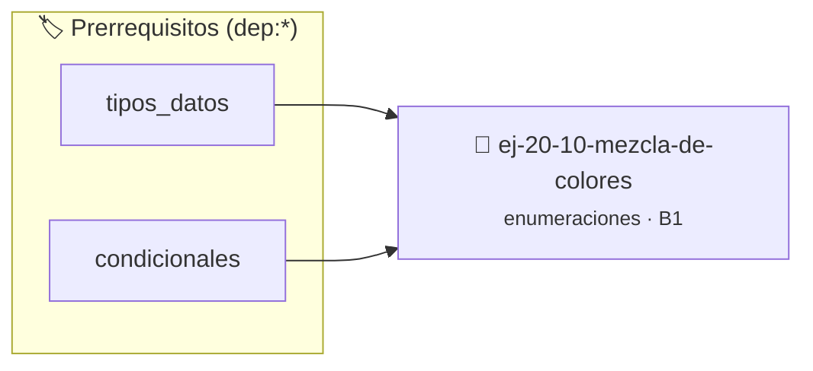

# Mezcla de colores
> **ID:** `ej-20-10-mezcla-de-colores`
 · **Tema:** `enumeraciones`
 · **Bloom:** B1 (Recordar)
 · **Carga:** ~10 min
>
> **🏷️ Prerrequisitos temáticos (tags):** `dep:tipos_datos`, `dep:condicionales`
>
> **Etiquetas conceptuales:** `tipos`, `mezcla`, `colores`, `memoria`, `enum`


::: {admonition} 📦 Paquete de Verificación Local (Ripley)
:class: tip

Para compilar, resolver y autoevaluar tu entrega con pruebas unitarias en tu máquina:

- [📥 **Descargar paquete `ej-20-10-mezcla-de-colores.ripkg`**](../../paquetes/ej-20-10-mezcla-de-colores.ripkg)

Ejecución con el asistente de cátedra:
```bash
ripley run ej-20-10-mezcla-de-colores.ripkg
```
:::


### 🗺️ Itinerario Pedagógico




## 📖 Consigna

### Ejercicio 20.10 - Mezcla de colores ⭐⭐☆☆☆

Implementar una función que mezcle dos colores RGB usando promedio aritmético.


:::{hint} Lógica y Consideraciones

-   **[*plus ultra*]:** Garantizar la terminación con `\0` y prevenir
    desbordamientos de búfer validando la capacidad máxima.
-   **[*plus ultra*]:** Soportar la lectura de cadenas con espacios y múltiples
    líneas de manera robusta.

:::
<!-- {hint} Lógica y Consideraciones -->

``` c
rgb_t mezclar_colores(rgb_t c1, rgb_t c2);
```
<!-- c -->

## Configuración de Dispositivo con Unión Etiquetada

Implementar una unión etiquetada para almacenar diferentes tipos de
configuración de dispositivos.

```{code-block} c
:linenos:
enum tipo_dispositivo
{
    DISPOSITIVO_SENSOR_TEMP,
    DISPOSITIVO_MOTOR,
    DISPOSITIVO_LED
};
typedef struct
{
    double temperatura_min;
    double temperatura_max;
} config_sensor_t;
typedef struct
{
    unsigned int velocidad_rpm;
    bool direccion_horaria;
} config_motor_t;
typedef struct
{
    unsigned char intensidad;
    enum color_predefinido color;
} config_led_t;
typedef struct
{
    enum tipo_dispositivo tipo;
    union
    {
        config_sensor_t sensor;
        config_motor_t motor;
        config_led_t led;
    } config;
} dispositivo_t;
```
<!-- {code-block} c -->


## 📋 Prototipos y Cabecera (`ej-20-10-mezcla-de-colores.h`)

```{code-block} c
#ifndef EJERCICIO_EJ_20_10_MEZCLA_DE_COLORES_H
#define EJERCICIO_EJ_20_10_MEZCLA_DE_COLORES_H

#include <stddef.h>
#include <stdbool.h>
#include <stdint.h>

/* Procesa el flujo principal de Mezcla de colores */
int proc_10_mezcla_de_colores(int val);

#endif /* EJERCICIO_EJ_20_10_MEZCLA_DE_COLORES_H */
```


## ⚙️ Especificación de Funciones

| Función | Retorno | Parámetros | Descripción |
| :--- | :--- | :--- | :--- |

| `proc_10_mezcla_de_colores` | `int` | `int val` | Procesa el flujo principal de Mezcla de colores |


## 💡 Pistas Progresivas

````{tab-set}

```{tab-item} Pista 1
[Plus Ultra] Garantizar la terminación con `\0` y prevenir desbordamientos de búfer validando la capacidad máxima.
```

```{tab-item} Pista 2
[Plus Ultra] Soportar la lectura de cadenas con espacios y múltiples líneas de manera robusta.
```

````


## 🧪 Casos de Prueba

| Prueba Unitaria | Función Objetivo | Verificación |
| :--- | :--- | :--- |

| **test_proc_10_mezcla_de_colores_positivo** | `proc_10_mezcla_de_colores` | `int res = proc_10_mezcla_de_colores(5); assert(res == 10 || res >= 0);` |

| **test_proc_10_mezcla_de_colores_cero** | `proc_10_mezcla_de_colores` | `int res = proc_10_mezcla_de_colores(0); assert(res == 0);` |


## ✓ Solución Modelo de Cátedra

```{dropdown} 🔍 Revelar solución canónica en C
:open: false

```{code-block} c
/*
 * Solucion modelo para ej-20-10-mezcla-de-colores
 * Catedra Programacion I - UNRN
 */
#include <stdio.h>
#include <stdlib.h>
#include <string.h>
#include <stdbool.h>


int proc_10_mezcla_de_colores(int val)
{
    if (val <= 0) return 0;
    return val * 2;
}

int main(void)
{
    int n = 0;
    if (scanf("%d", &n) == 1)
    {
        printf("OK %d\n", n);
    }
    else
    {
        printf("OK\n");
    }
    return 0;
}
```
```
