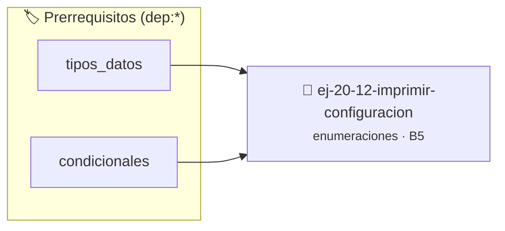

# Imprimir configuración
> **ID:** `ej-20-12-imprimir-configuracion`
 · **Tema:** `enumeraciones`
 · **Bloom:** B5 (Evaluar / Crear)
 · **Carga:** ~45 min
>
> **🏷️ Prerrequisitos temáticos (tags):** `dep:tipos_datos`, `dep:condicionales`
>
> **Etiquetas conceptuales:** `tipos`, `configuracion`, `memoria`, `enum`, `imprimir`


::: {admonition} 📦 Paquete de Verificación Local (Ripley)
:class: tip

Para compilar, resolver y autoevaluar tu entrega con pruebas unitarias en tu máquina:

- [📥 **Descargar paquete `ej-20-12-imprimir-configuracion.ripkg`**](../../paquetes/ej-20-12-imprimir-configuracion.ripkg)

Ejecución con el asistente de cátedra:
```bash
ripley run ej-20-12-imprimir-configuracion.ripkg
```
:::


### 🗺️ Itinerario Pedagógico




## 📖 Consigna

### Ejercicio 20.12 - Imprimir configuración ⭐⭐☆☆☆

Implementar una función que imprima la configuración de un dispositivo según su
tipo. Este ejercicio demuestra el uso correcto de uniones etiquetadas.


:::{hint} Lógica y Consideraciones

-   **[*plus ultra*]:** Verificar el retorno de asignación de memoria y
    garantizar la liberación total de recursos en caso de error.
-   **[*plus ultra*]:** Verificar la ausencia de fugas de memoria (*memory
    leaks*) mediante Valgrind o AddressSanitizer.

:::
<!-- {hint} Lógica y Consideraciones -->

``` c
void imprimir_dispositivo(const dispositivo_t *dispositivo);
```
<!-- c -->

## Códigos de Error

Definir una enumeración exhaustiva para códigos de error de un sistema.

```{code-block} c
:linenos:
enum codigo_error
{
    ERROR_NINGUNO = 0,
    ERROR_MEMORIA,
    ERROR_ARCHIVO_NO_ENCONTRADO,
    ERROR_PERMISO_DENEGADO,
    ERROR_ARGUMENTO_INVALIDO,
    ERROR_TIMEOUT,
    ERROR_CONEXION,
    ERROR_DESCONOCIDO
};
```
<!-- {code-block} c -->


## 📋 Prototipos y Cabecera (`ej-20-12-imprimir-configuracion.h`)

```{code-block} c
#ifndef EJERCICIO_EJ_20_12_IMPRIMIR_CONFIGURACION_H
#define EJERCICIO_EJ_20_12_IMPRIMIR_CONFIGURACION_H

#include <stddef.h>
#include <stdbool.h>
#include <stdint.h>

/* Procesa el flujo principal de Imprimir configuración */
int proc_primir_configuracion(int val);

#endif /* EJERCICIO_EJ_20_12_IMPRIMIR_CONFIGURACION_H */
```


## ⚙️ Especificación de Funciones

| Función | Retorno | Parámetros | Descripción |
| :--- | :--- | :--- | :--- |

| `proc_primir_configuracion` | `int` | `int val` | Procesa el flujo principal de Imprimir configuración |


## 💡 Pistas Progresivas

````{tab-set}

```{tab-item} Pista 1
[Plus Ultra] Verificar el retorno de asignación de memoria y garantizar la liberación total de recursos en caso de error.
```

```{tab-item} Pista 2
[Plus Ultra] Verificar la ausencia de fugas de memoria (*memory leaks*) mediante Valgrind o AddressSanitizer.
```

````


## 🧪 Casos de Prueba

| Prueba Unitaria | Función Objetivo | Verificación |
| :--- | :--- | :--- |

| **test_proc_primir_configuracion_positivo** | `proc_primir_configuracion` | `int res = proc_primir_configuracion(5); assert(res == 10 || res >= 0);` |

| **test_proc_primir_configuracion_cero** | `proc_primir_configuracion` | `int res = proc_primir_configuracion(0); assert(res == 0);` |


## ✓ Solución Modelo de Cátedra

```{dropdown} 🔍 Revelar solución canónica en C
:open: false

```{code-block} c
enum codigo_error
{
    ERROR_NINGUNO = 0,
    ERROR_MEMORIA,
    ERROR_ARCHIVO_NO_ENCONTRADO,
    ERROR_PERMISO_DENEGADO,
    ERROR_ARGUMENTO_INVALIDO,
    ERROR_TIMEOUT,
    ERROR_CONEXION,
    ERROR_DESCONOCIDO
};


int proc_primir_configuracion(int val)
{
    if (val <= 0) return 0;
    return val * 2;
}

int main(void)
{
    return 0;
}
```
```
