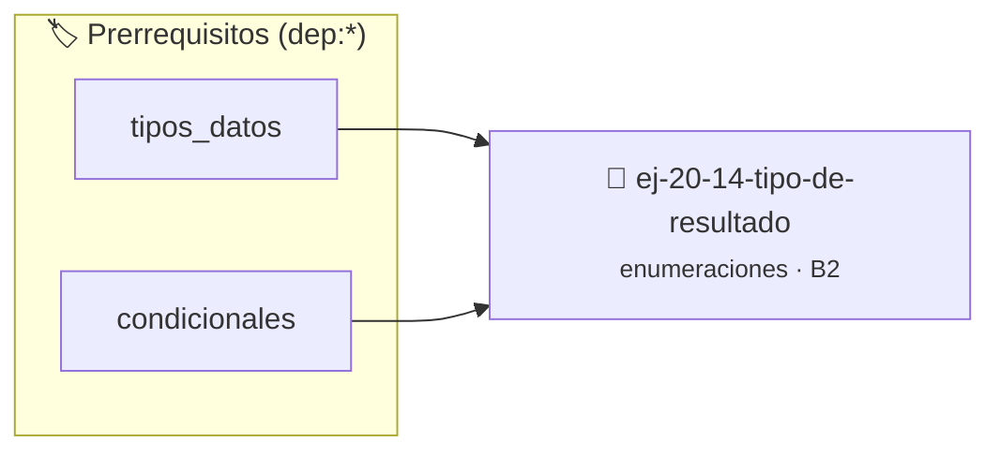

# Tipo de resultado
> **ID:** `ej-20-14-tipo-de-resultado` · **Unidad:** 2 (Tipos Compuestos y Direccionamiento)
 · **Tema:** `enumeraciones` / `mapeo_estados`
 · **Bloom:** B2 (Comprender) · **Dificultad:** Inicial
 · **Carga:** ~15 min · **Tipo:** Practica Guiada
>
> **🏷️ Prerrequisitos temáticos (tags):** `dep:tipos_datos`, `dep:condicionales`
>
> **Etiquetas conceptuales:** `tipos`, `resultado`, `enum`, `memoria`


::: {admonition} 📦 Paquete de Verificación Local (Ripley)
:class: tip

Para compilar, resolver y autoevaluar tu entrega con pruebas unitarias en tu máquina:

- [📥 **Descargar paquete `ej-20-14-tipo-de-resultado.ripkg`**](../../paquetes/ej-20-14-tipo-de-resultado.ripkg)

Ejecución con el asistente de cátedra:
```bash
ripley run ej-20-14-tipo-de-resultado.ripkg
```
:::


### 🗺️ Itinerario Pedagógico




## 📖 Consigna

Implementar un tipo `resultado_t` que encapsule un valor de retorno o un código
de error usando unión etiquetada.


```{code-block} c
:linenos:
typedef struct
{
    enum codigo_error error;
    union
    {
        int valor_int;
        double valor_double;
        void *valor_ptr;
    } datos;
} resultado_t;
```

Implementar funciones auxiliares:

``` c
resultado_t resultado_ok_int(int valor);
resultado_t resultado_error(enum codigo_error error);
bool resultado_es_error(const resultado_t *resultado);
```

## Estados de Reproducción Multimedia

Modelar un reproductor multimedia con estados y modos de reproducción.

```{code-block} c
:linenos:
enum estado_reproductor
{
    ESTADO_DETENIDO,
    ESTADO_REPRODUCIENDO,
    ESTADO_PAUSADO,
    ESTADO_AVANZANDO,
    ESTADO_RETROCEDIENDO
};
enum modo_reproduccion
{
    MODO_NORMAL,
    MODO_REPETIR_UNO,
    MODO_REPETIR_TODOS,
    MODO_ALEATORIO
};
```

### 📋 Contrato de las Funciones

```c
/*
 * Procesa el flujo principal de Tipo de resultado
 * Precondiciones: val representa el parámetro de entrada del flujo.
 * Postcondiciones: Retorna el resultado correspondiente o 0 si val <= 0.
 */
int proc_14_tipo_de_resultado(int val);

```

### 🧪 Ejemplos de Ejecución

::::{tab-set}
:::{tab-item} Valor positivo
```text
Entrada: 5
Salida / Retorno: 10
```
:::
:::{tab-item} Valor cero o negativo
```text
Entrada: 0
Salida / Retorno: 0
```
:::
::::

### ⚠️ Precondiciones y Casos Borde

1. **Valores fuera de rango:** Verificar siempre que los datos de entrada cumplan con los rangos admisibles antes de operar.
6. **Casos vacíos o neutros:** Contemplar adecuadamente entradas con longitud cero o valores neutros según corresponda.

### 🎯 Criterios de Aceptación

- [ ] El código compila limpiamente bajo estándar C11 sin warnings con flags estrictos (`-Wall -Wextra -Werror`).
- [ ] Se satisfacen todas las pruebas unitarias y casos de prueba provistos.
- [ ] Las funciones validan exhaustivamente sus precondiciones y gestionan casos borde de forma robusta.

:::{hint} Consideraciones Didácticas
- Validar punteros `NULL` recibidos como parámetro para evitar fallos de segmentación.
- Implementar una versión utilizando aritmética de punteros en lugar de indexación directa.
:::


## 📋 Prototipos y Cabecera (`ej-20-14-tipo-de-resultado.h`)

```{code-block} c
#ifndef EJERCICIO_EJ_20_14_TIPO_DE_RESULTADO_H
#define EJERCICIO_EJ_20_14_TIPO_DE_RESULTADO_H

#include <stddef.h>
#include <stdbool.h>
#include <stdint.h>

/* Procesa el flujo principal de Tipo de resultado */
int proc_14_tipo_de_resultado(int val);

#endif /* EJERCICIO_EJ_20_14_TIPO_DE_RESULTADO_H */
```


## ⚙️ Especificación de Funciones

| Función | Retorno | Parámetros | Descripción |
| :--- | :--- | :--- | :--- |

| `proc_14_tipo_de_resultado` | `int` | `int val` | Procesa el flujo principal de Tipo de resultado |


## 💡 Pistas Progresivas

````{tab-set}

```{tab-item} Pista 1
[Plus Ultra] Validar punteros `NULL` recibidos como parámetro para evitar fallos de segmentación.
```

```{tab-item} Pista 2
[Plus Ultra] Implementar una versión utilizando aritmética de punteros en lugar de indexación directa.
```

````


## 🧪 Casos de Prueba

| Prueba Unitaria | Función Objetivo | Verificación |
| :--- | :--- | :--- |

| **test_proc_14_tipo_de_resultado_positivo** | `proc_14_tipo_de_resultado` | `int res = proc_14_tipo_de_resultado(5); assert(res == 10 || res >= 0);` |

| **test_proc_14_tipo_de_resultado_cero** | `proc_14_tipo_de_resultado` | `int res = proc_14_tipo_de_resultado(0); assert(res == 0);` |


## ✓ Solución Modelo de Cátedra

```{dropdown} 🔍 Revelar solución canónica en C
:open: false

```{code-block} c
/*
 * Solucion modelo para ej-20-14-tipo-de-resultado
 * Catedra Programacion I - UNRN
 */
#include <stdio.h>
#include <stdlib.h>
#include <string.h>
#include <stdbool.h>


int proc_14_tipo_de_resultado(int val)
{
    if (val <= 0) return 0;
    return val * 2;
}

int main(void)
{
    int n = 0;
    if (scanf("%d", &n) == 1)
    {
        printf("OK %d\n", n);
    }
    else
    {
        printf("OK\n");
    }
    return 0;
}
```
```
