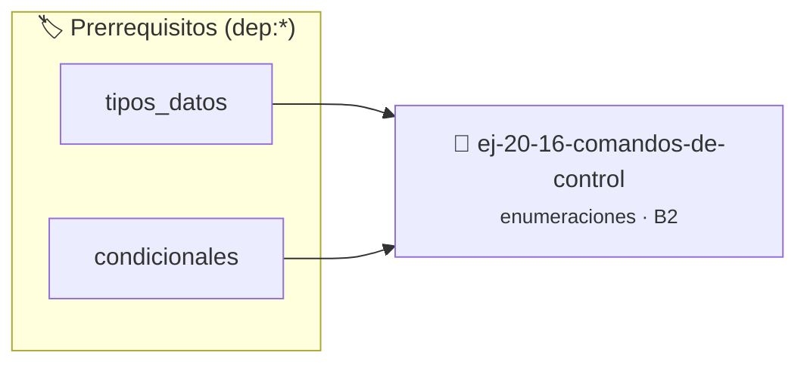

# Comandos de control
> **ID:** `ej-20-16-comandos-de-control`
 · **Tema:** `enumeraciones`
 · **Bloom:** B2 (Comprender)
 · **Carga:** ~15 min
>
> **🏷️ Prerrequisitos temáticos (tags):** `dep:tipos_datos`, `dep:condicionales`
>
> **Etiquetas conceptuales:** `control`, `tipos`, `comandos`, `memoria`, `enum`


::: {admonition} 📦 Paquete de Verificación Local (Ripley)
:class: tip

Para compilar, resolver y autoevaluar tu entrega con pruebas unitarias en tu máquina:

- [📥 **Descargar paquete `ej-20-16-comandos-de-control.ripkg`**](../../paquetes/ej-20-16-comandos-de-control.ripkg)

Ejecución con el asistente de cátedra:
```bash
ripley run ej-20-16-comandos-de-control.ripkg
```
:::


### 🗺️ Itinerario Pedagógico




## 📖 Consigna

### Ejercicio 20.16 - Comandos de control ⭐⭐☆☆☆

Implementar funciones para controlar el reproductor.


:::{hint} Lógica y Consideraciones

-   **[*plus ultra*]:** Implementar encapsulamiento completo manteniendo la
    definición interna oculta en el archivo `.c`.
-   **[*plus ultra*]:** Añadir una función de duplicación profunda (*deep copy*)
    para copiar la estructura de forma segura.

:::
<!-- {hint} Lógica y Consideraciones -->

``` c
void reproducir(reproductor_t *rep);
void pausar(reproductor_t *rep);
void detener(reproductor_t *rep);
void siguiente_pista(reproductor_t *rep);
void anterior_pista(reproductor_t *rep);
```
<!-- c -->

Las funciones deben respetar el estado actual y el modo de reproducción.

## Prioridades y Niveles de Log

Implementar un sistema de logging con niveles de prioridad.

```{code-block} c
:linenos:
enum nivel_log
{
    LOG_DEBUG = 0,
    LOG_INFO,
    LOG_WARNING,
    LOG_ERROR,
    LOG_FATAL
};
```
<!-- {code-block} c -->


## 📋 Prototipos y Cabecera (`ej-20-16-comandos-de-control.h`)

```{code-block} c
#ifndef EJERCICIO_EJ_20_16_COMANDOS_DE_CONTROL_H
#define EJERCICIO_EJ_20_16_COMANDOS_DE_CONTROL_H

#include <stddef.h>
#include <stdbool.h>
#include <stdint.h>

/* Procesa el flujo principal de Comandos de control */
int proc__comandos_de_control(int val);

#endif /* EJERCICIO_EJ_20_16_COMANDOS_DE_CONTROL_H */
```


## ⚙️ Especificación de Funciones

| Función | Retorno | Parámetros | Descripción |
| :--- | :--- | :--- | :--- |

| `proc__comandos_de_control` | `int` | `int val` | Procesa el flujo principal de Comandos de control |


## 💡 Pistas Progresivas

````{tab-set}

```{tab-item} Pista 1
[Plus Ultra] Implementar encapsulamiento completo manteniendo la definición interna oculta en el archivo `.c`.
```

```{tab-item} Pista 2
[Plus Ultra] Añadir una función de duplicación profunda (*deep copy*) para copiar la estructura de forma segura.
```

````


## 🧪 Casos de Prueba

| Prueba Unitaria | Función Objetivo | Verificación |
| :--- | :--- | :--- |

| **test_proc__comandos_de_control_positivo** | `proc__comandos_de_control` | `int res = proc__comandos_de_control(5); assert(res == 10 || res >= 0);` |

| **test_proc__comandos_de_control_cero** | `proc__comandos_de_control` | `int res = proc__comandos_de_control(0); assert(res == 0);` |


## ✓ Solución Modelo de Cátedra

```{dropdown} 🔍 Revelar solución canónica en C
:open: false

```{code-block} c
enum nivel_log
{
    LOG_DEBUG = 0,
    LOG_INFO,
    LOG_WARNING,
    LOG_ERROR,
    LOG_FATAL
};


int proc__comandos_de_control(int val)
{
    if (val <= 0) return 0;
    return val * 2;
}

int main(void)
{
    return 0;
}
```
```
