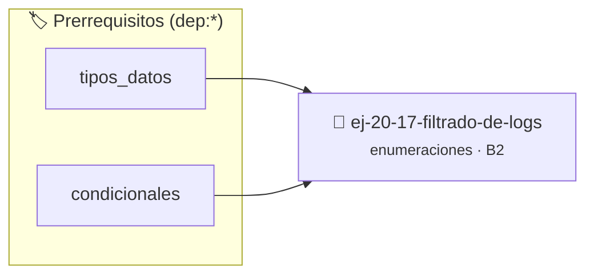

# Filtrado de logs
> **ID:** `ej-20-17-filtrado-de-logs` · **Unidad:** 2 (Tipos Compuestos y Direccionamiento)
 · **Tema:** `enumeraciones` / `registro_eventos`
 · **Bloom:** B2 (Comprender) · **Dificultad:** Inicial
 · **Carga:** ~15 min · **Tipo:** Practica Guiada
>
> **🏷️ Prerrequisitos temáticos (tags):** `dep:tipos_datos`, `dep:condicionales`
>
> **Etiquetas conceptuales:** `tipos`, `filtrado`, `enum`, `memoria`


::: {admonition} 📦 Paquete de Verificación Local (Ripley)
:class: tip

Para compilar, resolver y autoevaluar tu entrega con pruebas unitarias en tu máquina:

- [📥 **Descargar paquete `ej-20-17-filtrado-de-logs.ripkg`**](../../paquetes/ej-20-17-filtrado-de-logs.ripkg)

Ejecución con el asistente de cátedra:
```bash
ripley run ej-20-17-filtrado-de-logs.ripkg
```
:::


### 🗺️ Itinerario Pedagógico




## 📖 Consigna

### Ejercicio 20.17 - Filtrado de logs ⭐⭐☆☆☆

Implementar una función que determine si un mensaje debe ser registrado según el
nivel mínimo configurado.


:::{hint} Lógica y Consideraciones

-   **[*plus ultra*]:** Garantizar la terminación con `\0` y prevenir
    desbordamientos de búfer validando la capacidad máxima.
-   **[*plus ultra*]:** Soportar la lectura de cadenas con espacios y múltiples
    líneas de manera robusta.

:::
<!-- {hint} Lógica y Consideraciones -->

``` c
bool debe_registrar(enum nivel_log nivel_mensaje, enum nivel_log nivel_minimo);
```
<!-- c -->


## 📋 Prototipos y Cabecera (`ej-20-17-filtrado-de-logs.h`)

```{code-block} c
#ifndef EJERCICIO_EJ_20_17_FILTRADO_DE_LOGS_H
#define EJERCICIO_EJ_20_17_FILTRADO_DE_LOGS_H

#include <stddef.h>
#include <stdbool.h>
#include <stdint.h>

/* Procesa el flujo principal de Filtrado de logs */
int proc__17_filtrado_de_logs(int val);

#endif /* EJERCICIO_EJ_20_17_FILTRADO_DE_LOGS_H */
```


## ⚙️ Especificación de Funciones

| Función | Retorno | Parámetros | Descripción |
| :--- | :--- | :--- | :--- |

| `proc__17_filtrado_de_logs` | `int` | `int val` | Procesa el flujo principal de Filtrado de logs |


## 💡 Pistas Progresivas

````{tab-set}

```{tab-item} Pista 1
[Plus Ultra] Garantizar la terminación con `\0` y prevenir desbordamientos de búfer validando la capacidad máxima.
```

```{tab-item} Pista 2
[Plus Ultra] Soportar la lectura de cadenas con espacios y múltiples líneas de manera robusta.
```

````


## 🧪 Casos de Prueba

| Prueba Unitaria | Función Objetivo | Verificación |
| :--- | :--- | :--- |

| **test_proc__17_filtrado_de_logs_positivo** | `proc__17_filtrado_de_logs` | `int res = proc__17_filtrado_de_logs(5); assert(res == 10 || res >= 0);` |

| **test_proc__17_filtrado_de_logs_cero** | `proc__17_filtrado_de_logs` | `int res = proc__17_filtrado_de_logs(0); assert(res == 0);` |


## ✓ Solución Modelo de Cátedra

```{dropdown} 🔍 Revelar solución canónica en C
:open: false

```{code-block} c
/*
 * Ejercicio: Filtrado de logs
 * Cátedra Programación I - UNRN
 */

#include <stdio.h>


int proc__17_filtrado_de_logs(int val)
{
    if (val <= 0) return 0;
    return val * 2;
}

int main(void)
{
    /* TODO: Implementación de Filtrado de logs */
    return 0;
}
```
```
