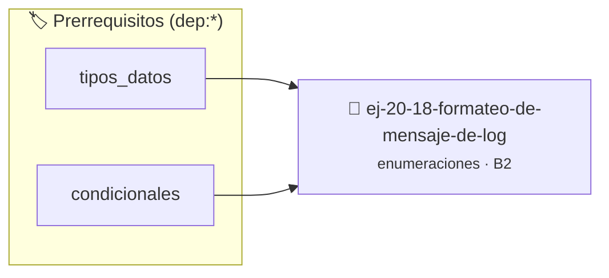

# Formateo de mensaje de log
> **ID:** `ej-20-18-formateo-de-mensaje-de-log` · **Unidad:** 2 (Tipos Compuestos y Direccionamiento)
 · **Tema:** `enumeraciones` / `registro_eventos`
 · **Bloom:** B2 (Comprender) · **Dificultad:** Inicial
 · **Carga:** ~15 min · **Tipo:** Practica Guiada
>
> **🏷️ Prerrequisitos temáticos (tags):** `dep:tipos_datos`, `dep:condicionales`
>
> **Etiquetas conceptuales:** `formateo`, `tipos`, `mensaje`, `memoria`, `enum`


::: {admonition} 📦 Paquete de Verificación Local (Ripley)
:class: tip

Para compilar, resolver y autoevaluar tu entrega con pruebas unitarias en tu máquina:

- [📥 **Descargar paquete `ej-20-18-formateo-de-mensaje-de-log.ripkg`**](../../paquetes/ej-20-18-formateo-de-mensaje-de-log.ripkg)

Ejecución con el asistente de cátedra:
```bash
ripley run ej-20-18-formateo-de-mensaje-de-log.ripkg
```
:::


### 🗺️ Itinerario Pedagógico




## 📖 Consigna

### Ejercicio 20.18 - Formateo de mensaje de log ⭐⭐☆☆☆

Implementar una función que formatee un mensaje de log incluyendo el nivel como
prefijo.


:::{hint} Lógica y Consideraciones

-   **[*plus ultra*]:** Garantizar la terminación con `\0` y prevenir
    desbordamientos de búfer validando la capacidad máxima.
-   **[*plus ultra*]:** Soportar la lectura de cadenas con espacios y múltiples
    líneas de manera robusta.

:::
<!-- {hint} Lógica y Consideraciones -->

``` c
void log_mensaje(enum nivel_log nivel, const char *mensaje);
```
<!-- c -->

Ejemplo de salida: `[ERROR] Archivo no encontrado`

## Protocolo de Comunicación

Diseñar estructuras para un protocolo simple de comunicación usando campos de
bits.

```{code-block} c
:linenos:
enum tipo_mensaje
{
    MSG_DATOS = 0,
    MSG_ACK = 1,
    MSG_NACK = 2,
    MSG_RESET = 3
};
typedef struct
{
    unsigned int tipo : 2;      // 2 bits para tipo (0-3)
    unsigned int prioridad : 2; // 2 bits para prioridad (0-3)
    unsigned int secuencia : 4; // 4 bits para número de secuencia (0-15)
} cabecera_mensaje_t;
```
<!-- {code-block} c -->


## 📋 Prototipos y Cabecera (`ej-20-18-formateo-de-mensaje-de-log.h`)

```{code-block} c
#ifndef EJERCICIO_EJ_20_18_FORMATEO_DE_MENSAJE_DE_LOG_H
#define EJERCICIO_EJ_20_18_FORMATEO_DE_MENSAJE_DE_LOG_H

#include <stddef.h>
#include <stdbool.h>
#include <stdint.h>

/* Procesa el flujo principal de Formateo de mensaje de log */
int proc_eo_de_mensaje_de_log(int val);

#endif /* EJERCICIO_EJ_20_18_FORMATEO_DE_MENSAJE_DE_LOG_H */
```


## ⚙️ Especificación de Funciones

| Función | Retorno | Parámetros | Descripción |
| :--- | :--- | :--- | :--- |

| `proc_eo_de_mensaje_de_log` | `int` | `int val` | Procesa el flujo principal de Formateo de mensaje de log |


## 💡 Pistas Progresivas

````{tab-set}

```{tab-item} Pista 1
[Plus Ultra] Garantizar la terminación con `\0` y prevenir desbordamientos de búfer validando la capacidad máxima.
```

```{tab-item} Pista 2
[Plus Ultra] Soportar la lectura de cadenas con espacios y múltiples líneas de manera robusta.
```

````


## 🧪 Casos de Prueba

| Prueba Unitaria | Función Objetivo | Verificación |
| :--- | :--- | :--- |

| **test_proc_eo_de_mensaje_de_log_positivo** | `proc_eo_de_mensaje_de_log` | `int res = proc_eo_de_mensaje_de_log(5); assert(res == 10 || res >= 0);` |

| **test_proc_eo_de_mensaje_de_log_cero** | `proc_eo_de_mensaje_de_log` | `int res = proc_eo_de_mensaje_de_log(0); assert(res == 0);` |


## ✓ Solución Modelo de Cátedra

```{dropdown} 🔍 Revelar solución canónica en C
:open: false

```{code-block} c
enum tipo_mensaje
{
    MSG_DATOS = 0,
    MSG_ACK = 1,
    MSG_NACK = 2,
    MSG_RESET = 3
};
typedef struct
{
    unsigned int tipo : 2;      // 2 bits para tipo (0-3)
    unsigned int prioridad : 2; // 2 bits para prioridad (0-3)
    unsigned int secuencia : 4; // 4 bits para número de secuencia (0-15)
} cabecera_mensaje_t;


int proc_eo_de_mensaje_de_log(int val)
{
    if (val <= 0) return 0;
    return val * 2;
}

int main(void)
{
    return 0;
}
```
```
