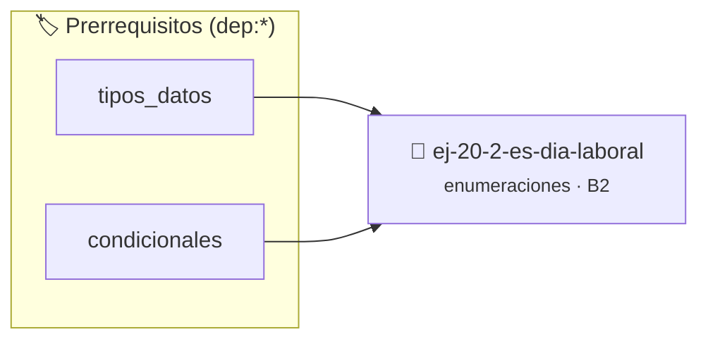

# Es día laboral
> **ID:** `ej-20-2-es-dia-laboral` · **Unidad:** 2 (Tipos Compuestos y Direccionamiento)
 · **Tema:** `enumeraciones` / `mapeo_estados`
 · **Bloom:** B2 (Comprender) · **Dificultad:** Inicial
 · **Carga:** ~15 min · **Tipo:** Practica Guiada
>
> **🏷️ Prerrequisitos temáticos (tags):** `dep:tipos_datos`, `dep:condicionales`
>
> **Etiquetas conceptuales:** `tipos`, `laboral`, `enum`, `memoria`


::: {admonition} 📦 Paquete de Verificación Local (Ripley)
:class: tip

Para compilar, resolver y autoevaluar tu entrega con pruebas unitarias en tu máquina:

- [📥 **Descargar paquete `ej-20-2-es-dia-laboral.ripkg`**](../../paquetes/ej-20-2-es-dia-laboral.ripkg)

Ejecución con el asistente de cátedra:
```bash
ripley run ej-20-2-es-dia-laboral.ripkg
```
:::


### 🗺️ Itinerario Pedagógico




## 📖 Consigna

### Ejercicio 20.2 - Es día laboral ⭐⭐☆☆☆

Implementar una función que determine si un día es laboral (lunes a viernes).


:::{hint} Lógica y Consideraciones

-   **[*plus ultra*]:** Diseñar la función para devolver un código de estado de
    error e informar el resultado mediante parámetros de salida.
-   **[*plus ultra*]:** Documentar la función con etiquetas Doxygen
    especificando precondiciones y postcondiciones.

:::
<!-- {hint} Lógica y Consideraciones -->

``` c
bool es_dia_laboral(enum dia_semana dia);
```
<!-- c -->


## 📋 Prototipos y Cabecera (`ej-20-2-es-dia-laboral.h`)

```{code-block} c
#ifndef EJERCICIO_EJ_20_2_ES_DIA_LABORAL_H
#define EJERCICIO_EJ_20_2_ES_DIA_LABORAL_H

#include <stddef.h>
#include <stdbool.h>
#include <stdint.h>

/* Procesa el flujo principal de Es día laboral */
int proc__20_2_es_dia_laboral(int val);

#endif /* EJERCICIO_EJ_20_2_ES_DIA_LABORAL_H */
```


## ⚙️ Especificación de Funciones

| Función | Retorno | Parámetros | Descripción |
| :--- | :--- | :--- | :--- |

| `proc__20_2_es_dia_laboral` | `int` | `int val` | Procesa el flujo principal de Es día laboral |


## 💡 Pistas Progresivas

````{tab-set}

```{tab-item} Pista 1
[Plus Ultra] Diseñar la función para devolver un código de estado de error e informar el resultado mediante parámetros de salida.
```

```{tab-item} Pista 2
[Plus Ultra] Documentar la función con etiquetas Doxygen especificando precondiciones y postcondiciones.
```

````


## 🧪 Casos de Prueba

| Prueba Unitaria | Función Objetivo | Verificación |
| :--- | :--- | :--- |

| **test_proc__20_2_es_dia_laboral_positivo** | `proc__20_2_es_dia_laboral` | `int res = proc__20_2_es_dia_laboral(5); assert(res == 10 || res >= 0);` |

| **test_proc__20_2_es_dia_laboral_cero** | `proc__20_2_es_dia_laboral` | `int res = proc__20_2_es_dia_laboral(0); assert(res == 0);` |


## ✓ Solución Modelo de Cátedra

```{dropdown} 🔍 Revelar solución canónica en C
:open: false

```{code-block} c
/*
 * Ejercicio: Es día laboral
 * Cátedra Programación I - UNRN
 */

#include <stdio.h>


int proc__20_2_es_dia_laboral(int val)
{
    if (val <= 0) return 0;
    return val * 2;
}

int main(void)
{
    /* TODO: Implementación de Es día laboral */
    return 0;
}
```
```
