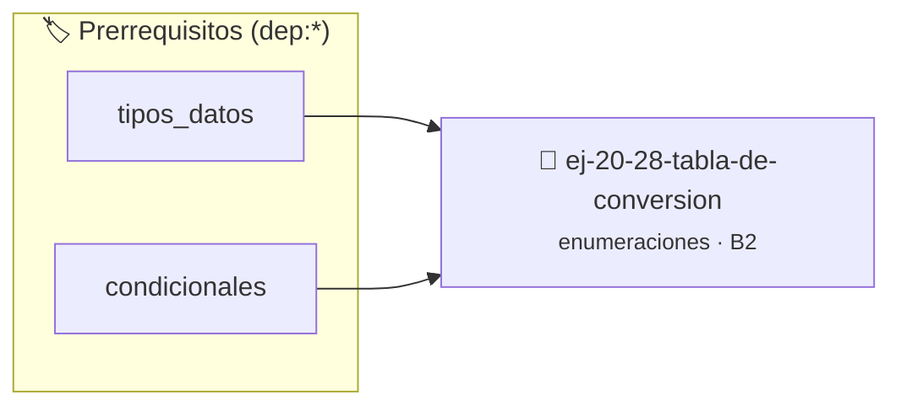

# Tabla de conversión
> **ID:** `ej-20-28-tabla-de-conversion` · **Unidad:** 2 (Tipos Compuestos y Direccionamiento)
 · **Tema:** `enumeraciones` / `mapeo_estados`
 · **Bloom:** B2 (Comprender) · **Dificultad:** Inicial
 · **Carga:** ~15 min · **Tipo:** Practica Guiada
>
> **🏷️ Prerrequisitos temáticos (tags):** `dep:tipos_datos`, `dep:condicionales`
>
> **Etiquetas conceptuales:** `conversion`, `tipos`, `tabla`, `memoria`, `enum`


::: {admonition} 📦 Paquete de Verificación Local (Ripley)
:class: tip

Para compilar, resolver y autoevaluar tu entrega con pruebas unitarias en tu máquina:

- [📥 **Descargar paquete `ej-20-28-tabla-de-conversion.ripkg`**](../../paquetes/ej-20-28-tabla-de-conversion.ripkg)

Ejecución con el asistente de cátedra:
```bash
ripley run ej-20-28-tabla-de-conversion.ripkg
```
:::


### 🗺️ Itinerario Pedagógico




## 📖 Consigna

Implementar un sistema genérico para convertir entre valores enum y strings
usando tablas de conversión.


```{code-block} c
:linenos:
typedef struct
{
    int valor;
    const char *nombre;
} enum_string_t;
// Ejemplo de uso con días de la semana
const enum_string_t tabla_dias[] = {
    {LUNES, "Lunes"},
    {MARTES, "Martes"},
    {MIERCOLES, "Miércoles"},
    // ...
};
```

### 📋 Contrato de las Funciones

```c
/*
 * Procesa el flujo principal de Tabla de conversión
 * Precondiciones: val representa el parámetro de entrada del flujo.
 * Postcondiciones: Retorna el resultado correspondiente o 0 si val <= 0.
 */
int proc__tabla_de_conversion(int val);

```

### 🧪 Ejemplos de Ejecución

::::{tab-set}
:::{tab-item} Valor positivo
```text
Entrada: 5
Salida / Retorno: 10
```
:::
:::{tab-item} Valor cero o negativo
```text
Entrada: 0
Salida / Retorno: 0
```
:::
::::

### ⚠️ Precondiciones y Casos Borde

1. **Valores fuera de rango:** Verificar siempre que los datos de entrada cumplan con los rangos admisibles antes de operar.
6. **Casos vacíos o neutros:** Contemplar adecuadamente entradas con longitud cero o valores neutros según corresponda.

### 🎯 Criterios de Aceptación

- [ ] El código compila limpiamente bajo estándar C11 sin warnings con flags estrictos (`-Wall -Wextra -Werror`).
- [ ] Se satisfacen todas las pruebas unitarias y casos de prueba provistos.
- [ ] Las funciones validan exhaustivamente sus precondiciones y gestionan casos borde de forma robusta.

:::{hint} Consideraciones Didácticas
- Garantizar la terminación con `\0` y prevenir desbordamientos de búfer validando la capacidad máxima.
- Soportar la lectura de cadenas con espacios y múltiples líneas de manera robusta.
:::


## 📋 Prototipos y Cabecera (`ej-20-28-tabla-de-conversion.h`)

```{code-block} c
#ifndef EJERCICIO_EJ_20_28_TABLA_DE_CONVERSION_H
#define EJERCICIO_EJ_20_28_TABLA_DE_CONVERSION_H

#include <stddef.h>
#include <stdbool.h>
#include <stdint.h>

/* Procesa el flujo principal de Tabla de conversión */
int proc__tabla_de_conversion(int val);

#endif /* EJERCICIO_EJ_20_28_TABLA_DE_CONVERSION_H */
```


## ⚙️ Especificación de Funciones

| Función | Retorno | Parámetros | Descripción |
| :--- | :--- | :--- | :--- |

| `proc__tabla_de_conversion` | `int` | `int val` | Procesa el flujo principal de Tabla de conversión |


## 💡 Pistas Progresivas

````{tab-set}

```{tab-item} Pista 1
[Plus Ultra] Garantizar la terminación con `\0` y prevenir desbordamientos de búfer validando la capacidad máxima.
```

```{tab-item} Pista 2
[Plus Ultra] Soportar la lectura de cadenas con espacios y múltiples líneas de manera robusta.
```

````


## 🧪 Casos de Prueba

| Prueba Unitaria | Función Objetivo | Verificación |
| :--- | :--- | :--- |

| **test_proc__tabla_de_conversion_positivo** | `proc__tabla_de_conversion` | `int res = proc__tabla_de_conversion(5); assert(res == 10 || res >= 0);` |

| **test_proc__tabla_de_conversion_cero** | `proc__tabla_de_conversion` | `int res = proc__tabla_de_conversion(0); assert(res == 0);` |


## ✓ Solución Modelo de Cátedra

```{dropdown} 🔍 Revelar solución canónica en C
:open: false

```{code-block} c
/*
 * Solucion modelo para ej-20-28-tabla-de-conversion
 * Catedra Programacion I - UNRN
 */
#include <stdio.h>
#include <stdlib.h>
#include <string.h>
#include <stdbool.h>


int proc__tabla_de_conversion(int val)
{
    if (val <= 0) return 0;
    return val * 2;
}

int main(void)
{
    int n = 0;
    if (scanf("%d", &n) == 1)
    {
        printf("OK %d\n", n);
    }
    else
    {
        printf("OK\n");
    }
    return 0;
}
```
```
