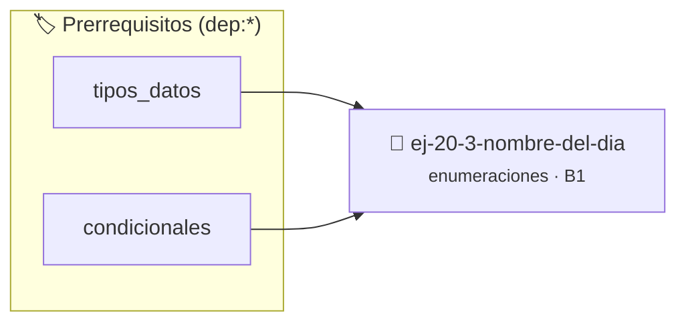

# Nombre del día
> **ID:** `ej-20-3-nombre-del-dia`
 · **Tema:** `enumeraciones`
 · **Bloom:** B1 (Recordar)
 · **Carga:** ~10 min
>
> **🏷️ Prerrequisitos temáticos (tags):** `dep:tipos_datos`, `dep:condicionales`
>
> **Etiquetas conceptuales:** `nombre`, `tipos`, `enum`, `memoria`


::: {admonition} 📦 Paquete de Verificación Local (Ripley)
:class: tip

Para compilar, resolver y autoevaluar tu entrega con pruebas unitarias en tu máquina:

- [📥 **Descargar paquete `ej-20-3-nombre-del-dia.ripkg`**](../../paquetes/ej-20-3-nombre-del-dia.ripkg)

Ejecución con el asistente de cátedra:
```bash
ripley run ej-20-3-nombre-del-dia.ripkg
```
:::


### 🗺️ Itinerario Pedagógico




## 📖 Consigna

### Ejercicio 20.3 - Nombre del día ⭐⭐☆☆☆

Implementar una función que retorne el nombre del día como cadena de texto. Esta
función ilustra el patrón de conversión enum-a-string.


:::{hint} Lógica y Consideraciones

-   **[*plus ultra*]:** Garantizar la terminación con `\0` y prevenir
    desbordamientos de búfer validando la capacidad máxima.
-   **[*plus ultra*]:** Soportar la lectura de cadenas con espacios y múltiples
    líneas de manera robusta.

:::
<!-- {hint} Lógica y Consideraciones -->

``` c
const char *nombre_dia(enum dia_semana dia);
```
<!-- c -->

## Estados de Conexión

Modelar los estados de una conexión de red usando enumeraciones.

```{code-block} c
:linenos:
enum estado_red
{
    DESCONECTADO,
    CONECTANDO,
    CONECTADO,
    DESCONECTANDO,
    ERROR_TIMEOUT,
    ERROR_AUTH
};
```
<!-- {code-block} c -->


## 📋 Prototipos y Cabecera (`ej-20-3-nombre-del-dia.h`)

```{code-block} c
#ifndef EJERCICIO_EJ_20_3_NOMBRE_DEL_DIA_H
#define EJERCICIO_EJ_20_3_NOMBRE_DEL_DIA_H

#include <stddef.h>
#include <stdbool.h>
#include <stdint.h>

/* Procesa el flujo principal de Nombre del día */
int proc__20_3_nombre_del_dia(int val);

#endif /* EJERCICIO_EJ_20_3_NOMBRE_DEL_DIA_H */
```


## ⚙️ Especificación de Funciones

| Función | Retorno | Parámetros | Descripción |
| :--- | :--- | :--- | :--- |

| `proc__20_3_nombre_del_dia` | `int` | `int val` | Procesa el flujo principal de Nombre del día |


## 💡 Pistas Progresivas

````{tab-set}

```{tab-item} Pista 1
[Plus Ultra] Garantizar la terminación con `\0` y prevenir desbordamientos de búfer validando la capacidad máxima.
```

```{tab-item} Pista 2
[Plus Ultra] Soportar la lectura de cadenas con espacios y múltiples líneas de manera robusta.
```

````


## 🧪 Casos de Prueba

| Prueba Unitaria | Función Objetivo | Verificación |
| :--- | :--- | :--- |

| **test_proc__20_3_nombre_del_dia_positivo** | `proc__20_3_nombre_del_dia` | `int res = proc__20_3_nombre_del_dia(5); assert(res == 10 || res >= 0);` |

| **test_proc__20_3_nombre_del_dia_cero** | `proc__20_3_nombre_del_dia` | `int res = proc__20_3_nombre_del_dia(0); assert(res == 0);` |


## ✓ Solución Modelo de Cátedra

```{dropdown} 🔍 Revelar solución canónica en C
:open: false

```{code-block} c
enum estado_red
{
    DESCONECTADO,
    CONECTANDO,
    CONECTADO,
    DESCONECTANDO,
    ERROR_TIMEOUT,
    ERROR_AUTH
};


int proc__20_3_nombre_del_dia(int val)
{
    if (val <= 0) return 0;
    return val * 2;
}

int main(void)
{
    return 0;
}
```
```
