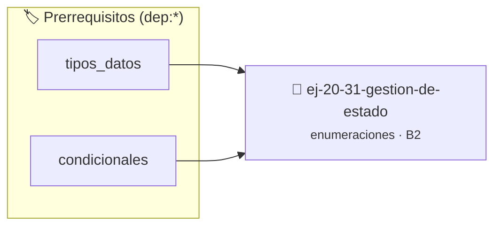

# Gestión de estado
> **ID:** `ej-20-31-gestion-de-estado`
 · **Tema:** `enumeraciones`
 · **Bloom:** B2 (Comprender)
 · **Carga:** ~15 min
>
> **🏷️ Prerrequisitos temáticos (tags):** `dep:tipos_datos`, `dep:condicionales`
>
> **Etiquetas conceptuales:** `tipos`, `memoria`, `gestion`, `enum`, `estado`


::: {admonition} 📦 Paquete de Verificación Local (Ripley)
:class: tip

Para compilar, resolver y autoevaluar tu entrega con pruebas unitarias en tu máquina:

- [📥 **Descargar paquete `ej-20-31-gestion-de-estado.ripkg`**](../../paquetes/ej-20-31-gestion-de-estado.ripkg)

Ejecución con el asistente de cátedra:
```bash
ripley run ej-20-31-gestion-de-estado.ripkg
```
:::


### 🗺️ Itinerario Pedagógico




## 📖 Consigna

### Ejercicio 20.31 - Gestión de estado ⭐⭐⭐☆☆

Implementar funciones para transiciones de estado comunes.


:::{hint} Lógica y Consideraciones

-   **[*plus ultra*]:** Garantizar la terminación con `\0` y prevenir
    desbordamientos de búfer validando la capacidad máxima.
-   **[*plus ultra*]:** Soportar la lectura de cadenas con espacios y múltiples
    líneas de manera robusta.

:::
<!-- {hint} Lógica y Consideraciones -->

``` c
void pausar_juego(juego_t *juego);
void reanudar_juego(juego_t *juego);
void perder_vida(juego_t *juego);
void ganar_nivel(juego_t *juego);
```
<!-- c -->

## Análisis de Tráfico con Enums Aninados

Modelar un sistema de análisis de tráfico de red con múltiples niveles de
clasificación.

```{code-block} c
:linenos:
enum protocolo
{
    PROTOCOLO_TCP,
    PROTOCOLO_UDP,
    PROTOCOLO_ICMP,
    PROTOCOLO_OTRO
};
enum tipo_trafico
{
    TRAFICO_NORMAL,
    TRAFICO_SOSPECHOSO,
    TRAFICO_MALICIOSO
};
typedef struct
{
    enum protocolo proto;
    enum tipo_trafico tipo;
    unsigned int puerto_origen;
    unsigned int puerto_destino;
    size_t bytes_transferidos;
} paquete_red_t;
```
<!-- {code-block} c -->


## 📋 Prototipos y Cabecera (`ej-20-31-gestion-de-estado.h`)

```{code-block} c
#ifndef EJERCICIO_EJ_20_31_GESTION_DE_ESTADO_H
#define EJERCICIO_EJ_20_31_GESTION_DE_ESTADO_H

#include <stddef.h>
#include <stdbool.h>
#include <stdint.h>

/* Procesa el flujo principal de Gestión de estado */
int proc_31_gestion_de_estado(int val);

#endif /* EJERCICIO_EJ_20_31_GESTION_DE_ESTADO_H */
```


## ⚙️ Especificación de Funciones

| Función | Retorno | Parámetros | Descripción |
| :--- | :--- | :--- | :--- |

| `proc_31_gestion_de_estado` | `int` | `int val` | Procesa el flujo principal de Gestión de estado |


## 💡 Pistas Progresivas

````{tab-set}

```{tab-item} Pista 1
[Plus Ultra] Garantizar la terminación con `\0` y prevenir desbordamientos de búfer validando la capacidad máxima.
```

```{tab-item} Pista 2
[Plus Ultra] Soportar la lectura de cadenas con espacios y múltiples líneas de manera robusta.
```

````


## 🧪 Casos de Prueba

| Prueba Unitaria | Función Objetivo | Verificación |
| :--- | :--- | :--- |

| **test_proc_31_gestion_de_estado_positivo** | `proc_31_gestion_de_estado` | `int res = proc_31_gestion_de_estado(5); assert(res == 10 || res >= 0);` |

| **test_proc_31_gestion_de_estado_cero** | `proc_31_gestion_de_estado` | `int res = proc_31_gestion_de_estado(0); assert(res == 0);` |


## ✓ Solución Modelo de Cátedra

```{dropdown} 🔍 Revelar solución canónica en C
:open: false

```{code-block} c
/*
 * Solucion modelo para ej-20-31-gestion-de-estado
 * Catedra Programacion I - UNRN
 */
#include <stdio.h>
#include <stdlib.h>
#include <string.h>
#include <stdbool.h>


int proc_31_gestion_de_estado(int val)
{
    if (val <= 0) return 0;
    return val * 2;
}

int main(void)
{
    int n = 0;
    if (scanf("%d", &n) == 1)
    {
        printf("OK %d\n", n);
    }
    else
    {
        printf("OK\n");
    }
    return 0;
}
```
```
