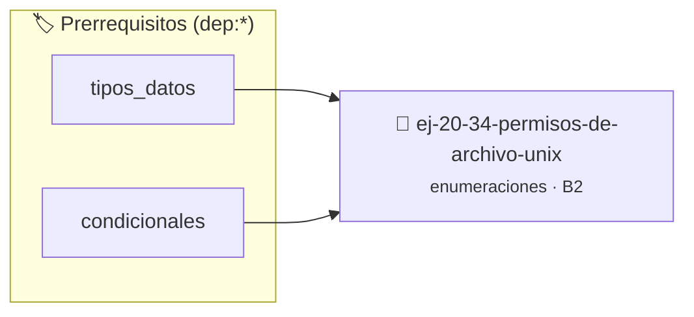

# Permisos de archivo (UNIX)
> **ID:** `ej-20-34-permisos-de-archivo-unix` · **Unidad:** 2 (Tipos Compuestos y Direccionamiento)
 · **Tema:** `enumeraciones` / `archivo`
 · **Bloom:** B2 (Comprender) · **Dificultad:** Inicial
 · **Carga:** ~15 min · **Tipo:** Practica Guiada
>
> **🏷️ Prerrequisitos temáticos (tags):** `dep:tipos_datos`, `dep:condicionales`
>
> **Etiquetas conceptuales:** `archivo`, `tipos`, `permisos`, `unix`, `memoria`


::: {admonition} 📦 Paquete de Verificación Local (Ripley)
:class: tip

Para compilar, resolver y autoevaluar tu entrega con pruebas unitarias en tu máquina:

- [📥 **Descargar paquete `ej-20-34-permisos-de-archivo-unix.ripkg`**](../../paquetes/ej-20-34-permisos-de-archivo-unix.ripkg)

Ejecución con el asistente de cátedra:
```bash
ripley run ej-20-34-permisos-de-archivo-unix.ripkg
```
:::


### 🗺️ Itinerario Pedagógico




## 📖 Consigna

### Ejercicio 20.34 - Permisos de archivo (UNIX) ⭐⭐☆☆☆

Modelar permisos de archivo estilo UNIX usando flags.


:::{hint} Lógica y Consideraciones

-   **[*plus ultra*]:** Garantizar la terminación con `\0` y prevenir
    desbordamientos de búfer validando la capacidad máxima.
-   **[*plus ultra*]:** Soportar la lectura de cadenas con espacios y múltiples
    líneas de manera robusta.

:::
<!-- {hint} Lógica y Consideraciones -->

```{code-block} c
:linenos:
enum permiso_unix
{
    OWNER_READ = 0400, // 0100000000 en octal
    OWNER_WRITE = 0200,
    OWNER_EXECUTE = 0100,
    GROUP_READ = 0040,
    GROUP_WRITE = 0020,
    GROUP_EXECUTE = 0010,
    OTHER_READ = 0004,
    OTHER_WRITE = 0002,
    OTHER_EXECUTE = 0001
};
```
<!-- {code-block} c -->

Implementar funciones para manipular permisos:

``` c
bool tiene_permiso_unix(unsigned int permisos, enum permiso_unix permiso);
unsigned int agregar_permiso_unix(unsigned int permisos,
                                  enum permiso_unix nuevo);
void mostrar_permisos_unix(unsigned int permisos); // Formato: rwxr-xr--
```
<!-- c -->


## 📋 Prototipos y Cabecera (`ej-20-34-permisos-de-archivo-unix.h`)

```{code-block} c
#ifndef EJERCICIO_EJ_20_34_PERMISOS_DE_ARCHIVO_UNIX_H
#define EJERCICIO_EJ_20_34_PERMISOS_DE_ARCHIVO_UNIX_H

#include <stddef.h>
#include <stdbool.h>
#include <stdint.h>

/* Procesa el flujo principal de Permisos de archivo (UNIX) */
int proc_isos_de_archivo_unix(int val);

#endif /* EJERCICIO_EJ_20_34_PERMISOS_DE_ARCHIVO_UNIX_H */
```


## ⚙️ Especificación de Funciones

| Función | Retorno | Parámetros | Descripción |
| :--- | :--- | :--- | :--- |

| `proc_isos_de_archivo_unix` | `int` | `int val` | Procesa el flujo principal de Permisos de archivo (UNIX) |


## 💡 Pistas Progresivas

````{tab-set}

```{tab-item} Pista 1
[Plus Ultra] Garantizar la terminación con `\0` y prevenir desbordamientos de búfer validando la capacidad máxima.
```

```{tab-item} Pista 2
[Plus Ultra] Soportar la lectura de cadenas con espacios y múltiples líneas de manera robusta.
```

````


## 🧪 Casos de Prueba

| Prueba Unitaria | Función Objetivo | Verificación |
| :--- | :--- | :--- |

| **test_proc_isos_de_archivo_unix_positivo** | `proc_isos_de_archivo_unix` | `int res = proc_isos_de_archivo_unix(5); assert(res == 10 || res >= 0);` |

| **test_proc_isos_de_archivo_unix_cero** | `proc_isos_de_archivo_unix` | `int res = proc_isos_de_archivo_unix(0); assert(res == 0);` |


## ✓ Solución Modelo de Cátedra

```{dropdown} 🔍 Revelar solución canónica en C
:open: false

```{code-block} c
enum permiso_unix
{
    OWNER_READ = 0400, // 0100000000 en octal
    OWNER_WRITE = 0200,
    OWNER_EXECUTE = 0100,
    GROUP_READ = 0040,
    GROUP_WRITE = 0020,
    GROUP_EXECUTE = 0010,
    OTHER_READ = 0004,
    OTHER_WRITE = 0002,
    OTHER_EXECUTE = 0001
};


int proc_isos_de_archivo_unix(int val)
{
    if (val <= 0) return 0;
    return val * 2;
}

int main(void)
{
    return 0;
}
```
```
