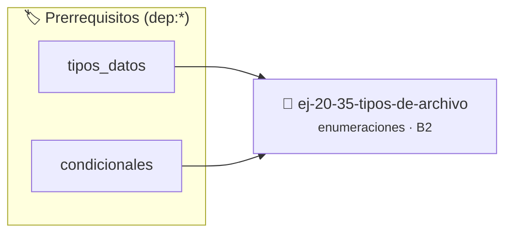

# Tipos de archivo
> **ID:** `ej-20-35-tipos-de-archivo`
 · **Tema:** `enumeraciones`
 · **Bloom:** B2 (Comprender)
 · **Carga:** ~15 min
>
> **🏷️ Prerrequisitos temáticos (tags):** `dep:tipos_datos`, `dep:condicionales`
>
> **Etiquetas conceptuales:** `archivo`, `tipos`, `enum`, `memoria`


::: {admonition} 📦 Paquete de Verificación Local (Ripley)
:class: tip

Para compilar, resolver y autoevaluar tu entrega con pruebas unitarias en tu máquina:

- [📥 **Descargar paquete `ej-20-35-tipos-de-archivo.ripkg`**](../../paquetes/ej-20-35-tipos-de-archivo.ripkg)

Ejecución con el asistente de cátedra:
```bash
ripley run ej-20-35-tipos-de-archivo.ripkg
```
:::


### 🗺️ Itinerario Pedagógico




## 📖 Consigna

### Ejercicio 20.35 - Tipos de archivo ⭐⭐☆☆☆

Modelar diferentes tipos de archivo en un sistema de archivos.


:::{hint} Lógica y Consideraciones

-   **[*plus ultra*]:** Garantizar la terminación con `\0` y prevenir
    desbordamientos de búfer validando la capacidad máxima.
-   **[*plus ultra*]:** Soportar la lectura de cadenas con espacios y múltiples
    líneas de manera robusta.

:::
<!-- {hint} Lógica y Consideraciones -->

```{code-block} c
:linenos:
enum tipo_archivo
{
    TIPO_REGULAR,
    TIPO_DIRECTORIO,
    TIPO_ENLACE_SIMBOLICO,
    TIPO_ENLACE_DURO,
    TIPO_DISPOSITIVO,
    TIPO_PIPE,
    TIPO_SOCKET
};
typedef struct
{
    char nombre[256];
    enum tipo_archivo tipo;
    size_t tamanio;
    unsigned int permisos;
} archivo_info_t;
```
<!-- {code-block} c -->

## Sistema de Eventos


## 📋 Prototipos y Cabecera (`ej-20-35-tipos-de-archivo.h`)

```{code-block} c
#ifndef EJERCICIO_EJ_20_35_TIPOS_DE_ARCHIVO_H
#define EJERCICIO_EJ_20_35_TIPOS_DE_ARCHIVO_H

#include <stddef.h>
#include <stdbool.h>
#include <stdint.h>

/* Procesa el flujo principal de Tipos de archivo */
int proc__35_tipos_de_archivo(int val);

#endif /* EJERCICIO_EJ_20_35_TIPOS_DE_ARCHIVO_H */
```


## ⚙️ Especificación de Funciones

| Función | Retorno | Parámetros | Descripción |
| :--- | :--- | :--- | :--- |

| `proc__35_tipos_de_archivo` | `int` | `int val` | Procesa el flujo principal de Tipos de archivo |


## 💡 Pistas Progresivas

````{tab-set}

```{tab-item} Pista 1
[Plus Ultra] Garantizar la terminación con `\0` y prevenir desbordamientos de búfer validando la capacidad máxima.
```

```{tab-item} Pista 2
[Plus Ultra] Soportar la lectura de cadenas con espacios y múltiples líneas de manera robusta.
```

````


## 🧪 Casos de Prueba

| Prueba Unitaria | Función Objetivo | Verificación |
| :--- | :--- | :--- |

| **test_proc__35_tipos_de_archivo_positivo** | `proc__35_tipos_de_archivo` | `int res = proc__35_tipos_de_archivo(5); assert(res == 10 || res >= 0);` |

| **test_proc__35_tipos_de_archivo_cero** | `proc__35_tipos_de_archivo` | `int res = proc__35_tipos_de_archivo(0); assert(res == 0);` |


## ✓ Solución Modelo de Cátedra

```{dropdown} 🔍 Revelar solución canónica en C
:open: false

```{code-block} c
/*
 * Solucion modelo para ej-20-35-tipos-de-archivo
 * Catedra Programacion I - UNRN
 */
#include <stdio.h>
#include <stdlib.h>
#include <string.h>
#include <stdbool.h>


int proc__35_tipos_de_archivo(int val)
{
    if (val <= 0) return 0;
    return val * 2;
}

int main(void)
{
    int n = 0;
    if (scanf("%d", &n) == 1)
    {
        printf("OK %d\n", n);
    }
    else
    {
        printf("OK\n");
    }
    return 0;
}
```
```
