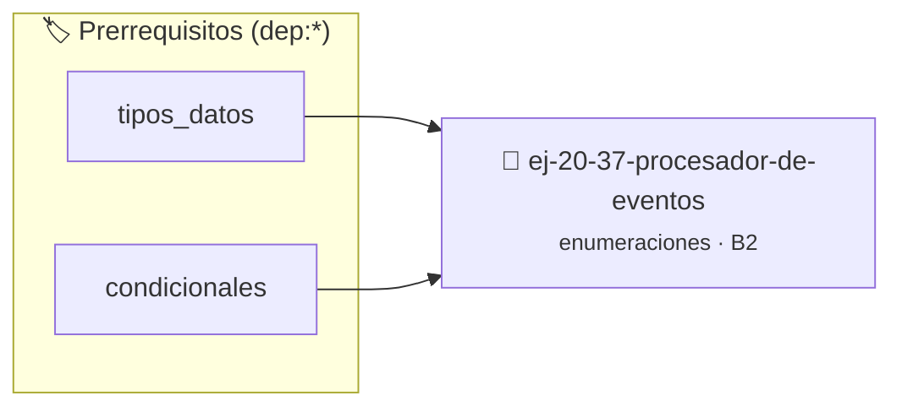

# Procesador de eventos
> **ID:** `ej-20-37-procesador-de-eventos` · **Unidad:** 2 (Tipos Compuestos y Direccionamiento)
 · **Tema:** `enumeraciones` / `mapeo_estados`
 · **Bloom:** B2 (Comprender) · **Dificultad:** Inicial
 · **Carga:** ~15 min · **Tipo:** Practica Guiada
>
> **🏷️ Prerrequisitos temáticos (tags):** `dep:tipos_datos`, `dep:condicionales`
>
> **Etiquetas conceptuales:** `tipos`, `memoria`, `eventos`, `enum`, `procesador`


::: {admonition} 📦 Paquete de Verificación Local (Ripley)
:class: tip

Para compilar, resolver y autoevaluar tu entrega con pruebas unitarias en tu máquina:

- [📥 **Descargar paquete `ej-20-37-procesador-de-eventos.ripkg`**](../../paquetes/ej-20-37-procesador-de-eventos.ripkg)

Ejecución con el asistente de cátedra:
```bash
ripley run ej-20-37-procesador-de-eventos.ripkg
```
:::


### 🗺️ Itinerario Pedagógico




## 📖 Consigna

### Ejercicio 20.37 - Procesador de eventos ⭐⭐☆☆☆

Implementar un procesador que maneje diferentes tipos de eventos.


:::{hint} Lógica y Consideraciones

-   **[*plus ultra*]:** Implementar encapsulamiento completo manteniendo la
    definición interna oculta en el archivo `.c`.
-   **[*plus ultra*]:** Añadir una función de duplicación profunda (*deep copy*)
    para copiar la estructura de forma segura.

:::
<!-- {hint} Lógica y Consideraciones -->

``` c
void procesar_evento(const evento_t *evento);
```
<!-- c -->

## Estados de Procesos (Sistema Operativo)


## 📋 Prototipos y Cabecera (`ej-20-37-procesador-de-eventos.h`)

```{code-block} c
#ifndef EJERCICIO_EJ_20_37_PROCESADOR_DE_EVENTOS_H
#define EJERCICIO_EJ_20_37_PROCESADOR_DE_EVENTOS_H

#include <stddef.h>
#include <stdbool.h>
#include <stdint.h>

/* Procesa el flujo principal de Procesador de eventos */
int proc_rocesador_de_eventos(int val);

#endif /* EJERCICIO_EJ_20_37_PROCESADOR_DE_EVENTOS_H */
```


## ⚙️ Especificación de Funciones

| Función | Retorno | Parámetros | Descripción |
| :--- | :--- | :--- | :--- |

| `proc_rocesador_de_eventos` | `int` | `int val` | Procesa el flujo principal de Procesador de eventos |


## 💡 Pistas Progresivas

````{tab-set}

```{tab-item} Pista 1
[Plus Ultra] Implementar encapsulamiento completo manteniendo la definición interna oculta en el archivo `.c`.
```

```{tab-item} Pista 2
[Plus Ultra] Añadir una función de duplicación profunda (*deep copy*) para copiar la estructura de forma segura.
```

````


## 🧪 Casos de Prueba

| Prueba Unitaria | Función Objetivo | Verificación |
| :--- | :--- | :--- |

| **test_proc_rocesador_de_eventos_positivo** | `proc_rocesador_de_eventos` | `int res = proc_rocesador_de_eventos(5); assert(res == 10 || res >= 0);` |

| **test_proc_rocesador_de_eventos_cero** | `proc_rocesador_de_eventos` | `int res = proc_rocesador_de_eventos(0); assert(res == 0);` |


## ✓ Solución Modelo de Cátedra

```{dropdown} 🔍 Revelar solución canónica en C
:open: false

```{code-block} c
/*
 * Ejercicio: Procesador de eventos
 * Cátedra Programación I - UNRN
 */

#include <stdio.h>


int proc_rocesador_de_eventos(int val)
{
    if (val <= 0) return 0;
    return val * 2;
}

int main(void)
{
    /* TODO: Implementación de Procesador de eventos */
    return 0;
}
```
```
