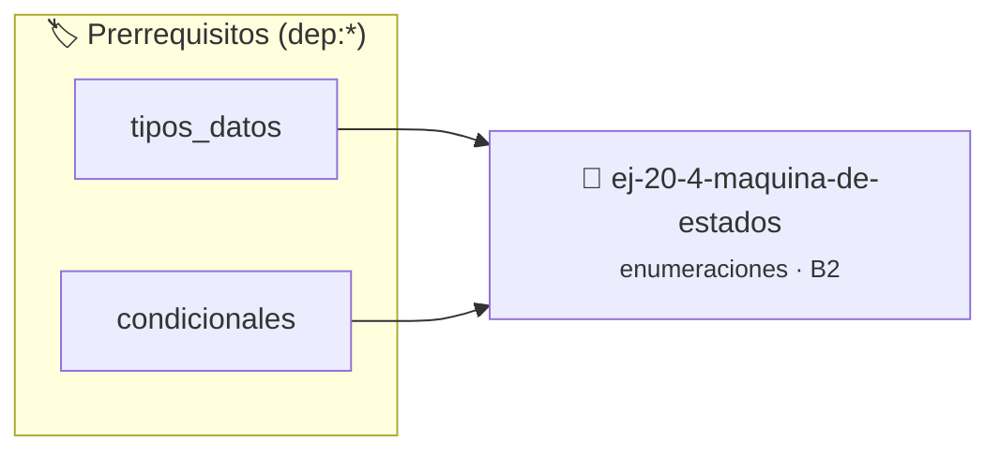

# Máquina de estados
> **ID:** `ej-20-4-maquina-de-estados` · **Unidad:** 2 (Tipos Compuestos y Direccionamiento)
 · **Tema:** `enumeraciones` / `mapeo_estados`
 · **Bloom:** B2 (Comprender) · **Dificultad:** Inicial
 · **Carga:** ~15 min · **Tipo:** Practica Guiada
>
> **🏷️ Prerrequisitos temáticos (tags):** `dep:tipos_datos`, `dep:condicionales`
>
> **Etiquetas conceptuales:** `maquina`, `tipos`, `memoria`, `enum`, `estados`


::: {admonition} 📦 Paquete de Verificación Local (Ripley)
:class: tip

Para compilar, resolver y autoevaluar tu entrega con pruebas unitarias en tu máquina:

- [📥 **Descargar paquete `ej-20-4-maquina-de-estados.ripkg`**](../../paquetes/ej-20-4-maquina-de-estados.ripkg)

Ejecución con el asistente de cátedra:
```bash
ripley run ej-20-4-maquina-de-estados.ripkg
```
:::


### 🗺️ Itinerario Pedagógico




## 📖 Consigna

### Ejercicio 20.4 - Máquina de estados ⭐⭐⭐☆☆

Implementar una función que procese transiciones de estado. La función debe
recibir el estado actual y un evento, y retornar el nuevo estado según las
reglas de transición.


:::{hint} Lógica y Consideraciones

-   **[*plus ultra*]:** Implementar encapsulamiento completo manteniendo la
    definición interna oculta en el archivo `.c`.
-   **[*plus ultra*]:** Añadir una función de duplicación profunda (*deep copy*)
    para copiar la estructura de forma segura.

:::
<!-- {hint} Lógica y Consideraciones -->

```{code-block} c
:linenos:
enum evento_red
{
    EVENTO_CONECTAR,
    EVENTO_DESCONECTAR,
    EVENTO_TIMEOUT,
    EVENTO_ERROR
};
enum estado_red procesar_evento(enum estado_red estado,
                                enum evento_red evento);
```
<!-- {code-block} c -->

**Reglas de transición sugeridas:**
- `DESCONECTADO` + `EVENTO_CONECTAR` → `CONECTANDO`
- `CONECTANDO` + `EVENTO_TIMEOUT` → `ERROR_TIMEOUT`
- `CONECTANDO` + `EVENTO_ERROR` → `ERROR_AUTH`
- `CONECTADO` + `EVENTO_DESCONECTAR` → `DESCONECTANDO`
- `DESCONECTANDO` + transición completa → `DESCONECTADO`


## 📋 Prototipos y Cabecera (`ej-20-4-maquina-de-estados.h`)

```{code-block} c
#ifndef EJERCICIO_EJ_20_4_MAQUINA_DE_ESTADOS_H
#define EJERCICIO_EJ_20_4_MAQUINA_DE_ESTADOS_H

#include <stddef.h>
#include <stdbool.h>
#include <stdint.h>

/* Procesa el flujo principal de Máquina de estados */
int proc_4_maquina_de_estados(int val);

#endif /* EJERCICIO_EJ_20_4_MAQUINA_DE_ESTADOS_H */
```


## ⚙️ Especificación de Funciones

| Función | Retorno | Parámetros | Descripción |
| :--- | :--- | :--- | :--- |

| `proc_4_maquina_de_estados` | `int` | `int val` | Procesa el flujo principal de Máquina de estados |


## 💡 Pistas Progresivas

````{tab-set}

```{tab-item} Pista 1
[Plus Ultra] Implementar encapsulamiento completo manteniendo la definición interna oculta en el archivo `.c`.
```

```{tab-item} Pista 2
[Plus Ultra] Añadir una función de duplicación profunda (*deep copy*) para copiar la estructura de forma segura.
```

````


## 🧪 Casos de Prueba

| Prueba Unitaria | Función Objetivo | Verificación |
| :--- | :--- | :--- |

| **test_proc_4_maquina_de_estados_positivo** | `proc_4_maquina_de_estados` | `int res = proc_4_maquina_de_estados(5); assert(res == 10 || res >= 0);` |

| **test_proc_4_maquina_de_estados_cero** | `proc_4_maquina_de_estados` | `int res = proc_4_maquina_de_estados(0); assert(res == 0);` |


## ✓ Solución Modelo de Cátedra

```{dropdown} 🔍 Revelar solución canónica en C
:open: false

```{code-block} c
enum evento_red
{
    EVENTO_CONECTAR,
    EVENTO_DESCONECTAR,
    EVENTO_TIMEOUT,
    EVENTO_ERROR
};
enum estado_red procesar_evento(enum estado_red estado,
                                enum evento_red evento);


int proc_4_maquina_de_estados(int val)
{
    if (val <= 0) return 0;
    return val * 2;
}

int main(void)
{
    return 0;
}
```
```
