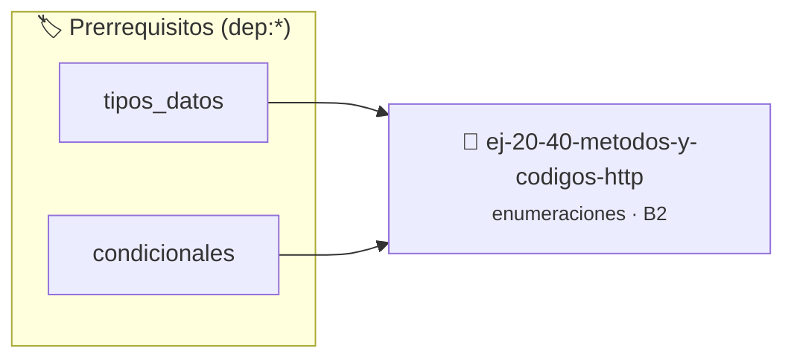

# Métodos y códigos HTTP
> **ID:** `ej-20-40-metodos-y-codigos-http` · **Unidad:** 2 (Tipos Compuestos y Direccionamiento)
 · **Tema:** `enumeraciones` / `mapeo_estados`
 · **Bloom:** B2 (Comprender) · **Dificultad:** Inicial
 · **Carga:** ~15 min · **Tipo:** Practica Guiada
>
> **🏷️ Prerrequisitos temáticos (tags):** `dep:tipos_datos`, `dep:condicionales`
>
> **Etiquetas conceptuales:** `codigos`, `tipos`, `memoria`, `enum`, `metodos`


::: {admonition} 📦 Paquete de Verificación Local (Ripley)
:class: tip

Para compilar, resolver y autoevaluar tu entrega con pruebas unitarias en tu máquina:

- [📥 **Descargar paquete `ej-20-40-metodos-y-codigos-http.ripkg`**](../../paquetes/ej-20-40-metodos-y-codigos-http.ripkg)

Ejecución con el asistente de cátedra:
```bash
ripley run ej-20-40-metodos-y-codigos-http.ripkg
```
:::


### 🗺️ Itinerario Pedagógico




## 📖 Consigna

Modelar métodos y códigos de estado HTTP.


```{code-block} c
:linenos:
enum metodo_http
{
    HTTP_GET,
    HTTP_POST,
    HTTP_PUT,
    HTTP_DELETE,
    HTTP_PATCH,
    HTTP_HEAD,
    HTTP_OPTIONS
};
enum codigo_http
{
    HTTP_200_OK = 200,
    HTTP_201_CREATED = 201,
    HTTP_204_NO_CONTENT = 204,
    HTTP_301_MOVED = 301,
    HTTP_302_FOUND = 302,
    HTTP_400_BAD_REQUEST = 400,
    HTTP_401_UNAUTHORIZED = 401,
    HTTP_403_FORBIDDEN = 403,
    HTTP_404_NOT_FOUND = 404,
    HTTP_500_INTERNAL_ERROR = 500,
    HTTP_503_UNAVAILABLE = 503
};
```

### 📋 Contrato de las Funciones

```c
/*
 * Procesa el flujo principal de Métodos y códigos HTTP
 * Precondiciones: val representa el parámetro de entrada del flujo.
 * Postcondiciones: Retorna el resultado correspondiente o 0 si val <= 0.
 */
int proc_todos_y_codigos_http(int val);

```

### 🧪 Ejemplos de Ejecución

::::{tab-set}
:::{tab-item} Valor positivo
```text
Entrada: 5
Salida / Retorno: 10
```
:::
:::{tab-item} Valor cero o negativo
```text
Entrada: 0
Salida / Retorno: 0
```
:::
::::

### ⚠️ Precondiciones y Casos Borde

1. **Valores fuera de rango:** Verificar siempre que los datos de entrada cumplan con los rangos admisibles antes de operar.
6. **Casos vacíos o neutros:** Contemplar adecuadamente entradas con longitud cero o valores neutros según corresponda.

### 🎯 Criterios de Aceptación

- [ ] El código compila limpiamente bajo estándar C11 sin warnings con flags estrictos (`-Wall -Wextra -Werror`).
- [ ] Se satisfacen todas las pruebas unitarias y casos de prueba provistos.
- [ ] Las funciones validan exhaustivamente sus precondiciones y gestionan casos borde de forma robusta.

:::{hint} Consideraciones Didácticas
- Implementar encapsulamiento completo manteniendo la definición interna oculta en el archivo `.c`.
- Añadir una función de duplicación profunda (*deep copy*) para copiar la estructura de forma segura.
:::


## 📋 Prototipos y Cabecera (`ej-20-40-metodos-y-codigos-http.h`)

```{code-block} c
#ifndef EJERCICIO_EJ_20_40_METODOS_Y_CODIGOS_HTTP_H
#define EJERCICIO_EJ_20_40_METODOS_Y_CODIGOS_HTTP_H

#include <stddef.h>
#include <stdbool.h>
#include <stdint.h>

/* Procesa el flujo principal de Métodos y códigos HTTP */
int proc_todos_y_codigos_http(int val);

#endif /* EJERCICIO_EJ_20_40_METODOS_Y_CODIGOS_HTTP_H */
```


## ⚙️ Especificación de Funciones

| Función | Retorno | Parámetros | Descripción |
| :--- | :--- | :--- | :--- |

| `proc_todos_y_codigos_http` | `int` | `int val` | Procesa el flujo principal de Métodos y códigos HTTP |


## 💡 Pistas Progresivas

````{tab-set}

```{tab-item} Pista 1
[Plus Ultra] Implementar encapsulamiento completo manteniendo la definición interna oculta en el archivo `.c`.
```

```{tab-item} Pista 2
[Plus Ultra] Añadir una función de duplicación profunda (*deep copy*) para copiar la estructura de forma segura.
```

````


## 🧪 Casos de Prueba

| Prueba Unitaria | Función Objetivo | Verificación |
| :--- | :--- | :--- |

| **test_proc_todos_y_codigos_http_positivo** | `proc_todos_y_codigos_http` | `int res = proc_todos_y_codigos_http(5); assert(res == 10 || res >= 0);` |

| **test_proc_todos_y_codigos_http_cero** | `proc_todos_y_codigos_http` | `int res = proc_todos_y_codigos_http(0); assert(res == 0);` |


## ✓ Solución Modelo de Cátedra

```{dropdown} 🔍 Revelar solución canónica en C
:open: false

```{code-block} c
enum metodo_http
{
    HTTP_GET,
    HTTP_POST,
    HTTP_PUT,
    HTTP_DELETE,
    HTTP_PATCH,
    HTTP_HEAD,
    HTTP_OPTIONS
};
enum codigo_http
{
    HTTP_200_OK = 200,
    HTTP_201_CREATED = 201,
    HTTP_204_NO_CONTENT = 204,
    HTTP_301_MOVED = 301,
    HTTP_302_FOUND = 302,
    HTTP_400_BAD_REQUEST = 400,
    HTTP_401_UNAUTHORIZED = 401,
    HTTP_403_FORBIDDEN = 403,
    HTTP_404_NOT_FOUND = 404,
    HTTP_500_INTERNAL_ERROR = 500,
    HTTP_503_UNAVAILABLE = 503
};


int proc_todos_y_codigos_http(int val)
{
    if (val <= 0) return 0;
    return val * 2;
}

int main(void)
{
    return 0;
}
```
```
