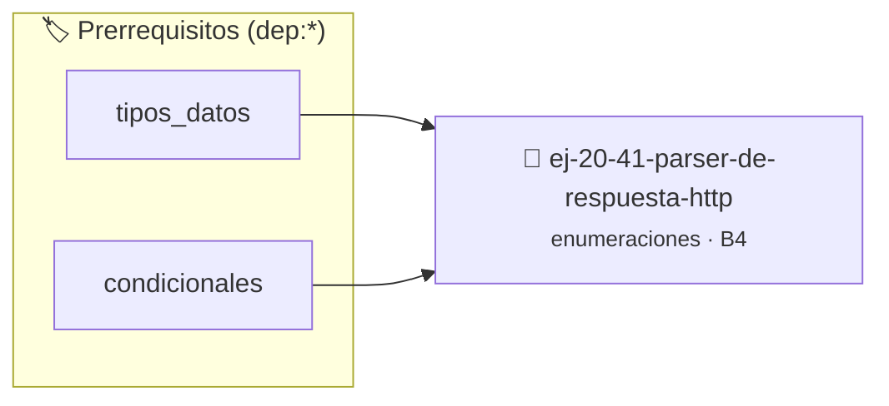

# Parser de respuesta HTTP
> **ID:** `ej-20-41-parser-de-respuesta-http` · **Unidad:** 2 (Tipos Compuestos y Direccionamiento)
 · **Tema:** `enumeraciones` / `mapeo_estados`
 · **Bloom:** B4 (Analizar) · **Dificultad:** Avanzada
 · **Carga:** ~35 min · **Tipo:** Practica Guiada
>
> **🏷️ Prerrequisitos temáticos (tags):** `dep:tipos_datos`, `dep:condicionales`
>
> **Etiquetas conceptuales:** `tipos`, `memoria`, `enum`, `parser`, `respuesta`


::: {admonition} 📦 Paquete de Verificación Local (Ripley)
:class: tip

Para compilar, resolver y autoevaluar tu entrega con pruebas unitarias en tu máquina:

- [📥 **Descargar paquete `ej-20-41-parser-de-respuesta-http.ripkg`**](../../paquetes/ej-20-41-parser-de-respuesta-http.ripkg)

Ejecución con el asistente de cátedra:
```bash
ripley run ej-20-41-parser-de-respuesta-http.ripkg
```
:::


### 🗺️ Itinerario Pedagógico




## 📖 Consigna

### Ejercicio 20.41 - Parser de respuesta HTTP ⭐⭐☆☆☆

Implementar funciones para trabajar con HTTP.


:::{hint} Lógica y Consideraciones

-   **[*plus ultra*]:** Garantizar la terminación con `\0` y prevenir
    desbordamientos de búfer validando la capacidad máxima.
-   **[*plus ultra*]:** Soportar la lectura de cadenas con espacios y múltiples
    líneas de manera robusta.

:::
<!-- {hint} Lógica y Consideraciones -->

``` c
const char *metodo_a_string(enum metodo_http metodo);
const char *codigo_a_mensaje(enum codigo_http codigo);
bool es_codigo_exito(enum codigo_http codigo);          // 2xx
bool es_codigo_error_cliente(enum codigo_http codigo);  // 4xx
bool es_codigo_error_servidor(enum codigo_http codigo); // 5xx
```
<!-- c -->

## Semáforo (Sistema de Control)


## 📋 Prototipos y Cabecera (`ej-20-41-parser-de-respuesta-http.h`)

```{code-block} c
#ifndef EJERCICIO_EJ_20_41_PARSER_DE_RESPUESTA_HTTP_H
#define EJERCICIO_EJ_20_41_PARSER_DE_RESPUESTA_HTTP_H

#include <stddef.h>
#include <stdbool.h>
#include <stdint.h>

/* Procesa el flujo principal de Parser de respuesta HTTP */
int proc_er_de_respuesta_http(int val);

#endif /* EJERCICIO_EJ_20_41_PARSER_DE_RESPUESTA_HTTP_H */
```


## ⚙️ Especificación de Funciones

| Función | Retorno | Parámetros | Descripción |
| :--- | :--- | :--- | :--- |

| `proc_er_de_respuesta_http` | `int` | `int val` | Procesa el flujo principal de Parser de respuesta HTTP |


## 💡 Pistas Progresivas

````{tab-set}

```{tab-item} Pista 1
[Plus Ultra] Garantizar la terminación con `\0` y prevenir desbordamientos de búfer validando la capacidad máxima.
```

```{tab-item} Pista 2
[Plus Ultra] Soportar la lectura de cadenas con espacios y múltiples líneas de manera robusta.
```

````


## 🧪 Casos de Prueba

| Prueba Unitaria | Función Objetivo | Verificación |
| :--- | :--- | :--- |

| **test_proc_er_de_respuesta_http_positivo** | `proc_er_de_respuesta_http` | `int res = proc_er_de_respuesta_http(5); assert(res == 10 || res >= 0);` |

| **test_proc_er_de_respuesta_http_cero** | `proc_er_de_respuesta_http` | `int res = proc_er_de_respuesta_http(0); assert(res == 0);` |


## ✓ Solución Modelo de Cátedra

```{dropdown} 🔍 Revelar solución canónica en C
:open: false

```{code-block} c
/*
 * Ejercicio: Parser de respuesta HTTP
 * Cátedra Programación I - UNRN
 */

#include <stdio.h>


int proc_er_de_respuesta_http(int val)
{
    if (val <= 0) return 0;
    return val * 2;
}

int main(void)
{
    /* TODO: Implementación de Parser de respuesta HTTP */
    return 0;
}
```
```
