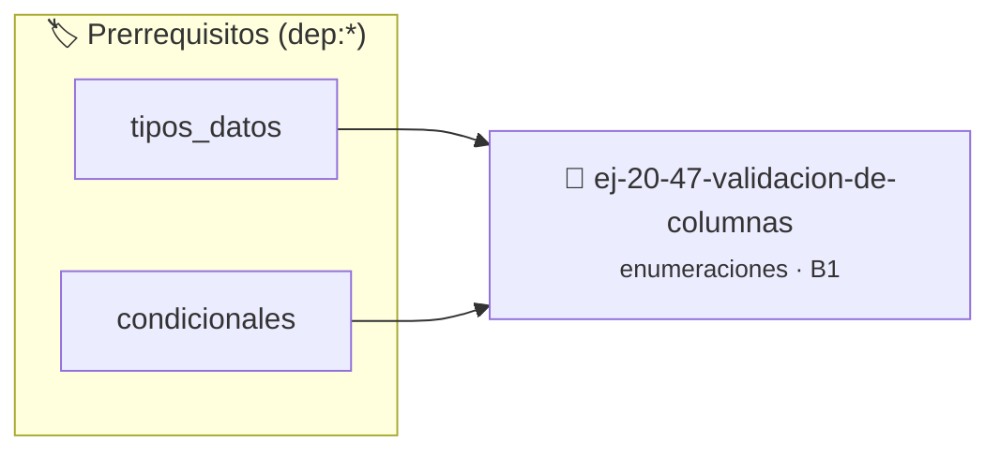

# Validación de columnas
> **ID:** `ej-20-47-validacion-de-columnas` · **Unidad:** 2 (Tipos Compuestos y Direccionamiento)
 · **Tema:** `enumeraciones` / `mapeo_estados`
 · **Bloom:** B1 (Recordar) · **Dificultad:** Inicial
 · **Carga:** ~10 min · **Tipo:** Concepto
>
> **🏷️ Prerrequisitos temáticos (tags):** `dep:tipos_datos`, `dep:condicionales`
>
> **Etiquetas conceptuales:** `tipos`, `memoria`, `validacion`, `columnas`, `enum`


::: {admonition} 📦 Paquete de Verificación Local (Ripley)
:class: tip

Para compilar, resolver y autoevaluar tu entrega con pruebas unitarias en tu máquina:

- [📥 **Descargar paquete `ej-20-47-validacion-de-columnas.ripkg`**](../../paquetes/ej-20-47-validacion-de-columnas.ripkg)

Ejecución con el asistente de cátedra:
```bash
ripley run ej-20-47-validacion-de-columnas.ripkg
```
:::


### 🗺️ Itinerario Pedagógico




## 📖 Consigna

Implementar funciones para validar definiciones de columnas.


``` c
bool es_tipo_numerico(enum tipo_sql tipo);
bool es_tipo_texto(enum tipo_sql tipo);
bool constraints_validos(unsigned int constraints);
size_t tamanio_tipo(enum tipo_sql tipo);
```

## Formatos de Imagen

### 📋 Contrato de las Funciones

```c
/*
 * Procesa el flujo principal de Validación de columnas
 * Precondiciones: val representa el parámetro de entrada del flujo.
 * Postcondiciones: Retorna el resultado correspondiente o 0 si val <= 0.
 */
int proc_lidacion_de_columnas(int val);

```

### 🧪 Ejemplos de Ejecución

::::{tab-set}
:::{tab-item} Valor positivo
```text
Entrada: 5
Salida / Retorno: 10
```
:::
:::{tab-item} Valor cero o negativo
```text
Entrada: 0
Salida / Retorno: 0
```
:::
::::

### ⚠️ Precondiciones y Casos Borde

1. **Valores fuera de rango:** Verificar siempre que los datos de entrada cumplan con los rangos admisibles antes de operar.
6. **Casos vacíos o neutros:** Contemplar adecuadamente entradas con longitud cero o valores neutros según corresponda.

### 🎯 Criterios de Aceptación

- [ ] El código compila limpiamente bajo estándar C11 sin warnings con flags estrictos (`-Wall -Wextra -Werror`).
- [ ] Se satisfacen todas las pruebas unitarias y casos de prueba provistos.
- [ ] Las funciones validan exhaustivamente sus precondiciones y gestionan casos borde de forma robusta.

:::{hint} Consideraciones Didácticas
- Garantizar la terminación con `\0` y prevenir desbordamientos de búfer validando la capacidad máxima.
- Soportar la lectura de cadenas con espacios y múltiples líneas de manera robusta.
:::


## 📋 Prototipos y Cabecera (`ej-20-47-validacion-de-columnas.h`)

```{code-block} c
#ifndef EJERCICIO_EJ_20_47_VALIDACION_DE_COLUMNAS_H
#define EJERCICIO_EJ_20_47_VALIDACION_DE_COLUMNAS_H

#include <stddef.h>
#include <stdbool.h>
#include <stdint.h>

/* Procesa el flujo principal de Validación de columnas */
int proc_lidacion_de_columnas(int val);

#endif /* EJERCICIO_EJ_20_47_VALIDACION_DE_COLUMNAS_H */
```


## ⚙️ Especificación de Funciones

| Función | Retorno | Parámetros | Descripción |
| :--- | :--- | :--- | :--- |

| `proc_lidacion_de_columnas` | `int` | `int val` | Procesa el flujo principal de Validación de columnas |


## 💡 Pistas Progresivas

````{tab-set}

```{tab-item} Pista 1
[Plus Ultra] Garantizar la terminación con `\0` y prevenir desbordamientos de búfer validando la capacidad máxima.
```

```{tab-item} Pista 2
[Plus Ultra] Soportar la lectura de cadenas con espacios y múltiples líneas de manera robusta.
```

````


## 🧪 Casos de Prueba

| Prueba Unitaria | Función Objetivo | Verificación |
| :--- | :--- | :--- |

| **test_proc_lidacion_de_columnas_positivo** | `proc_lidacion_de_columnas` | `int res = proc_lidacion_de_columnas(5); assert(res == 10 || res >= 0);` |

| **test_proc_lidacion_de_columnas_cero** | `proc_lidacion_de_columnas` | `int res = proc_lidacion_de_columnas(0); assert(res == 0);` |


## ✓ Solución Modelo de Cátedra

```{dropdown} 🔍 Revelar solución canónica en C
:open: false

```{code-block} c
/*
 * Ejercicio: Validación de columnas
 * Cátedra Programación I - UNRN
 */

#include <stdio.h>


int proc_lidacion_de_columnas(int val)
{
    if (val <= 0) return 0;
    return val * 2;
}

int main(void)
{
    /* TODO: Implementación de Validación de columnas */
    return 0;
}
```
```
