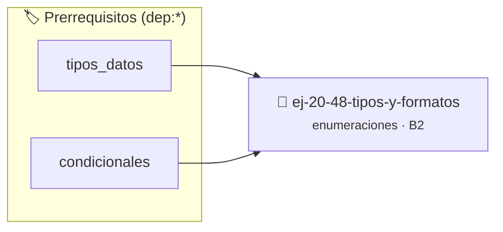

# Tipos y formatos
> **ID:** `ej-20-48-tipos-y-formatos` · **Unidad:** 2 (Tipos Compuestos y Direccionamiento)
 · **Tema:** `enumeraciones` / `mapeo_estados`
 · **Bloom:** B2 (Comprender) · **Dificultad:** Inicial
 · **Carga:** ~15 min · **Tipo:** Practica Guiada
>
> **🏷️ Prerrequisitos temáticos (tags):** `dep:tipos_datos`, `dep:condicionales`
>
> **Etiquetas conceptuales:** `tipos`, `formatos`, `enum`, `memoria`


::: {admonition} 📦 Paquete de Verificación Local (Ripley)
:class: tip

Para compilar, resolver y autoevaluar tu entrega con pruebas unitarias en tu máquina:

- [📥 **Descargar paquete `ej-20-48-tipos-y-formatos.ripkg`**](../../paquetes/ej-20-48-tipos-y-formatos.ripkg)

Ejecución con el asistente de cátedra:
```bash
ripley run ej-20-48-tipos-y-formatos.ripkg
```
:::


### 🗺️ Itinerario Pedagógico




## 📖 Consigna

### Ejercicio 20.48 - Tipos y formatos ⭐⭐☆☆☆

Modelar diferentes formatos de imagen y sus propiedades.


:::{hint} Lógica y Consideraciones

-   **[*plus ultra*]:** Garantizar la terminación con `\0` y prevenir
    desbordamientos de búfer validando la capacidad máxima.
-   **[*plus ultra*]:** Soportar la lectura de cadenas con espacios y múltiples
    líneas de manera robusta.

:::
<!-- {hint} Lógica y Consideraciones -->

```{code-block} c
:linenos:
enum formato_imagen
{
    FORMATO_JPEG,
    FORMATO_PNG,
    FORMATO_GIF,
    FORMATO_BMP,
    FORMATO_WEBP,
    FORMATO_TIFF,
    FORMATO_SVG
};
enum modo_color
{
    COLOR_ESCALA_GRISES,
    COLOR_RGB,
    COLOR_RGBA,
    COLOR_CMYK,
    COLOR_INDEXADO
};
typedef struct
{
    enum formato_imagen formato;
    enum modo_color modo;
    int ancho;
    int alto;
    int profundidad_bits;
    bool tiene_transparencia;
    bool es_animado;
} metadata_imagen_t;
```
<!-- {code-block} c -->


## 📋 Prototipos y Cabecera (`ej-20-48-tipos-y-formatos.h`)

```{code-block} c
#ifndef EJERCICIO_EJ_20_48_TIPOS_Y_FORMATOS_H
#define EJERCICIO_EJ_20_48_TIPOS_Y_FORMATOS_H

#include <stddef.h>
#include <stdbool.h>
#include <stdint.h>

/* Procesa el flujo principal de Tipos y formatos */
int proc__48_tipos_y_formatos(int val);

#endif /* EJERCICIO_EJ_20_48_TIPOS_Y_FORMATOS_H */
```


## ⚙️ Especificación de Funciones

| Función | Retorno | Parámetros | Descripción |
| :--- | :--- | :--- | :--- |

| `proc__48_tipos_y_formatos` | `int` | `int val` | Procesa el flujo principal de Tipos y formatos |


## 💡 Pistas Progresivas

````{tab-set}

```{tab-item} Pista 1
[Plus Ultra] Garantizar la terminación con `\0` y prevenir desbordamientos de búfer validando la capacidad máxima.
```

```{tab-item} Pista 2
[Plus Ultra] Soportar la lectura de cadenas con espacios y múltiples líneas de manera robusta.
```

````


## 🧪 Casos de Prueba

| Prueba Unitaria | Función Objetivo | Verificación |
| :--- | :--- | :--- |

| **test_proc__48_tipos_y_formatos_positivo** | `proc__48_tipos_y_formatos` | `int res = proc__48_tipos_y_formatos(5); assert(res == 10 || res >= 0);` |

| **test_proc__48_tipos_y_formatos_cero** | `proc__48_tipos_y_formatos` | `int res = proc__48_tipos_y_formatos(0); assert(res == 0);` |


## ✓ Solución Modelo de Cátedra

```{dropdown} 🔍 Revelar solución canónica en C
:open: false

```{code-block} c
#include <stdbool.h>

enum formato_imagen
{
    FORMATO_JPEG,
    FORMATO_PNG,
    FORMATO_GIF,
    FORMATO_BMP,
    FORMATO_WEBP,
    FORMATO_TIFF,
    FORMATO_SVG
};
enum modo_color
{
    COLOR_ESCALA_GRISES,
    COLOR_RGB,
    COLOR_RGBA,
    COLOR_CMYK,
    COLOR_INDEXADO
};
typedef struct
{
    enum formato_imagen formato;
    enum modo_color modo;
    int ancho;
    int alto;
    int profundidad_bits;
    bool tiene_transparencia;
    bool es_animado;
} metadata_imagen_t;


int proc__48_tipos_y_formatos(int val)
{
    if (val <= 0) return 0;
    return val * 2;
}

int main(void)
{
    return 0;
}
```
```
