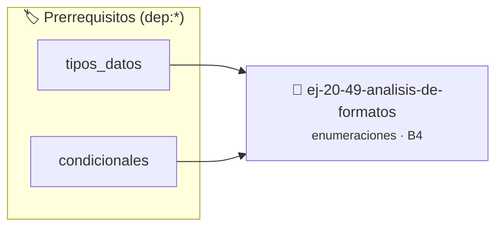

# Análisis de formatos
> **ID:** `ej-20-49-analisis-de-formatos`
 · **Tema:** `enumeraciones`
 · **Bloom:** B4 (Analizar)
 · **Carga:** ~35 min
>
> **🏷️ Prerrequisitos temáticos (tags):** `dep:tipos_datos`, `dep:condicionales`
>
> **Etiquetas conceptuales:** `tipos`, `analisis`, `memoria`, `enum`, `formatos`


::: {admonition} 📦 Paquete de Verificación Local (Ripley)
:class: tip

Para compilar, resolver y autoevaluar tu entrega con pruebas unitarias en tu máquina:

- [📥 **Descargar paquete `ej-20-49-analisis-de-formatos.ripkg`**](../../paquetes/ej-20-49-analisis-de-formatos.ripkg)

Ejecución con el asistente de cátedra:
```bash
ripley run ej-20-49-analisis-de-formatos.ripkg
```
:::


### 🗺️ Itinerario Pedagógico




## 📖 Consigna

### Ejercicio 20.49 - Análisis de formatos ⭐⭐☆☆☆

Implementar funciones para analizar propiedades de formatos.


:::{hint} Lógica y Consideraciones

-   **[*plus ultra*]:** Garantizar la terminación con `\0` y prevenir
    desbordamientos de búfer validando la capacidad máxima.
-   **[*plus ultra*]:** Soportar la lectura de cadenas con espacios y múltiples
    líneas de manera robusta.

:::
<!-- {hint} Lógica y Consideraciones -->

``` c
bool soporta_transparencia(enum formato_imagen formato);
bool soporta_animacion(enum formato_imagen formato);
bool es_formato_comprimido(enum formato_imagen formato);
const char *extension_formato(enum formato_imagen formato);
```
<!-- c -->

## Sistema de Notificaciones


## 📋 Prototipos y Cabecera (`ej-20-49-analisis-de-formatos.h`)

```{code-block} c
#ifndef EJERCICIO_EJ_20_49_ANALISIS_DE_FORMATOS_H
#define EJERCICIO_EJ_20_49_ANALISIS_DE_FORMATOS_H

#include <stddef.h>
#include <stdbool.h>
#include <stdint.h>

/* Procesa el flujo principal de Análisis de formatos */
int proc_analisis_de_formatos(int val);

#endif /* EJERCICIO_EJ_20_49_ANALISIS_DE_FORMATOS_H */
```


## ⚙️ Especificación de Funciones

| Función | Retorno | Parámetros | Descripción |
| :--- | :--- | :--- | :--- |

| `proc_analisis_de_formatos` | `int` | `int val` | Procesa el flujo principal de Análisis de formatos |


## 💡 Pistas Progresivas

````{tab-set}

```{tab-item} Pista 1
[Plus Ultra] Garantizar la terminación con `\0` y prevenir desbordamientos de búfer validando la capacidad máxima.
```

```{tab-item} Pista 2
[Plus Ultra] Soportar la lectura de cadenas con espacios y múltiples líneas de manera robusta.
```

````


## 🧪 Casos de Prueba

| Prueba Unitaria | Función Objetivo | Verificación |
| :--- | :--- | :--- |

| **test_proc_analisis_de_formatos_positivo** | `proc_analisis_de_formatos` | `int res = proc_analisis_de_formatos(5); assert(res == 10 || res >= 0);` |

| **test_proc_analisis_de_formatos_cero** | `proc_analisis_de_formatos` | `int res = proc_analisis_de_formatos(0); assert(res == 0);` |


## ✓ Solución Modelo de Cátedra

```{dropdown} 🔍 Revelar solución canónica en C
:open: false

```{code-block} c
/*
 * Ejercicio: Análisis de formatos
 * Cátedra Programación I - UNRN
 */

#include <stdio.h>


int proc_analisis_de_formatos(int val)
{
    if (val <= 0) return 0;
    return val * 2;
}

int main(void)
{
    /* TODO: Implementación de Análisis de formatos */
    return 0;
}
```
```
