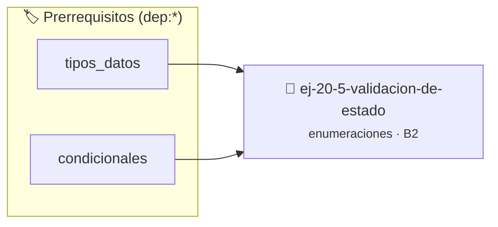

# Validación de estado
> **ID:** `ej-20-5-validacion-de-estado`
 · **Tema:** `enumeraciones`
 · **Bloom:** B2 (Comprender)
 · **Carga:** ~15 min
>
> **🏷️ Prerrequisitos temáticos (tags):** `dep:tipos_datos`, `dep:condicionales`
>
> **Etiquetas conceptuales:** `tipos`, `memoria`, `validacion`, `enum`, `estado`


::: {admonition} 📦 Paquete de Verificación Local (Ripley)
:class: tip

Para compilar, resolver y autoevaluar tu entrega con pruebas unitarias en tu máquina:

- [📥 **Descargar paquete `ej-20-5-validacion-de-estado.ripkg`**](../../paquetes/ej-20-5-validacion-de-estado.ripkg)

Ejecución con el asistente de cátedra:
```bash
ripley run ej-20-5-validacion-de-estado.ripkg
```
:::


### 🗺️ Itinerario Pedagógico




## 📖 Consigna

### Ejercicio 20.5 - Validación de estado ⭐⭐⭐☆☆

Implementar una función que valide si un valor numérico corresponde a un estado
válido de la enumeración. Usar el patrón del valor centinela.


:::{hint} Lógica y Consideraciones

-   **[*plus ultra*]:** Garantizar la terminación con `\0` y prevenir
    desbordamientos de búfer validando la capacidad máxima.
-   **[*plus ultra*]:** Soportar la lectura de cadenas con espacios y múltiples
    líneas de manera robusta.

:::
<!-- {hint} Lógica y Consideraciones -->

```{code-block} c
:linenos:
enum estado_red
{
    DESCONECTADO,
    CONECTANDO,
    CONECTADO,
    DESCONECTANDO,
    ERROR_TIMEOUT,
    ERROR_AUTH,
    _ESTADO_MAX // Valor centinela
};
bool estado_valido(int valor);
```
<!-- {code-block} c -->

## Sistema de Permisos con Flags

Implementar un sistema de permisos usando flags de bits. Este ejercicio
demuestra cómo combinar múltiples opciones en un único valor.

```{code-block} c
:linenos:
enum permisos
{
    PERMISO_LECTURA = 1 << 0,   // 0x01
    PERMISO_ESCRITURA = 1 << 1, // 0x02
    PERMISO_EJECUCION = 1 << 2, // 0x04
    PERMISO_ELIMINAR = 1 << 3   // 0x08
};
```
<!-- {code-block} c -->


## 📋 Prototipos y Cabecera (`ej-20-5-validacion-de-estado.h`)

```{code-block} c
#ifndef EJERCICIO_EJ_20_5_VALIDACION_DE_ESTADO_H
#define EJERCICIO_EJ_20_5_VALIDACION_DE_ESTADO_H

#include <stddef.h>
#include <stdbool.h>
#include <stdint.h>

/* Procesa el flujo principal de Validación de estado */
int proc_validacion_de_estado(int val);

#endif /* EJERCICIO_EJ_20_5_VALIDACION_DE_ESTADO_H */
```


## ⚙️ Especificación de Funciones

| Función | Retorno | Parámetros | Descripción |
| :--- | :--- | :--- | :--- |

| `proc_validacion_de_estado` | `int` | `int val` | Procesa el flujo principal de Validación de estado |


## 💡 Pistas Progresivas

````{tab-set}

```{tab-item} Pista 1
[Plus Ultra] Garantizar la terminación con `\0` y prevenir desbordamientos de búfer validando la capacidad máxima.
```

```{tab-item} Pista 2
[Plus Ultra] Soportar la lectura de cadenas con espacios y múltiples líneas de manera robusta.
```

````


## 🧪 Casos de Prueba

| Prueba Unitaria | Función Objetivo | Verificación |
| :--- | :--- | :--- |

| **test_proc_validacion_de_estado_positivo** | `proc_validacion_de_estado` | `int res = proc_validacion_de_estado(5); assert(res == 10 || res >= 0);` |

| **test_proc_validacion_de_estado_cero** | `proc_validacion_de_estado` | `int res = proc_validacion_de_estado(0); assert(res == 0);` |


## ✓ Solución Modelo de Cátedra

```{dropdown} 🔍 Revelar solución canónica en C
:open: false

```{code-block} c
#include <stdbool.h>

enum estado_red
{
    DESCONECTADO,
    CONECTANDO,
    CONECTADO,
    DESCONECTANDO,
    ERROR_TIMEOUT,
    ERROR_AUTH,
    _ESTADO_MAX // Valor centinela
};
bool estado_valido(int valor);


int proc_validacion_de_estado(int val)
{
    if (val <= 0) return 0;
    return val * 2;
}

int main(void)
{
    return 0;
}
```
```
