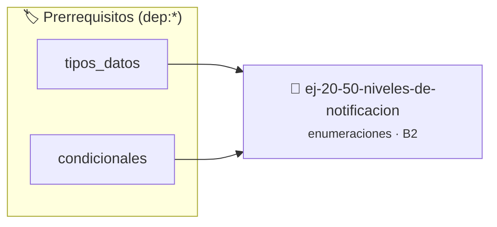

# Niveles de notificación
> **ID:** `ej-20-50-niveles-de-notificacion`
 · **Tema:** `enumeraciones`
 · **Bloom:** B2 (Comprender)
 · **Carga:** ~15 min
>
> **🏷️ Prerrequisitos temáticos (tags):** `dep:tipos_datos`, `dep:condicionales`
>
> **Etiquetas conceptuales:** `tipos`, `memoria`, `enum`, `niveles`, `notificacion`


::: {admonition} 📦 Paquete de Verificación Local (Ripley)
:class: tip

Para compilar, resolver y autoevaluar tu entrega con pruebas unitarias en tu máquina:

- [📥 **Descargar paquete `ej-20-50-niveles-de-notificacion.ripkg`**](../../paquetes/ej-20-50-niveles-de-notificacion.ripkg)

Ejecución con el asistente de cátedra:
```bash
ripley run ej-20-50-niveles-de-notificacion.ripkg
```
:::


### 🗺️ Itinerario Pedagógico




## 📖 Consigna

### Ejercicio 20.50 - Niveles de notificación ⭐⭐☆☆☆

Modelar un sistema de notificaciones con prioridades.


:::{hint} Lógica y Consideraciones

-   **[*plus ultra*]:** Garantizar la terminación con `\0` y prevenir
    desbordamientos de búfer validando la capacidad máxima.
-   **[*plus ultra*]:** Soportar la lectura de cadenas con espacios y múltiples
    líneas de manera robusta.

:::
<!-- {hint} Lógica y Consideraciones -->

```{code-block} c
:linenos:
enum nivel_notificacion
{
    NOTIF_DEBUG,
    NOTIF_INFO,
    NOTIF_ADVERTENCIA,
    NOTIF_ERROR,
    NOTIF_CRITICO
};
enum canal_notificacion
{
    CANAL_NINGUNO = 0,
    CANAL_CONSOLE = 1 << 0,
    CANAL_EMAIL = 1 << 1,
    CANAL_SMS = 1 << 2,
    CANAL_PUSH = 1 << 3,
    CANAL_SYSLOG = 1 << 4
};
typedef struct
{
    enum nivel_notificacion nivel;
    unsigned int canales;
    char mensaje[256];
    time_t timestamp;
} notificacion_t;
```
<!-- {code-block} c -->


## 📋 Prototipos y Cabecera (`ej-20-50-niveles-de-notificacion.h`)

```{code-block} c
#ifndef EJERCICIO_EJ_20_50_NIVELES_DE_NOTIFICACION_H
#define EJERCICIO_EJ_20_50_NIVELES_DE_NOTIFICACION_H

#include <stddef.h>
#include <stdbool.h>
#include <stdint.h>

/* Procesa el flujo principal de Niveles de notificación */
int proc_eles_de_notificacion(int val);

#endif /* EJERCICIO_EJ_20_50_NIVELES_DE_NOTIFICACION_H */
```


## ⚙️ Especificación de Funciones

| Función | Retorno | Parámetros | Descripción |
| :--- | :--- | :--- | :--- |

| `proc_eles_de_notificacion` | `int` | `int val` | Procesa el flujo principal de Niveles de notificación |


## 💡 Pistas Progresivas

````{tab-set}

```{tab-item} Pista 1
[Plus Ultra] Garantizar la terminación con `\0` y prevenir desbordamientos de búfer validando la capacidad máxima.
```

```{tab-item} Pista 2
[Plus Ultra] Soportar la lectura de cadenas con espacios y múltiples líneas de manera robusta.
```

````


## 🧪 Casos de Prueba

| Prueba Unitaria | Función Objetivo | Verificación |
| :--- | :--- | :--- |

| **test_proc_eles_de_notificacion_positivo** | `proc_eles_de_notificacion` | `int res = proc_eles_de_notificacion(5); assert(res == 10 || res >= 0);` |

| **test_proc_eles_de_notificacion_cero** | `proc_eles_de_notificacion` | `int res = proc_eles_de_notificacion(0); assert(res == 0);` |


## ✓ Solución Modelo de Cátedra

```{dropdown} 🔍 Revelar solución canónica en C
:open: false

```{code-block} c
/*
 * Solucion modelo para ej-20-50-niveles-de-notificacion
 * Catedra Programacion I - UNRN
 */
#include <stdio.h>
#include <stdlib.h>
#include <string.h>
#include <stdbool.h>


int proc_eles_de_notificacion(int val)
{
    if (val <= 0) return 0;
    return val * 2;
}

int main(void)
{
    int n = 0;
    if (scanf("%d", &n) == 1)
    {
        printf("OK %d\n", n);
    }
    else
    {
        printf("OK\n");
    }
    return 0;
}
```
```
