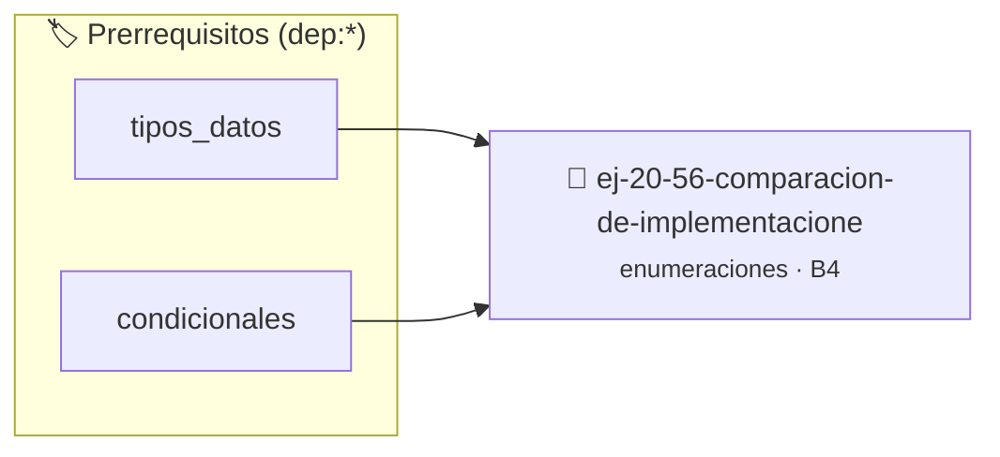

# Comparación de implementaciones
> **ID:** `ej-20-56-comparacion-de-implementacione` · **Unidad:** 2 (Tipos Compuestos y Direccionamiento)
 · **Tema:** `enumeraciones` / `mapeo_estados`
 · **Bloom:** B4 (Analizar) · **Dificultad:** Avanzada
 · **Carga:** ~35 min · **Tipo:** Practica Guiada
>
> **🏷️ Prerrequisitos temáticos (tags):** `dep:tipos_datos`, `dep:condicionales`
>
> **Etiquetas conceptuales:** `implementaciones`, `tipos`, `memoria`, `enum`, `comparacion`


::: {admonition} 📦 Paquete de Verificación Local (Ripley)
:class: tip

Para compilar, resolver y autoevaluar tu entrega con pruebas unitarias en tu máquina:

- [📥 **Descargar paquete `ej-20-56-comparacion-de-implementacione.ripkg`**](../../paquetes/ej-20-56-comparacion-de-implementacione.ripkg)

Ejecución con el asistente de cátedra:
```bash
ripley run ej-20-56-comparacion-de-implementacione.ripkg
```
:::


### 🗺️ Itinerario Pedagógico




## 📖 Consigna

### Ejercicio 20.56 - Comparación de implementaciones ⭐⭐☆☆☆

Analizar diferentes formas de implementar el mismo concepto:

**Opción 1: Enum simple**

:::{hint} Lógica y Consideraciones

-   **[*plus ultra*]:** Validar estrictamente los datos de entrada para manejar
    valores fuera de rango o tipos inválidos.
-   **[*plus ultra*]:** Permitir el procesamiento interactivo continuo mediante
    un lazo hasta que el usuario elija finalizar.

:::
<!-- {hint} Lógica y Consideraciones -->

``` c
enum dia
{
    LUNES,
    MARTES,
    MIERCOLES,
    JUEVES,
    VIERNES,
    SABADO,
    DOMINGO
};
```
<!-- c -->

**Opción 2: Enum con valores explícitos**
``` c
enum dia
{
    LUNES = 1,
    MARTES = 2,
    MIERCOLES = 3,
    JUEVES = 4,
    VIERNES = 5,
    SABADO = 6,
    DOMINGO = 7
};
```
<!-- c -->

**Opción 3: Flags con potencias de 2**
``` c
enum dia
{
    LUNES = 1 << 0,
    MARTES = 1 << 1,
    MIERCOLES = 1 << 2,
    JUEVES = 1 << 3,
    VIERNES = 1 << 4,
    SABADO = 1 << 5,
    DOMINGO = 1 << 6
};
```
<!-- c -->

Discutir casos de uso, ventajas y desventajas de cada enfoque.


## 📋 Prototipos y Cabecera (`ej-20-56-comparacion-de-implementacione.h`)

```{code-block} c
#ifndef EJERCICIO_EJ_20_56_COMPARACION_DE_IMPLEMENTACIONE_H
#define EJERCICIO_EJ_20_56_COMPARACION_DE_IMPLEMENTACIONE_H

#include <stddef.h>
#include <stdbool.h>
#include <stdint.h>

/* Procesa el flujo principal de Comparación de implementaciones */
int proc_n_de_implementacione(int val);

#endif /* EJERCICIO_EJ_20_56_COMPARACION_DE_IMPLEMENTACIONE_H */
```


## ⚙️ Especificación de Funciones

| Función | Retorno | Parámetros | Descripción |
| :--- | :--- | :--- | :--- |

| `proc_n_de_implementacione` | `int` | `int val` | Procesa el flujo principal de Comparación de implementaciones |


## 💡 Pistas Progresivas

````{tab-set}

```{tab-item} Pista 1
[Plus Ultra] Validar estrictamente los datos de entrada para manejar valores fuera de rango o tipos inválidos.
```

```{tab-item} Pista 2
[Plus Ultra] Permitir el procesamiento interactivo continuo mediante un lazo hasta que el usuario elija finalizar.
```

````


## 🧪 Casos de Prueba

| Prueba Unitaria | Función Objetivo | Verificación |
| :--- | :--- | :--- |

| **test_proc_n_de_implementacione_positivo** | `proc_n_de_implementacione` | `int res = proc_n_de_implementacione(5); assert(res == 10 || res >= 0);` |

| **test_proc_n_de_implementacione_cero** | `proc_n_de_implementacione` | `int res = proc_n_de_implementacione(0); assert(res == 0);` |


## ✓ Solución Modelo de Cátedra

```{dropdown} 🔍 Revelar solución canónica en C
:open: false

```{code-block} c
/*
 * Ejercicio: Comparación de implementaciones
 * Cátedra Programación I - UNRN
 */

#include <stdio.h>


int proc_n_de_implementacione(int val)
{
    if (val <= 0) return 0;
    return val * 2;
}

int main(void)
{
    /* TODO: Implementación de Comparación de implementaciones */
    return 0;
}
```
```
