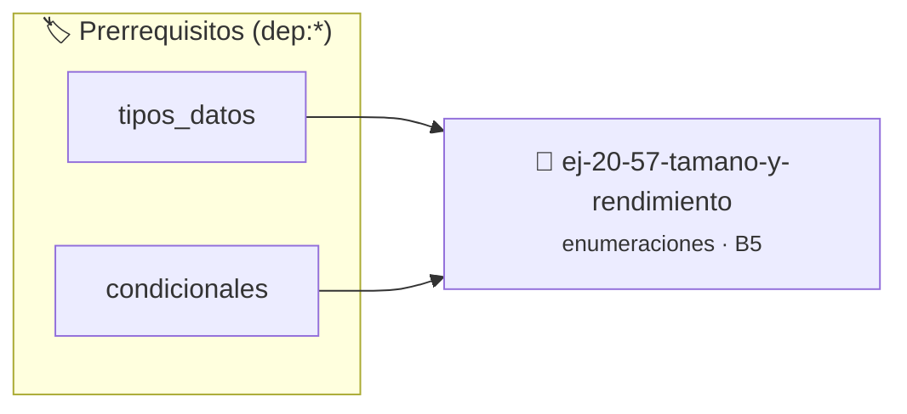

# Tamaño y rendimiento
> **ID:** `ej-20-57-tamano-y-rendimiento` · **Unidad:** 2 (Tipos Compuestos y Direccionamiento)
 · **Tema:** `enumeraciones` / `mapeo_estados`
 · **Bloom:** B5 (Evaluar / Crear) · **Dificultad:** Desafio
 · **Carga:** ~45 min · **Tipo:** Desafio
>
> **🏷️ Prerrequisitos temáticos (tags):** `dep:tipos_datos`, `dep:condicionales`
>
> **Etiquetas conceptuales:** `tamano`, `tipos`, `memoria`, `enum`, `rendimiento`


::: {admonition} 📦 Paquete de Verificación Local (Ripley)
:class: tip

Para compilar, resolver y autoevaluar tu entrega con pruebas unitarias en tu máquina:

- [📥 **Descargar paquete `ej-20-57-tamano-y-rendimiento.ripkg`**](../../paquetes/ej-20-57-tamano-y-rendimiento.ripkg)

Ejecución con el asistente de cátedra:
```bash
ripley run ej-20-57-tamano-y-rendimiento.ripkg
```
:::


### 🗺️ Itinerario Pedagógico




## 📖 Consigna

Investigar y documentar:
- Tamaño en memoria de enums (usualmente `sizeof(int)`)
- Rendimiento de operaciones con enums vs constantes
- Optimizaciones del compilador con enums
- Diferencias entre C y C++ en el manejo de enums


Definí una enumeración para días de la semana y mostrá el nombre según el valor.

**Orientación:**


``` c
typedef enum
{
    LUNES,
    MARTES,
    MIERCOLES,
    JUEVES,
    VIERNES,
    SABADO,
    DOMINGO
} dia_semana_t;
```
- Usá `switch` para convertir enum a string

---

Definí estructura para punto en 2D y función para calcular distancia entre dos
puntos.

**Orientación:**


``` c
typedef struct
{
    double x;
    double y;
} punto_t;
```
- Distancia: `sqrt((p2.x - p1.x)² + (p2.y - p1.y)²)`

---

Creá estructura para fecha y función de validación.

**Orientación:**


``` c
typedef struct
{
    int dia;
    int mes;
    int anio;
} fecha_t;
```
- Validar: 1 ≤ mes ≤ 12, día según mes, considerar bisiestos

---

Definí estructura persona y función para mostrar información.

**Orientación:**


``` c
typedef struct
{
    char nombre[50];
    char apellido[50];
    int edad;
} persona_t;
```
- Función `void mostrar_persona(const persona_t *p)`

---

Creá array de estudiantes y función para encontrar el de mayor promedio.

**Orientación:**


``` c
typedef struct
{
    char nombre[50];
    float promedio;
} estudiante_t;
estudiante_t clase[30];
```
- Recorré array comparando promedios

---

Definí enumeración para códigos de error HTTP.

**Orientación:**


```{code-block} c
:linenos:
typedef enum
{
    HTTP_OK = 200,
    HTTP_CREATED = 201,
    HTTP_BAD_REQUEST = 400,
    HTTP_NOT_FOUND = 404,
    HTTP_SERVER_ERROR = 500
} http_status_t;
```

---

Creá estructura para dirección y persona que incluya dirección.

**Orientación:**


```{code-block} c
:linenos:
typedef struct
{
    char calle[100];
    int numero;
    char ciudad[50];
} direccion_t;
typedef struct
{
    char nombre[50];
    direccion_t direccion; // Estructura anidada
} persona_t;
```

---

Definí estructura nodo para lista enlazada.

**Orientación:**


``` c
typedef struct nodo
{
    int dato;
    struct nodo *siguiente; // Puntero a mismo tipo
} nodo_t;
```
- Funciones: crear_nodo, insertar_inicio, mostrar_lista

---

Usá union para almacenar valor que puede ser int, float o char.

**Orientación:**


```{code-block} c
:linenos:
typedef enum
{
    TIPO_INT,
    TIPO_FLOAT,
    TIPO_CHAR
} tipo_t;
typedef struct
{
    tipo_t tipo;
    union
    {
        int i;
        float f;
        char c;
    } valor;
} variable_t;
```
- El tipo indica cuál campo de la union es válido

---

Practicá diferentes formas de inicializar estructuras.

**Orientación:**


```{code-block} c
:linenos:
// Orden
punto_t p1 = {3.0, 4.0};
// Designadores (C99)
punto_t p2 = {.x = 3.0, .y = 4.0};
punto_t p3 = {.y = 4.0, .x = 3.0}; // Orden no importa
// Parcial (resto en 0)
punto_t p4 = {.x = 3.0};
```

---

Definí rectángulo con dos puntos (esquinas opuestas) y calcula área/perímetro.

**Orientación:**


``` c
typedef struct
{
    punto_t superior_izq;
    punto_t inferior_der;
} rectangulo_t;
```
- Área: ancho × alto
- Perímetro: 2 × (ancho + alto)

---

Sistema con estructuras para libro, autor, editorial.

**Orientación:**


```{code-block} c
:linenos:
typedef struct
{
    char nombre[50];
    int anio_nacimiento;
} autor_t;
typedef struct
{
    char titulo[100];
    autor_t autor;
    int anio_publicacion;
    float precio;
} libro_t;
```
- Funciones: buscar por título, filtrar por autor, ordenar por precio

---

Usá enum para permisos de archivo estilo Unix.

**Orientación:**


```{code-block} c
:linenos:
typedef enum
{
    PERM_READ = 1 << 0,    // 0001
    PERM_WRITE = 1 << 1,   // 0010
    PERM_EXECUTE = 1 << 2, // 0100
} permisos_t;
// Combinar permisos con OR
int permisos = PERM_READ | PERM_WRITE;
// Verificar con AND
if (permisos & PERM_READ)
{ /* tiene lectura */
}
```

---

Explorá alineación de memoria en estructuras.

**Orientación:**


```{code-block} c
:linenos:
typedef struct
{
    char c;       // 1 byte + 3 padding
    int i;        // 4 bytes
    char d;       // 1 byte + 3 padding
} mal_alineada_t; // Total: 12 bytes
typedef struct
{
    int i;         // 4 bytes
    char c;        // 1 byte
    char d;        // 1 byte + 2 padding
} bien_alineada_t; // Total: 8 bytes
```
- Usá `sizeof()` para ver diferencias

---

Implementá un sistema de clasificación y manejo de paquetes de red combinando tipos enumerados y estructuras:

**Orientación:**


```{code-block} c
:linenos:
typedef enum
{
    PROTO_TCP,
    PROTO_UDP,
    PROTO_ICMP
} protocolo_t;

typedef enum
{
    ESTADO_PENDIENTE,
    ESTADO_EN_TRANSITO,
    ESTADO_ENTREGADO,
    ESTADO_DESCARTADO
} estado_paquete_t;

typedef struct
{
    unsigned int id;
    protocolo_t protocolo;
    estado_paquete_t estado;
    unsigned short puerto_origen;
    unsigned short puerto_destino;
    size_t bytes_datos;
} paquete_red_t;
```
- Funciones: `paquete_crear`, `paquete_actualizar_estado`, `paquete_mostrar_info`

---

Creá sistema de figuras geométricas con union.

**Orientación:**


```{code-block} c
:linenos:
typedef enum
{
    CIRCULO,
    RECTANGULO,
    TRIANGULO
} tipo_figura_t;
typedef struct
{
    punto_t centro;
    double radio;
} circulo_t;
typedef struct
{
    punto_t p1, p2;
} rectangulo_t;
typedef struct
{
    tipo_figura_t tipo;
    union
    {
        circulo_t circulo;
        rectangulo_t rectangulo;
    } datos;
} figura_t;
double calcular_area(const figura_t *f);
```

---

Implementá cola FIFO con estructura.

**Orientación:**


```{code-block} c
:linenos:
typedef struct
{
    int *datos;
    int frente;
    int fin;
    int capacidad;
    int tamanio;
} cola_t;
```
- Funciones: crear, encolar, desencolar, esta_llena, destruir

---

Representá un inventario de dispositivos y conexiones con tipos y estados enumerados:

**Orientación:**


```{code-block} c
:linenos:
typedef enum
{
    DISP_ROUTER,
    DISP_SWITCH,
    DISP_SERVIDOR,
    DISP_TERMINAL
} tipo_dispositivo_t;

typedef enum
{
    CONEXION_ACTIVA,
    CONEXION_INACTIVA,
    CONEXION_FALLA
} estado_conexion_t;

typedef struct
{
    unsigned int id;
    char hostname[32];
    tipo_dispositivo_t tipo;
    estado_conexion_t estado;
    unsigned int ip;
} dispositivo_t;
```
- Funciones: `dispositivo_crear`, `dispositivo_cambiar_estado`, `dispositivo_imprimir`

---

Sistema CRUD para empleados.

**Orientación:**


```{code-block} c
:linenos:
typedef struct
{
    int id;
    char nombre[50];
    char departamento[50];
    float salario;
} empleado_t;
typedef struct
{
    empleado_t *empleados;
    int cantidad;
    int capacidad;
} base_datos_t;
```
- Funciones: crear, agregar, buscar, actualizar, eliminar, listar

---

Implementá máquina de estados finitos.

**Orientación:**


```{code-block} c
:linenos:
typedef enum
{
    ESTADO_INICIO,
    ESTADO_PROCESANDO,
    ESTADO_PAUSA,
    ESTADO_ERROR,
    ESTADO_FIN
} estado_t;
typedef enum
{
    EVENTO_INICIAR,
    EVENTO_PAUSAR,
    EVENTO_REANUDAR,
    EVENTO_ERROR,
    EVENTO_COMPLETAR
} evento_t;
typedef struct
{
    estado_t estado_actual;
    // Datos del contexto
} maquina_t;
estado_t transicion(estado_t actual, evento_t evento);
```

---

## Notas Finales

:::{tip} Convenciones de Nomenclatura

**Enumeraciones:**
``` c
typedef enum
{
    COLOR_ROJO,
    COLOR_VERDE,
    COLOR_AZUL
} color_t;
```
- Sufijo `_t` para el tipo
- Prefijo común para los valores

**Estructuras:**
``` c
typedef struct
{
    // campos
} nombre_t;
```
- Sufijo `_t` indica que es un tipo definido por el usuario

:::

:::{note} Tamaño y Alineación

**Obtener tamaño:**
``` c
printf("Tamaño: %zu bytes\n", sizeof(estructura_t));
```

**Offset de campos:**
``` c
#include <stddef.h>
printf("Offset de campo: %zu\n", offsetof(estructura_t, campo));
```

**Alineación:**
- Campos se alinean a múltiplos de su tamaño
- Estructura completa se alinea al mayor campo
- Reordenar campos puede ahorrar memoria

:::

:::{warning} Errores Comunes

1. **Olvidar typedef:**
   ```c
   struct punto
   {
       int x, y;
   };
   struct punto p; // Necesitas "struct"
   typedef struct
   {
       int x, y;
   } punto_t;
   punto_t p; // Más limpio
   ```

2. **Union sin tipo discriminador:**
   ```c
   // MAL: no sabés qué campo es válido
   union
   {
       int i;
       float f;
   } valor;
   // BIEN: con tipo
   struct
   {
       enum
       {
           INT,
           FLOAT
       } tipo;
       union
       {
           int i;
           float f;
       } valor;
   } variable;
   ```

3. **Comparación de structs:**
   ```c
   // MAL: no se puede comparar directamente
   if (p1 == p2)
   {
   }
   // BIEN: comparar campo por campo
   if (p1.x == p2.x && p1.y == p2.y)
   {
   }
   ```

4. **Copiar structs con punteros:**
   ```c
   typedef struct
   {
       char *nombre; // Puntero
   } persona_t;
   persona_t p2 = p1; // Copia shallow: ambos apuntan al mismo nombre
   // Necesitas copia profunda manual
   ```

:::

:::{tip} Inicialización

**Cero:**
``` c
estructura_t s = {0}; // Todo en cero
```

**Designadores C99:**
``` c
punto_t p = {.x = 10, .y = 20};
```

**Compuesta (C99):**
``` c
punto_t p = (punto_t){.x = 10, .y = 20};
```

**Array de structs:**
``` c
punto_t puntos[] = {{1, 2}, {3, 4}, {.x = 5, .y = 6}};
```

:::

:::{note} Estructuras Opacas

**Encapsulamiento:**
```{code-block} c
:linenos:
// archivo.h
typedef struct archivo archivo_t; // Declaración opaca
archivo_t *abrir_archivo(const char *ruta);
// archivo.c
struct archivo
{ // Definición oculta
    FILE *fp;
    int linea;
};
```
- Usuario solo ve puntero, no puede acceder a campos
- Facilita cambios internos sin romper código cliente

:::

Estas consignas cubren tipos de datos personalizados desde básicos hasta
sistemas complejos, preparando para diseño de TADs profesionales.

### 📋 Contrato de las Funciones

```c
/*
 * Procesa el flujo principal de Tamaño y rendimiento
 * Precondiciones: val representa el parámetro de entrada del flujo.
 * Postcondiciones: Retorna el resultado correspondiente o 0 si val <= 0.
 */
int proc_tamano_y_rendimiento(int val);

```

### 🧪 Ejemplos de Ejecución

::::{tab-set}
:::{tab-item} Valor positivo
```text
Entrada: 5
Salida / Retorno: 10
```
:::
:::{tab-item} Valor cero o negativo
```text
Entrada: 0
Salida / Retorno: 0
```
:::
::::

### ⚠️ Precondiciones y Casos Borde

1. **Valores fuera de rango:** Verificar siempre que los datos de entrada cumplan con los rangos admisibles antes de operar.
6. **Casos vacíos o neutros:** Contemplar adecuadamente entradas con longitud cero o valores neutros según corresponda.

### 🎯 Criterios de Aceptación

- [ ] El código compila limpiamente bajo estándar C11 sin warnings con flags estrictos (`-Wall -Wextra -Werror`).
- [ ] Se satisfacen todas las pruebas unitarias y casos de prueba provistos.
- [ ] Las funciones validan exhaustivamente sus precondiciones y gestionan casos borde de forma robusta.

:::{hint} Consideraciones Didácticas
- Verificar el retorno de asignación de memoria y garantizar la liberación total de recursos en caso de error.
- Verificar la ausencia de fugas de memoria (*memory leaks*) mediante Valgrind o AddressSanitizer.
- Garantizar la terminación con `\0` y prevenir desbordamientos de búfer validando la capacidad máxima.
- Soportar la lectura de cadenas con espacios y múltiples líneas de manera robusta.
- Garantizar la terminación con `\0` y prevenir desbordamientos de búfer validando la capacidad máxima.
- Soportar la lectura de cadenas con espacios y múltiples líneas de manera robusta.
- Garantizar la terminación con `\0` y prevenir desbordamientos de búfer validando la capacidad máxima.
- Soportar la lectura de cadenas con espacios y múltiples líneas de manera robusta.
- Garantizar la terminación con `\0` y prevenir desbordamientos de búfer validando la capacidad máxima.
- Soportar la lectura de cadenas con espacios y múltiples líneas de manera robusta.
- Garantizar la terminación con `\0` y prevenir desbordamientos de búfer validando la capacidad máxima.
- Soportar la lectura de cadenas con espacios y múltiples líneas de manera robusta.
- Validar estrictamente los datos de entrada para manejar valores fuera de rango o tipos inválidos.
- Permitir el procesamiento interactivo continuo mediante un lazo hasta que el usuario elija finalizar.
- Garantizar la terminación con `\0` y prevenir desbordamientos de búfer validando la capacidad máxima.
- Soportar la lectura de cadenas con espacios y múltiples líneas de manera robusta.
- Validar punteros `NULL` recibidos como parámetro para evitar fallos de segmentación.
- Implementar una versión utilizando aritmética de punteros en lugar de indexación directa.
- Garantizar la terminación con `\0` y prevenir desbordamientos de búfer validando la capacidad máxima.
- Soportar la lectura de cadenas con espacios y múltiples líneas de manera robusta.
- Garantizar la terminación con `\0` y prevenir desbordamientos de búfer validando la capacidad máxima.
- Soportar la lectura de cadenas con espacios y múltiples líneas de manera robusta.
- Garantizar la terminación con `\0` y prevenir desbordamientos de búfer validando la capacidad máxima.
- Soportar la lectura de cadenas con espacios y múltiples líneas de manera robusta.
- Garantizar la terminación con `\0` y prevenir desbordamientos de búfer validando la capacidad máxima.
- Soportar la lectura de cadenas con espacios y múltiples líneas de manera robusta.
- Verificar la correcta apertura del archivo y controlar errores de E/S con `ferror` y `feof`.
- Soportar rutas complejas y asegurar el cierre del archivo en todos los caminos de ejecución.
- Verificar el retorno de asignación de memoria y garantizar la liberación total de recursos en caso de error.
- Verificar la ausencia de fugas de memoria (*memory leaks*) mediante Valgrind o AddressSanitizer.
- Validar que los campos de puerto y tamaño se encuentren dentro de los rangos válidos del protocolo.
- Modularizar la función de formateo para imprimir el paquete como una cadena estructurada.
- Garantizar la terminación con `\0` y prevenir desbordamientos de búfer validando la capacidad máxima.
- Soportar la lectura de cadenas con espacios y múltiples líneas de manera robusta.
- Garantizar la terminación con `\0` y prevenir desbordamientos de búfer validando la capacidad máxima.
- Soportar la lectura de cadenas con espacios y múltiples líneas de manera robusta.
- Validar que las direcciones IP ingresadas tengan un formato numérico coherente.
- Implementar una función para listar todos los dispositivos que se encuentren en un estado específico.
- Garantizar la terminación con `\0` y prevenir desbordamientos de búfer validando la capacidad máxima.
- Soportar la lectura de cadenas con espacios y múltiples líneas de manera robusta.
- Validar punteros `NULL` recibidos como parámetro para evitar fallos de segmentación.
- Implementar una versión utilizando aritmética de punteros en lugar de indexación directa.
- Sufijo `_t` para el tipo
- Prefijo común para los valores **Estructuras:** ``` c typedef struct { // campos } nombre_t; ``` <!-- c -->
- Sufijo `_t` indica que es un tipo definido por el usuario
:::


## 📋 Prototipos y Cabecera (`ej-20-57-tamano-y-rendimiento.h`)

```{code-block} c
#ifndef EJERCICIO_EJ_20_57_TAMANO_Y_RENDIMIENTO_H
#define EJERCICIO_EJ_20_57_TAMANO_Y_RENDIMIENTO_H

#include <stddef.h>
#include <stdbool.h>
#include <stdint.h>

/* Procesa el flujo principal de Tamaño y rendimiento */
int proc_tamano_y_rendimiento(int val);

#endif /* EJERCICIO_EJ_20_57_TAMANO_Y_RENDIMIENTO_H */
```


## ⚙️ Especificación de Funciones

| Función | Retorno | Parámetros | Descripción |
| :--- | :--- | :--- | :--- |

| `proc_tamano_y_rendimiento` | `int` | `int val` | Procesa el flujo principal de Tamaño y rendimiento |


## 💡 Pistas Progresivas

````{tab-set}

```{tab-item} Pista 1
[Plus Ultra] Verificar el retorno de asignación de memoria y garantizar la liberación total de recursos en caso de error.
```

```{tab-item} Pista 2
[Plus Ultra] Verificar la ausencia de fugas de memoria (*memory leaks*) mediante Valgrind o AddressSanitizer.
```

```{tab-item} Pista 3
[Plus Ultra] Garantizar la terminación con `\0` y prevenir desbordamientos de búfer validando la capacidad máxima.
```

```{tab-item} Pista 4
[Plus Ultra] Soportar la lectura de cadenas con espacios y múltiples líneas de manera robusta.
```

```{tab-item} Pista 5
[Plus Ultra] Garantizar la terminación con `\0` y prevenir desbordamientos de búfer validando la capacidad máxima.
```

```{tab-item} Pista 6
[Plus Ultra] Soportar la lectura de cadenas con espacios y múltiples líneas de manera robusta.
```

```{tab-item} Pista 7
[Plus Ultra] Garantizar la terminación con `\0` y prevenir desbordamientos de búfer validando la capacidad máxima.
```

```{tab-item} Pista 8
[Plus Ultra] Soportar la lectura de cadenas con espacios y múltiples líneas de manera robusta.
```

```{tab-item} Pista 9
[Plus Ultra] Garantizar la terminación con `\0` y prevenir desbordamientos de búfer validando la capacidad máxima.
```

```{tab-item} Pista 10
[Plus Ultra] Soportar la lectura de cadenas con espacios y múltiples líneas de manera robusta.
```

```{tab-item} Pista 11
[Plus Ultra] Garantizar la terminación con `\0` y prevenir desbordamientos de búfer validando la capacidad máxima.
```

```{tab-item} Pista 12
[Plus Ultra] Soportar la lectura de cadenas con espacios y múltiples líneas de manera robusta.
```

```{tab-item} Pista 13
[Plus Ultra] Validar estrictamente los datos de entrada para manejar valores fuera de rango o tipos inválidos.
```

```{tab-item} Pista 14
[Plus Ultra] Permitir el procesamiento interactivo continuo mediante un lazo hasta que el usuario elija finalizar.
```

```{tab-item} Pista 15
[Plus Ultra] Garantizar la terminación con `\0` y prevenir desbordamientos de búfer validando la capacidad máxima.
```

```{tab-item} Pista 16
[Plus Ultra] Soportar la lectura de cadenas con espacios y múltiples líneas de manera robusta.
```

```{tab-item} Pista 17
[Plus Ultra] Validar punteros `NULL` recibidos como parámetro para evitar fallos de segmentación.
```

```{tab-item} Pista 18
[Plus Ultra] Implementar una versión utilizando aritmética de punteros en lugar de indexación directa.
```

```{tab-item} Pista 19
[Plus Ultra] Garantizar la terminación con `\0` y prevenir desbordamientos de búfer validando la capacidad máxima.
```

```{tab-item} Pista 20
[Plus Ultra] Soportar la lectura de cadenas con espacios y múltiples líneas de manera robusta.
```

```{tab-item} Pista 21
[Plus Ultra] Garantizar la terminación con `\0` y prevenir desbordamientos de búfer validando la capacidad máxima.
```

```{tab-item} Pista 22
[Plus Ultra] Soportar la lectura de cadenas con espacios y múltiples líneas de manera robusta.
```

```{tab-item} Pista 23
[Plus Ultra] Garantizar la terminación con `\0` y prevenir desbordamientos de búfer validando la capacidad máxima.
```

```{tab-item} Pista 24
[Plus Ultra] Soportar la lectura de cadenas con espacios y múltiples líneas de manera robusta.
```

```{tab-item} Pista 25
[Plus Ultra] Garantizar la terminación con `\0` y prevenir desbordamientos de búfer validando la capacidad máxima.
```

```{tab-item} Pista 26
[Plus Ultra] Soportar la lectura de cadenas con espacios y múltiples líneas de manera robusta.
```

```{tab-item} Pista 27
[Plus Ultra] Verificar la correcta apertura del archivo y controlar errores de E/S con `ferror` y `feof`.
```

```{tab-item} Pista 28
[Plus Ultra] Soportar rutas complejas y asegurar el cierre del archivo en todos los caminos de ejecución.
```

```{tab-item} Pista 29
[Plus Ultra] Verificar el retorno de asignación de memoria y garantizar la liberación total de recursos en caso de error.
```

```{tab-item} Pista 30
[Plus Ultra] Verificar la ausencia de fugas de memoria (*memory leaks*) mediante Valgrind o AddressSanitizer.
```

```{tab-item} Pista 31
[Plus Ultra] Validar que los campos de puerto y tamaño se encuentren dentro de los rangos válidos del protocolo.
```

```{tab-item} Pista 32
[Plus Ultra] Modularizar la función de formateo para imprimir el paquete como una cadena estructurada.
```

```{tab-item} Pista 33
[Plus Ultra] Garantizar la terminación con `\0` y prevenir desbordamientos de búfer validando la capacidad máxima.
```

```{tab-item} Pista 34
[Plus Ultra] Soportar la lectura de cadenas con espacios y múltiples líneas de manera robusta.
```

```{tab-item} Pista 35
[Plus Ultra] Garantizar la terminación con `\0` y prevenir desbordamientos de búfer validando la capacidad máxima.
```

```{tab-item} Pista 36
[Plus Ultra] Soportar la lectura de cadenas con espacios y múltiples líneas de manera robusta.
```

```{tab-item} Pista 37
[Plus Ultra] Validar que las direcciones IP ingresadas tengan un formato numérico coherente.
```

```{tab-item} Pista 38
[Plus Ultra] Implementar una función para listar todos los dispositivos que se encuentren en un estado específico.
```

```{tab-item} Pista 39
[Plus Ultra] Garantizar la terminación con `\0` y prevenir desbordamientos de búfer validando la capacidad máxima.
```

```{tab-item} Pista 40
[Plus Ultra] Soportar la lectura de cadenas con espacios y múltiples líneas de manera robusta.
```

```{tab-item} Pista 41
[Plus Ultra] Validar punteros `NULL` recibidos como parámetro para evitar fallos de segmentación.
```

```{tab-item} Pista 42
[Plus Ultra] Implementar una versión utilizando aritmética de punteros en lugar de indexación directa.
```

```{tab-item} Pista 43
Sufijo `_t` para el tipo
```

```{tab-item} Pista 44
Prefijo común para los valores **Estructuras:** ``` c typedef struct { // campos } nombre_t; ``` <!-- c -->
```

```{tab-item} Pista 45
Sufijo `_t` indica que es un tipo definido por el usuario
```

````


## 🧪 Casos de Prueba

| Prueba Unitaria | Función Objetivo | Verificación |
| :--- | :--- | :--- |

| **test_proc_tamano_y_rendimiento_positivo** | `proc_tamano_y_rendimiento` | `int res = proc_tamano_y_rendimiento(5); assert(res == 10 || res >= 0);` |

| **test_proc_tamano_y_rendimiento_cero** | `proc_tamano_y_rendimiento` | `int res = proc_tamano_y_rendimiento(0); assert(res == 0);` |


## ✓ Solución Modelo de Cátedra

```{dropdown} 🔍 Revelar solución canónica en C
:open: false

```{code-block} c
typedef enum
{
    HTTP_OK = 200,
    HTTP_CREATED = 201,
    HTTP_BAD_REQUEST = 400,
    HTTP_NOT_FOUND = 404,
    HTTP_SERVER_ERROR = 500
} http_status_t;


int proc_tamano_y_rendimiento(int val)
{
    if (val <= 0) return 0;
    return val * 2;
}

int main(void)
{
    return 0;
}
```
```
