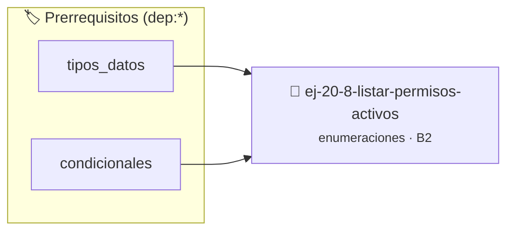

# Listar permisos activos
> **ID:** `ej-20-8-listar-permisos-activos` · **Unidad:** 2 (Tipos Compuestos y Direccionamiento)
 · **Tema:** `enumeraciones` / `listas_enlazadas`
 · **Bloom:** B2 (Comprender) · **Dificultad:** Inicial
 · **Carga:** ~15 min · **Tipo:** Practica Guiada
>
> **🏷️ Prerrequisitos temáticos (tags):** `dep:tipos_datos`, `dep:condicionales`
>
> **Etiquetas conceptuales:** `tipos`, `permisos`, `memoria`, `enum`, `activos`


::: {admonition} 📦 Paquete de Verificación Local (Ripley)
:class: tip

Para compilar, resolver y autoevaluar tu entrega con pruebas unitarias en tu máquina:

- [📥 **Descargar paquete `ej-20-8-listar-permisos-activos.ripkg`**](../../paquetes/ej-20-8-listar-permisos-activos.ripkg)

Ejecución con el asistente de cátedra:
```bash
ripley run ej-20-8-listar-permisos-activos.ripkg
```
:::


### 🗺️ Itinerario Pedagógico




## 📖 Consigna

### Ejercicio 20.8 - Listar permisos activos ⭐⭐☆☆☆

Implementar una función que imprima todos los permisos activos en un conjunto de
permisos.


:::{hint} Lógica y Consideraciones

-   **[*plus ultra*]:** Garantizar la terminación con `\0` y prevenir
    desbordamientos de búfer validando la capacidad máxima.
-   **[*plus ultra*]:** Soportar la lectura de cadenas con espacios y múltiples
    líneas de manera robusta.

:::
<!-- {hint} Lógica y Consideraciones -->

``` c
void mostrar_permisos(unsigned int permisos);
```
<!-- c -->

## Colores RGB con Enum

Definir una enumeración para colores predefinidos y una estructura para
representar colores RGB personalizados.

```{code-block} c
:linenos:
enum color_predefinido
{
    COLOR_NEGRO,
    COLOR_BLANCO,
    COLOR_ROJO,
    COLOR_VERDE,
    COLOR_AZUL,
    COLOR_AMARILLO,
    COLOR_MAGENTA,
    COLOR_CIAN
};
typedef struct
{
    unsigned char r;
    unsigned char g;
    unsigned char b;
} rgb_t;
```
<!-- {code-block} c -->


## 📋 Prototipos y Cabecera (`ej-20-8-listar-permisos-activos.h`)

```{code-block} c
#ifndef EJERCICIO_EJ_20_8_LISTAR_PERMISOS_ACTIVOS_H
#define EJERCICIO_EJ_20_8_LISTAR_PERMISOS_ACTIVOS_H

#include <stddef.h>
#include <stdbool.h>
#include <stdint.h>

/* Procesa el flujo principal de Listar permisos activos */
int proc_tar_permisos_activos(int val);

#endif /* EJERCICIO_EJ_20_8_LISTAR_PERMISOS_ACTIVOS_H */
```


## ⚙️ Especificación de Funciones

| Función | Retorno | Parámetros | Descripción |
| :--- | :--- | :--- | :--- |

| `proc_tar_permisos_activos` | `int` | `int val` | Procesa el flujo principal de Listar permisos activos |


## 💡 Pistas Progresivas

````{tab-set}

```{tab-item} Pista 1
[Plus Ultra] Garantizar la terminación con `\0` y prevenir desbordamientos de búfer validando la capacidad máxima.
```

```{tab-item} Pista 2
[Plus Ultra] Soportar la lectura de cadenas con espacios y múltiples líneas de manera robusta.
```

````


## 🧪 Casos de Prueba

| Prueba Unitaria | Función Objetivo | Verificación |
| :--- | :--- | :--- |

| **test_proc_tar_permisos_activos_positivo** | `proc_tar_permisos_activos` | `int res = proc_tar_permisos_activos(5); assert(res == 10 || res >= 0);` |

| **test_proc_tar_permisos_activos_cero** | `proc_tar_permisos_activos` | `int res = proc_tar_permisos_activos(0); assert(res == 0);` |


## ✓ Solución Modelo de Cátedra

```{dropdown} 🔍 Revelar solución canónica en C
:open: false

```{code-block} c
enum color_predefinido
{
    COLOR_NEGRO,
    COLOR_BLANCO,
    COLOR_ROJO,
    COLOR_VERDE,
    COLOR_AZUL,
    COLOR_AMARILLO,
    COLOR_MAGENTA,
    COLOR_CIAN
};
typedef struct
{
    unsigned char r;
    unsigned char g;
    unsigned char b;
} rgb_t;


int proc_tar_permisos_activos(int val)
{
    if (val <= 0) return 0;
    return val * 2;
}

int main(void)
{
    return 0;
}
```
```
