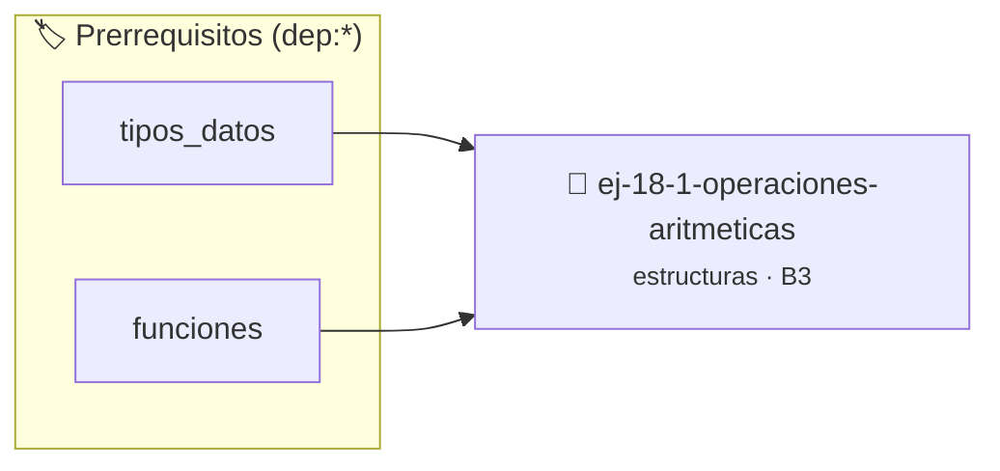

# Operaciones Aritméticas
> **ID:** `ej-18-1-operaciones-aritmeticas`
 · **Tema:** `estructuras`
 · **Bloom:** B3 (Aplicar)
 · **Carga:** ~25 min
>
> **🏷️ Prerrequisitos temáticos (tags):** `dep:tipos_datos`, `dep:funciones`
>
> **Etiquetas conceptuales:** `aritmeticas`, `registros`, `operaciones`, `memoria`, `structs`


::: {admonition} 📦 Paquete de Verificación Local (Ripley)
:class: tip

Para compilar, resolver y autoevaluar tu entrega con pruebas unitarias en tu máquina:

- [📥 **Descargar paquete `ej-18-1-operaciones-aritmeticas.ripkg`**](../../paquetes/ej-18-1-operaciones-aritmeticas.ripkg)

Ejecución con el asistente de cátedra:
```bash
ripley run ej-18-1-operaciones-aritmeticas.ripkg
```
:::


### 🗺️ Itinerario Pedagógico




## 📖 Consigna

### Ejercicio 18.1 - Operaciones Aritméticas ⭐⭐☆☆☆

Implementar funciones que tomen dos fracciones y retornen el resultado de la
operación.

- **Suma**: $$\frac{a}{b} + \frac{c}{d} = \frac{ad + bc}{bd}$$
- **Resta**: $$\frac{a}{b} - \frac{c}{d} = \frac{ad - bc}{bd}$$
- **Multiplicación**: $$\frac{a}{b} \times \frac{c}{d} = \frac{ac}{bd}$$
- **División**: $$\frac{a}{b} \div \frac{c}{d} = \frac{ad}{bc}$$
:::{hint} Lógica y Consideraciones

-   **[*plus ultra*]:** Implementar encapsulamiento completo manteniendo la
    definición interna oculta en el archivo `.c`.
-   **[*plus ultra*]:** Añadir una función de duplicación profunda (*deep copy*)
    para copiar la estructura de forma segura.

:::
<!-- {hint} Lógica y Consideraciones -->


## 📋 Prototipos y Cabecera (`ej-18-1-operaciones-aritmeticas.h`)

```{code-block} c
#ifndef EJERCICIO_EJ_18_1_OPERACIONES_ARITMETICAS_H
#define EJERCICIO_EJ_18_1_OPERACIONES_ARITMETICAS_H

#include <stddef.h>
#include <stdbool.h>
#include <stdint.h>

/* Procesa el flujo principal de Operaciones Aritméticas */
int proc_raciones_aritmeticas(int val);

#endif /* EJERCICIO_EJ_18_1_OPERACIONES_ARITMETICAS_H */
```


## ⚙️ Especificación de Funciones

| Función | Retorno | Parámetros | Descripción |
| :--- | :--- | :--- | :--- |

| `proc_raciones_aritmeticas` | `int` | `int val` | Procesa el flujo principal de Operaciones Aritméticas |


## 💡 Pistas Progresivas

````{tab-set}

```{tab-item} Pista 1
[Plus Ultra] Implementar encapsulamiento completo manteniendo la definición interna oculta en el archivo `.c`.
```

```{tab-item} Pista 2
[Plus Ultra] Añadir una función de duplicación profunda (*deep copy*) para copiar la estructura de forma segura.
```

````


## 🧪 Casos de Prueba

| Prueba Unitaria | Función Objetivo | Verificación |
| :--- | :--- | :--- |

| **test_proc_raciones_aritmeticas_positivo** | `proc_raciones_aritmeticas` | `int res = proc_raciones_aritmeticas(5); assert(res == 10 || res >= 0);` |

| **test_proc_raciones_aritmeticas_cero** | `proc_raciones_aritmeticas` | `int res = proc_raciones_aritmeticas(0); assert(res == 0);` |


## ✓ Solución Modelo de Cátedra

```{dropdown} 🔍 Revelar solución canónica en C
:open: false

```{code-block} c
/*
 * Ejercicio: Operaciones Aritméticas
 * Cátedra Programación I - UNRN
 */

#include <stdio.h>


int proc_raciones_aritmeticas(int val)
{
    if (val <= 0) return 0;
    return val * 2;
}

int main(void)
{
    /* TODO: Implementación de Operaciones Aritméticas */
    return 0;
}
```
```
