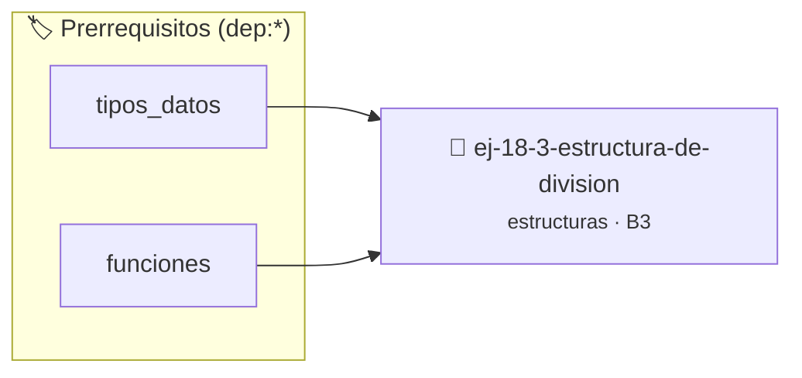

# Estructura de división
> **ID:** `ej-18-3-estructura-de-division`
 · **Tema:** `estructuras`
 · **Bloom:** B3 (Aplicar)
 · **Carga:** ~25 min
>
> **🏷️ Prerrequisitos temáticos (tags):** `dep:tipos_datos`, `dep:funciones`
>
> **Etiquetas conceptuales:** `registros`, `memoria`, `estructura`, `division`, `structs`


::: {admonition} 📦 Paquete de Verificación Local (Ripley)
:class: tip

Para compilar, resolver y autoevaluar tu entrega con pruebas unitarias en tu máquina:

- [📥 **Descargar paquete `ej-18-3-estructura-de-division.ripkg`**](../../paquetes/ej-18-3-estructura-de-division.ripkg)

Ejecución con el asistente de cátedra:
```bash
ripley run ej-18-3-estructura-de-division.ripkg
```
:::


### 🗺️ Itinerario Pedagógico




## 📖 Consigna

### Ejercicio 18.3 - Estructura de división ⭐⭐⭐☆☆

La división entera en C (`/` y `%`) produce dos resultados. El objetivo es
unificar estas operaciones en una única función que retorne una `struct` con el
cociente y el resto, basándose en el algoritmo de la división.

$$dividendo = divisor \times cociente + resto, \quad \text{donde } 0 \le resto < |divisor|$$


:::{hint} Lógica y Consideraciones

-   **[*plus ultra*]:** Garantizar la terminación con `\0` y prevenir
    desbordamientos de búfer validando la capacidad máxima.
-   **[*plus ultra*]:** Soportar la lectura de cadenas con espacios y múltiples
    líneas de manera robusta.

:::
<!-- {hint} Lógica y Consideraciones -->

``` c
typedef struct
{
    int cociente;
    int resto;
} division_t;
division_t division_lenta(int dividendo, int divisor);
```
<!-- c -->

---

## Medición de Tiempo

Desarrollar una estructura `tiempo_t` para representar un instante o duración en
horas, minutos y segundos, junto con funciones para manipularla.

``` c
typedef struct
{
    int horas;
    int minutos;
    int segundos;
} tiempo_t;
```
<!-- c -->


## 📋 Prototipos y Cabecera (`ej-18-3-estructura-de-division.h`)

```{code-block} c
#ifndef EJERCICIO_EJ_18_3_ESTRUCTURA_DE_DIVISION_H
#define EJERCICIO_EJ_18_3_ESTRUCTURA_DE_DIVISION_H

#include <stddef.h>
#include <stdbool.h>
#include <stdint.h>

/* Procesa el flujo principal de Estructura de división */
int proc_tructura_de_division(int val);

#endif /* EJERCICIO_EJ_18_3_ESTRUCTURA_DE_DIVISION_H */
```


## ⚙️ Especificación de Funciones

| Función | Retorno | Parámetros | Descripción |
| :--- | :--- | :--- | :--- |

| `proc_tructura_de_division` | `int` | `int val` | Procesa el flujo principal de Estructura de división |


## 💡 Pistas Progresivas

````{tab-set}

```{tab-item} Pista 1
[Plus Ultra] Garantizar la terminación con `\0` y prevenir desbordamientos de búfer validando la capacidad máxima.
```

```{tab-item} Pista 2
[Plus Ultra] Soportar la lectura de cadenas con espacios y múltiples líneas de manera robusta.
```

````


## 🧪 Casos de Prueba

| Prueba Unitaria | Función Objetivo | Verificación |
| :--- | :--- | :--- |

| **test_proc_tructura_de_division_positivo** | `proc_tructura_de_division` | `int res = proc_tructura_de_division(5); assert(res == 10 || res >= 0);` |

| **test_proc_tructura_de_division_cero** | `proc_tructura_de_division` | `int res = proc_tructura_de_division(0); assert(res == 0);` |


## ✓ Solución Modelo de Cátedra

```{dropdown} 🔍 Revelar solución canónica en C
:open: false

```{code-block} c
/*
 * Ejercicio: Estructura de división
 * Cátedra Programación I - UNRN
 */

#include <stdio.h>


int proc_tructura_de_division(int val)
{
    if (val <= 0) return 0;
    return val * 2;
}

int main(void)
{
    /* TODO: Implementación de Estructura de división */
    return 0;
}
```
```
