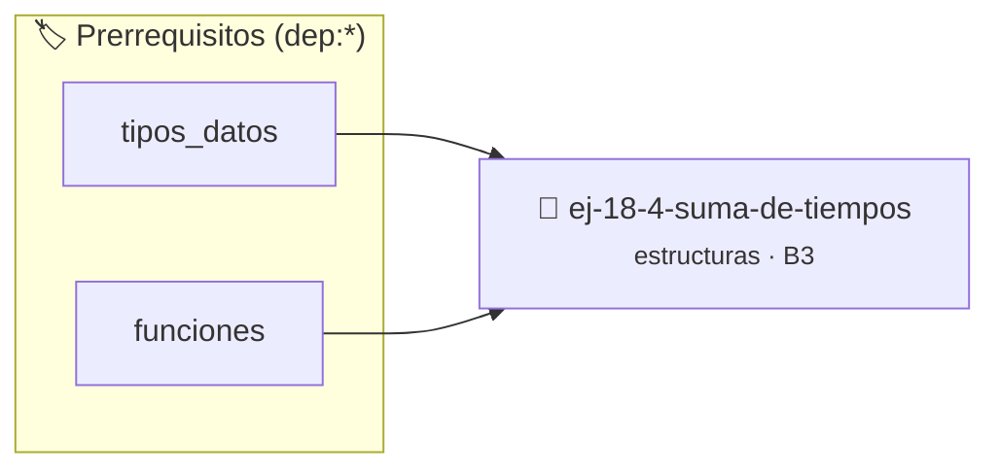

# Suma de Tiempos
> **ID:** `ej-18-4-suma-de-tiempos`
 · **Tema:** `estructuras`
 · **Bloom:** B3 (Aplicar)
 · **Carga:** ~25 min
>
> **🏷️ Prerrequisitos temáticos (tags):** `dep:tipos_datos`, `dep:funciones`
>
> **Etiquetas conceptuales:** `registros`, `tiempos`, `structs`, `memoria`


::: {admonition} 📦 Paquete de Verificación Local (Ripley)
:class: tip

Para compilar, resolver y autoevaluar tu entrega con pruebas unitarias en tu máquina:

- [📥 **Descargar paquete `ej-18-4-suma-de-tiempos.ripkg`**](../../paquetes/ej-18-4-suma-de-tiempos.ripkg)

Ejecución con el asistente de cátedra:
```bash
ripley run ej-18-4-suma-de-tiempos.ripkg
```
:::


### 🗺️ Itinerario Pedagógico




## 📖 Consigna

### Ejercicio 18.4 - Suma de Tiempos ⭐⭐☆☆☆

Implementar una función que sume dos `tiempo_t`. El resultado debe ser
normalizado para que los segundos y minutos no excedan 59.

- $S_{total} = t_1.segundos + t_2.segundos$
- $M_{acarreo} = S_{total} / 60$
- $S_{resultado} = S_{total} \% 60$
- $M_{total} = t_1.minutos + t_2.minutos + M_{acarreo}$
- $H_{acarreo} = M_{total} / 60$
- $M_{resultado} = M_{total} \% 60$
- $H_{resultado} = t_1.horas + t_2.horas + H_{acarreo}$
:::{hint} Lógica y Consideraciones

-   **[*plus ultra*]:** Implementar encapsulamiento completo manteniendo la
    definición interna oculta en el archivo `.c`.
-   **[*plus ultra*]:** Añadir una función de duplicación profunda (*deep copy*)
    para copiar la estructura de forma segura.

:::
<!-- {hint} Lógica y Consideraciones -->


## 📋 Prototipos y Cabecera (`ej-18-4-suma-de-tiempos.h`)

```{code-block} c
#ifndef EJERCICIO_EJ_18_4_SUMA_DE_TIEMPOS_H
#define EJERCICIO_EJ_18_4_SUMA_DE_TIEMPOS_H

#include <stddef.h>
#include <stdbool.h>
#include <stdint.h>

/* Procesa el flujo principal de Suma de Tiempos */
int proc_18_4_suma_de_tiempos(int val);

#endif /* EJERCICIO_EJ_18_4_SUMA_DE_TIEMPOS_H */
```


## ⚙️ Especificación de Funciones

| Función | Retorno | Parámetros | Descripción |
| :--- | :--- | :--- | :--- |

| `proc_18_4_suma_de_tiempos` | `int` | `int val` | Procesa el flujo principal de Suma de Tiempos |


## 💡 Pistas Progresivas

````{tab-set}

```{tab-item} Pista 1
[Plus Ultra] Implementar encapsulamiento completo manteniendo la definición interna oculta en el archivo `.c`.
```

```{tab-item} Pista 2
[Plus Ultra] Añadir una función de duplicación profunda (*deep copy*) para copiar la estructura de forma segura.
```

````


## 🧪 Casos de Prueba

| Prueba Unitaria | Función Objetivo | Verificación |
| :--- | :--- | :--- |

| **test_proc_18_4_suma_de_tiempos_positivo** | `proc_18_4_suma_de_tiempos` | `int res = proc_18_4_suma_de_tiempos(5); assert(res == 10 || res >= 0);` |

| **test_proc_18_4_suma_de_tiempos_cero** | `proc_18_4_suma_de_tiempos` | `int res = proc_18_4_suma_de_tiempos(0); assert(res == 0);` |


## ✓ Solución Modelo de Cátedra

```{dropdown} 🔍 Revelar solución canónica en C
:open: false

```{code-block} c
/*
 * Ejercicio: Suma de Tiempos
 * Cátedra Programación I - UNRN
 */

#include <stdio.h>


int proc_18_4_suma_de_tiempos(int val)
{
    if (val <= 0) return 0;
    return val * 2;
}

int main(void)
{
    /* TODO: Implementación de Suma de Tiempos */
    return 0;
}
```
```
