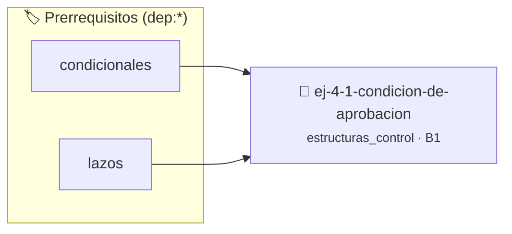

# Condición de aprobación
> **ID:** `ej-4-1-condicion-de-aprobacion` · **Unidad:** 1 (Fundamentos y Estructuras de Control)
 · **Tema:** `estructuras_control` / `control`
 · **Bloom:** B1 (Recordar) · **Dificultad:** Inicial
 · **Carga:** ~10 min · **Tipo:** Concepto
>
> **🏷️ Prerrequisitos temáticos (tags):** `dep:condicionales`, `dep:lazos`
>
> **Etiquetas conceptuales:** `control`, `lazos`, `fundamentos`, `aprobacion`, `condicionales`


::: {admonition} 📦 Paquete de Verificación Local (Ripley)
:class: tip

Para compilar, resolver y autoevaluar tu entrega con pruebas unitarias en tu máquina:

- [📥 **Descargar paquete `ej-4-1-condicion-de-aprobacion.ripkg`**](../../paquetes/ej-4-1-condicion-de-aprobacion.ripkg)

Ejecución con el asistente de cátedra:
```bash
ripley run ej-4-1-condicion-de-aprobacion.ripkg
```
:::


### 🗺️ Itinerario Pedagógico




## 📖 Consigna

### Ejercicio 4.1 - Condición de aprobación ⭐⭐☆☆☆

:::{exercise}
:label: entrada-2
:enumerator: entrada-2
Pedí al usuario que ingrese su nota final (entera) e imprimí su condición:
- "Promociona" si la nota es mayor o igual a 6.
- "Aprueba" si la nota es mayor o igual a 4 pero menor a 6.
- "Desaprueba" si la nota es menor a 4.
    desbordamientos de búfer validando la capacidad máxima.
    líneas de manera robusta.

-   **[*plus ultra*]:** Validar que la calificación esté dentro del rango válido [1, 10].
-   **[*plus ultra*]:** Modularizar la condición en una función booleana independiente.

:::
<!-- {exercise} -->

:::{solution} entrada-2
:class: dropdown

```{code-block} c
:linenos:
#include <stdio.h>
int main(void)
{
    int nota = 0;
    printf("Ingrese la nota: ");
    if (scanf("%d", &nota) != 1)
    {
        printf("Error al leer la nota.\n");
        return 1;
    }
    if (nota >= 6)
    {
        printf("Promociona\n");
    }
    else if (nota >= 4)
    {
        printf("Aprueba\n");
    }
    else
    {
        printf("Desaprueba\n");
    }
    return 0;
}
```
<!-- {code-block} c -->

:::
<!-- {solution} entrada-2 -->

---

## Estructuras de Repetición (Lazos)


## 📋 Prototipos y Cabecera (`ej-4-1-condicion-de-aprobacion.h`)

```{code-block} c
#ifndef EJERCICIO_EJ_4_1_CONDICION_DE_APROBACION_H
#define EJERCICIO_EJ_4_1_CONDICION_DE_APROBACION_H

#include <stddef.h>
#include <stdbool.h>
#include <stdint.h>

/* Procesa el flujo principal de Condición de aprobación */
int proc_dicion_de_aprobacion(int val);

#endif /* EJERCICIO_EJ_4_1_CONDICION_DE_APROBACION_H */
```


## ⚙️ Especificación de Funciones

| Función | Retorno | Parámetros | Descripción |
| :--- | :--- | :--- | :--- |

| `proc_dicion_de_aprobacion` | `int` | `int val` | Procesa el flujo principal de Condición de aprobación |


## 🧪 Casos de Prueba

| Prueba Unitaria | Función Objetivo | Verificación |
| :--- | :--- | :--- |

| **test_proc_dicion_de_aprobacion_positivo** | `proc_dicion_de_aprobacion` | `int res = proc_dicion_de_aprobacion(5); assert(res == 10 || res >= 0);` |

| **test_proc_dicion_de_aprobacion_cero** | `proc_dicion_de_aprobacion` | `int res = proc_dicion_de_aprobacion(0); assert(res == 0);` |


## ✓ Solución Modelo de Cátedra

```{dropdown} 🔍 Revelar solución canónica en C
:open: false

```{code-block} c
#include <stdio.h>

int proc_dicion_de_aprobacion(int val)
{
    if (val <= 0) return 0;
    return val * 2;
}

int main(void)
{
    int nota = 0;
    printf("Ingrese la nota: ");
    if (scanf("%d", &nota) != 1)
    {
        printf("Error al leer la nota.\n");
        return 1;
    }
    if (nota >= 6)
    {
        printf("Promociona\n");
    }
    else if (nota >= 4)
    {
        printf("Aprueba\n");
    }
    else
    {
        printf("Desaprueba\n");
    }
    return 0;
}
```
```
