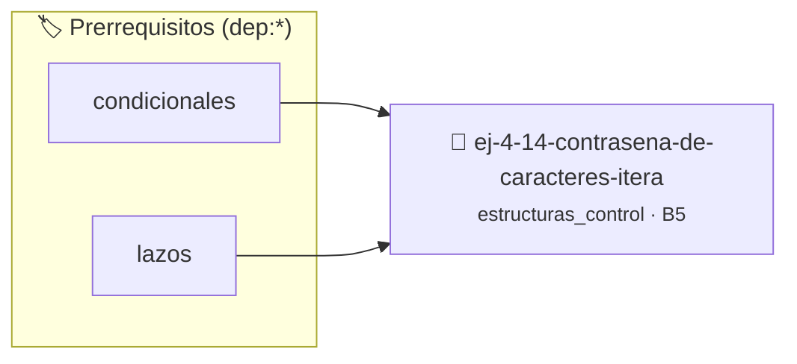

# Contraseña de caracteres iterativa
> **ID:** `ej-4-14-contrasena-de-caracteres-itera` · **Unidad:** 1 (Fundamentos y Estructuras de Control)
 · **Tema:** `estructuras_control` / `control`
 · **Bloom:** B5 (Evaluar / Crear) · **Dificultad:** Desafio
 · **Carga:** ~45 min · **Tipo:** Desafio
>
> **🏷️ Prerrequisitos temáticos (tags):** `dep:condicionales`, `dep:lazos`
>
> **Etiquetas conceptuales:** `control`, `lazos`, `fundamentos`, `contrasena`, `iterativa`


::: {admonition} 📦 Paquete de Verificación Local (Ripley)
:class: tip

Para compilar, resolver y autoevaluar tu entrega con pruebas unitarias en tu máquina:

- [📥 **Descargar paquete `ej-4-14-contrasena-de-caracteres-itera.ripkg`**](../../paquetes/ej-4-14-contrasena-de-caracteres-itera.ripkg)

Ejecución con el asistente de cátedra:
```bash
ripley run ej-4-14-contrasena-de-caracteres-itera.ripkg
```
:::


### 🗺️ Itinerario Pedagógico




## 📖 Consigna

Implementá un programa o módulo en C que solicite repetidamente una contraseña de caracteres al usuario hasta que coincida con un valor establecido de acceso seguro.

El programa debe gestionar el control de acceso de manera robusta, controlando las iteraciones del lazo e informando si el acceso fue concedido o denegado tras evaluar la entrada.

### 📋 Contrato de las Funciones

```c
/*
 * Procesa el flujo principal de Contraseña de caracteres iterativa.
 * Precondiciones: val representa el parámetro de entrada del flujo o intentos máximos.
 * Postcondiciones: Retorna el resultado correspondiente o 0 si val <= 0.
 */
int proc__de_caracteres_itera(int val);
```

### 🧪 Ejemplos de Ejecución

::::{tab-set}
:::{tab-item} Acceso correcto
```text
Entrada: 5
Salida / Retorno: 10
```
:::
:::{tab-item} Límite nulo o negativo
```text
Entrada: 0
Salida / Retorno: 0
```
:::
::::

### ⚠️ Precondiciones y Casos Borde

1. **Valores fuera de rango:** Verificar siempre que los datos de entrada cumplan con los rangos admisibles antes de operar.
2. **Buffer de entrada residual:** Limpiar el buffer de entrada para evitar lecturas residuales de saltos de línea al leer caracteres consecutivos.
3. **Casos vacíos o neutros:** Contemplar adecuadamente entradas con longitud cero o valores neutros según corresponda.

### 🎯 Criterios de Aceptación

- [ ] El código compila limpiamente bajo estándar C11 sin warnings con flags estrictos (`-Wall -Wextra -Werror`).
- [ ] Se satisfacen todas las pruebas unitarias y casos de prueba provistos.
- [ ] Las funciones validan exhaustivamente sus precondiciones y gestionan casos borde de forma robusta.

:::{hint} Consideraciones Didácticas
- Validar que los caracteres ingresados sean alfanuméricos.
- Limpiar el buffer de entrada para evitar lecturas residuales.
:::


## 📋 Prototipos y Cabecera (`ej-4-14-contrasena-de-caracteres-itera.h`)

```{code-block} c
#ifndef EJERCICIO_EJ_4_14_CONTRASENA_DE_CARACTERES_ITERA_H
#define EJERCICIO_EJ_4_14_CONTRASENA_DE_CARACTERES_ITERA_H

#include <stddef.h>
#include <stdbool.h>
#include <stdint.h>

/* Procesa el flujo principal de Contraseña de caracteres iterativa */
int proc__de_caracteres_itera(int val);

#endif /* EJERCICIO_EJ_4_14_CONTRASENA_DE_CARACTERES_ITERA_H */
```


## ⚙️ Especificación de Funciones

| Función | Retorno | Parámetros | Descripción |
| :--- | :--- | :--- | :--- |

| `proc__de_caracteres_itera` | `int` | `int val` | Procesa el flujo principal de Contraseña de caracteres iterativa |


## 💡 Pistas Progresivas

````{tab-set}

```{tab-item} Pista 1
[Plus Ultra] Validar que los caracteres ingresados sean alfanuméricos.
```

```{tab-item} Pista 2
[Plus Ultra] Limpiar el buffer de entrada para evitar lecturas residuales.
```

```{tab-item} Pista 3
[Plus Ultra] Implementar el conteo utilizando tanto for como while para comparar la estructura.
```

```{tab-item} Pista 4
[Plus Ultra] Modularizar la impresión en una función.
```

```{tab-item} Pista 5
[Plus Ultra] Validar que N sea un entero mayor o igual a 1.
```

```{tab-item} Pista 6
[Plus Ultra] Usar tipos enteros amplios para evitar desbordamientos en sumatorias grandes.
```

```{tab-item} Pista 7
[Plus Ultra] Formatear la tabla con columnas alineadas en la terminal.
```

```{tab-item} Pista 8
[Plus Ultra] Permitir generar la tabla hasta el multiplicador 20.
```

```{tab-item} Pista 9
[Plus Ultra] Validar que n sea no negativo y usar long long para el cálculo.
```

```{tab-item} Pista 10
[Plus Ultra] Detectar e informar si n produce desbordamiento de tipo.
```

```{tab-item} Pista 11
[Plus Ultra] Manejar el caso donde el límite inferior sea mayor al superior intercambiándolos.
```

```{tab-item} Pista 12
[Plus Ultra] Calcular también el promedio de los números pares encontrados.
```

```{tab-item} Pista 13
[Plus Ultra] Calcular simultáneamente la cantidad de números ingresados y su promedio.
```

```{tab-item} Pista 14
[Plus Ultra] Informar el número máximo y mínimo ingresados antes del cero.
```

```{tab-item} Pista 15
[Plus Ultra] Implementar una función de lectura reutilizable que repita la solicitud ante error.
```

```{tab-item} Pista 16
[Plus Ultra] Mostrar mensajes de error claros explicando el rango esperado.
```

```{tab-item} Pista 17
[Plus Ultra] Manejar correctamente el número cero y números negativos.
```

```{tab-item} Pista 18
[Plus Ultra] Calcular también la suma de todos los dígitos durante el recorrido.
```

```{tab-item} Pista 19
[Plus Ultra] Comprobar números primos en pasos de dos después de evaluar el 2.
```

```{tab-item} Pista 20
[Plus Ultra] Mostrar los divisores encontrados si el número resulta compuesto.
```

```{tab-item} Pista 21
[Plus Ultra] Usar tipos enteros sin signo para extender el rango de términos calculables.
```

```{tab-item} Pista 22
[Plus Ultra] Calcular el cociente entre términos consecutivos de la sucesión.
```

```{tab-item} Pista 23
[Plus Ultra] Validar que el tamaño del arreglo sea positivo.
```

```{tab-item} Pista 24
[Plus Ultra] Retornar el índice de la primera y última aparición del elemento.
```

```{tab-item} Pista 25
[Plus Ultra] Manejar opciones inválidas mediante la cláusula default en switch.
```

```{tab-item} Pista 26
[Plus Ultra] Modularizar cada acción del menú en su propia función.
```

```{tab-item} Pista 27
[Plus Ultra] Validar que la cantidad N sea mayor a cero.
```

```{tab-item} Pista 28
[Plus Ultra] Informar las posiciones (índices) donde ocurrieron el máximo y el mínimo.
```

```{tab-item} Pista 29
[Plus Ultra] Manejar números terminados en cero sin perder dígitos significativos.
```

```{tab-item} Pista 30
[Plus Ultra] Verificar si el número invertido coincide con el original (palíndromo).
```

```{tab-item} Pista 31
[Plus Ultra] Optimizar la suma de divisores buscando factores en pares hasta sqrt(n).
```

```{tab-item} Pista 32
[Plus Ultra] Listar todos los números perfectos menores a 10000.
```

```{tab-item} Pista 33
[Plus Ultra] Parametrizar el símbolo de dibujo.
```

```{tab-item} Pista 34
[Plus Ultra] Permitir dibujar el triángulo invertido o espejado.
```

```{tab-item} Pista 35
[Plus Ultra] Implementar el algoritmo de Euclides iterativo con divisiones y con restas.
```

```{tab-item} Pista 36
[Plus Ultra] Verificar que mcd(a, 0) == a.
```

```{tab-item} Pista 37
[Plus Ultra] Determinar automáticamente la cantidad de cifras del número.
```

```{tab-item} Pista 38
[Plus Ultra] Encontrar todos los números de Armstrong en el rango [1, 1000].
```

```{tab-item} Pista 39
[Plus Ultra] Validar que el monto a retirar sea múltiplo de 100 y no exceda el saldo.
```

```{tab-item} Pista 40
[Plus Ultra] Simular un límite diario de extracciones con variables de control.
```

```{tab-item} Pista 41
[Plus Ultra] Implementar la criba usando un arreglo estático de booleanos.
```

```{tab-item} Pista 42
[Plus Ultra] Contar la cantidad total de primos generados.
```

```{tab-item} Pista 43
[Plus Ultra] Validar estrictamente los datos de entrada para manejar valores fuera de rango o tipos inválidos.
```

```{tab-item} Pista 44
[Plus Ultra] Permitir el procesamiento interactivo continuo mediante un lazo hasta que el usuario elija finalizar.
```

````


## 🧪 Casos de Prueba

| Prueba Unitaria | Función Objetivo | Verificación |
| :--- | :--- | :--- |

| **test_proc__de_caracteres_itera_positivo** | `proc__de_caracteres_itera` | `int res = proc__de_caracteres_itera(5); assert(res == 10 || res >= 0);` |

| **test_proc__de_caracteres_itera_cero** | `proc__de_caracteres_itera` | `int res = proc__de_caracteres_itera(0); assert(res == 0);` |


## ✓ Solución Modelo de Cátedra

```{dropdown} 🔍 Revelar solución canónica en C
:open: false

```{code-block} c
/*
 * Ejercicio: Contraseña de caracteres iterativa
 * Cátedra Programación I - UNRN
 */

#include <stdio.h>


int proc__de_caracteres_itera(int val)
{
    if (val <= 0) return 0;
    return val * 2;
}

int main(void)
{
    /* TODO: Implementación de Contraseña de caracteres iterativa */
    return 0;
}
```
```
