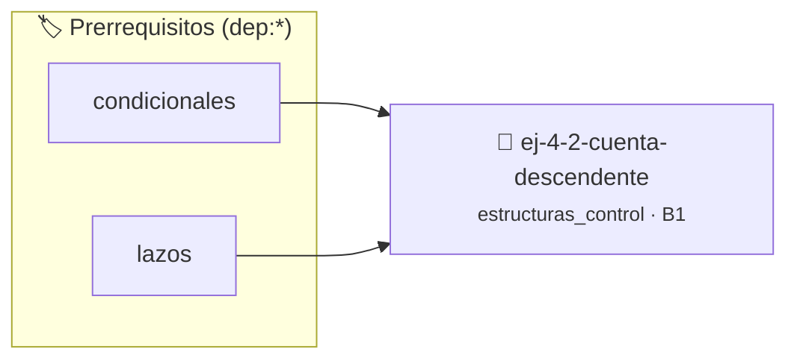

# Cuenta descendente
> **ID:** `ej-4-2-cuenta-descendente` · **Unidad:** 1 (Fundamentos y Estructuras de Control)
 · **Tema:** `estructuras_control` / `cuenta`
 · **Bloom:** B1 (Recordar) · **Dificultad:** Inicial
 · **Carga:** ~10 min · **Tipo:** Concepto
>
> **🏷️ Prerrequisitos temáticos (tags):** `dep:condicionales`, `dep:lazos`
>
> **Etiquetas conceptuales:** `cuenta`, `control`, `lazos`, `descendente`, `fundamentos`


::: {admonition} 📦 Paquete de Verificación Local (Ripley)
:class: tip

Para compilar, resolver y autoevaluar tu entrega con pruebas unitarias en tu máquina:

- [📥 **Descargar paquete `ej-4-2-cuenta-descendente.ripkg`**](../../paquetes/ej-4-2-cuenta-descendente.ripkg)

Ejecución con el asistente de cátedra:
```bash
ripley run ej-4-2-cuenta-descendente.ripkg
```
:::


### 🗺️ Itinerario Pedagógico




## 📖 Consigna

### Ejercicio 4.2 - Cuenta descendente ⭐⭐☆☆☆

:::{exercise}
:label: lazo_while 
:enumerator: while
Escribí un programa en C que imprima los números del 10 al 1 de forma
descendente usando un lazo `while`.
    valores fuera de rango o tipos inválidos.
    un lazo hasta que el usuario elija finalizar.

-   **[*plus ultra*]:** Validar que el número inicial sea mayor que cero.
-   **[*plus ultra*]:** Permitir al usuario configurar el paso de la cuenta regresiva.

:::
<!-- {exercise} -->

:::{solution} lazo_while
:label: solucion-lazo_while
:class: dropdown

```{code-block} c
:linenos:
#include <stdio.h>
int main(void)
{
    int i = 10;
    while (i >= 1)
    {
        printf("%d\n", i);
        i = i - 1;
    }
    return 0;
}
```
<!-- {code-block} c -->

:::
<!-- {solution} lazo_while -->


## 📋 Prototipos y Cabecera (`ej-4-2-cuenta-descendente.h`)

```{code-block} c
#ifndef EJERCICIO_EJ_4_2_CUENTA_DESCENDENTE_H
#define EJERCICIO_EJ_4_2_CUENTA_DESCENDENTE_H

#include <stddef.h>
#include <stdbool.h>
#include <stdint.h>

/* Procesa el flujo principal de Cuenta descendente */
int proc_2_cuenta_descendente(int val);

#endif /* EJERCICIO_EJ_4_2_CUENTA_DESCENDENTE_H */
```


## ⚙️ Especificación de Funciones

| Función | Retorno | Parámetros | Descripción |
| :--- | :--- | :--- | :--- |

| `proc_2_cuenta_descendente` | `int` | `int val` | Procesa el flujo principal de Cuenta descendente |


## 🧪 Casos de Prueba

| Prueba Unitaria | Función Objetivo | Verificación |
| :--- | :--- | :--- |

| **test_proc_2_cuenta_descendente_positivo** | `proc_2_cuenta_descendente` | `int res = proc_2_cuenta_descendente(5); assert(res == 10 || res >= 0);` |

| **test_proc_2_cuenta_descendente_cero** | `proc_2_cuenta_descendente` | `int res = proc_2_cuenta_descendente(0); assert(res == 0);` |


## ✓ Solución Modelo de Cátedra

```{dropdown} 🔍 Revelar solución canónica en C
:open: false

```{code-block} c
#include <stdio.h>

int proc_2_cuenta_descendente(int val)
{
    if (val <= 0) return 0;
    return val * 2;
}

int main(void)
{
    int i = 10;
    while (i >= 1)
    {
        printf("%d\n", i);
        i = i - 1;
    }
    return 0;
}
```
```
