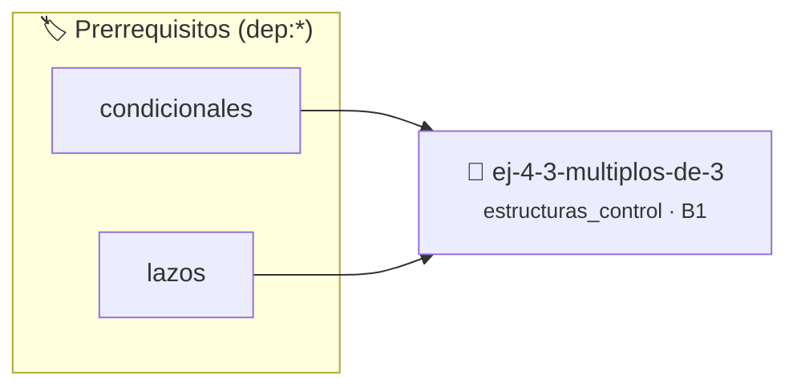

# Múltiplos de 3
> **ID:** `ej-4-3-multiplos-de-3` · **Unidad:** 1 (Fundamentos y Estructuras de Control)
 · **Tema:** `estructuras_control` / `control`
 · **Bloom:** B1 (Recordar) · **Dificultad:** Inicial
 · **Carga:** ~10 min · **Tipo:** Concepto
>
> **🏷️ Prerrequisitos temáticos (tags):** `dep:condicionales`, `dep:lazos`
>
> **Etiquetas conceptuales:** `control`, `lazos`, `fundamentos`, `condicionales`, `multiplos`


::: {admonition} 📦 Paquete de Verificación Local (Ripley)
:class: tip

Para compilar, resolver y autoevaluar tu entrega con pruebas unitarias en tu máquina:

- [📥 **Descargar paquete `ej-4-3-multiplos-de-3.ripkg`**](../../paquetes/ej-4-3-multiplos-de-3.ripkg)

Ejecución con el asistente de cátedra:
```bash
ripley run ej-4-3-multiplos-de-3.ripkg
```
:::


### 🗺️ Itinerario Pedagógico




## 📖 Consigna

### Ejercicio 4.3 - Múltiplos de 3 ⭐⭐☆☆☆

:::{exercise}
:label: lazo_for
:enumerator: for
Usá un lazo `for` para mostrar los números múltiplos de 3 comprendidos en el
rango de 0 a 30 inclusive.
    desbordamientos de búfer validando la capacidad máxima.
    líneas de manera robusta.

-   **[*plus ultra*]:** Permitir al usuario definir el límite superior hasta el cual buscar múltiplos.
-   **[*plus ultra*]:** Contar la cantidad total de múltiplos encontrados.

:::
<!-- {exercise} -->

:::{solution} lazo_for
:label: solucion-lazo_for
:class: dropdown
```{code-block} c
:linenos:
#include <stdio.h>
int main(void)
{
    for (int i = 0; i <= 30; i = i + 1)
    {
        if (i % 3 == 0)
        {
            printf("%d es múltiplo de 3\n", i);
        }
    }
    return 0;
}
```
<!-- {code-block} c -->

:::
<!-- {solution} lazo_for -->


## 📋 Prototipos y Cabecera (`ej-4-3-multiplos-de-3.h`)

```{code-block} c
#ifndef EJERCICIO_EJ_4_3_MULTIPLOS_DE_3_H
#define EJERCICIO_EJ_4_3_MULTIPLOS_DE_3_H

#include <stddef.h>
#include <stdbool.h>
#include <stdint.h>

/* Procesa el flujo principal de Múltiplos de 3 */
int ejecutar_ej_4_3_multiplos_de_3(int val);

#endif /* EJERCICIO_EJ_4_3_MULTIPLOS_DE_3_H */
```


## ⚙️ Especificación de Funciones

| Función | Retorno | Parámetros | Descripción |
| :--- | :--- | :--- | :--- |

| `ejecutar_ej_4_3_multiplos_de_3` | `int` | `int val` | Procesa el flujo principal de Múltiplos de 3 |


## 🧪 Casos de Prueba

| Prueba Unitaria | Función Objetivo | Verificación |
| :--- | :--- | :--- |

| **test_ejecutar_ej_4_3_multiplos_de_3_positivo** | `ejecutar_ej_4_3_multiplos_de_3` | `int res = ejecutar_ej_4_3_multiplos_de_3(5); assert(res == 10 || res >= 0);` |

| **test_ejecutar_ej_4_3_multiplos_de_3_cero** | `ejecutar_ej_4_3_multiplos_de_3` | `int res = ejecutar_ej_4_3_multiplos_de_3(0); assert(res == 0);` |


## ✓ Solución Modelo de Cátedra

```{dropdown} 🔍 Revelar solución canónica en C
:open: false

```{code-block} c
#include <stdio.h>

int ejecutar_ej_4_3_multiplos_de_3(int val)
{
    if (val <= 0) return 0;
    return val * 2;
}

int main(void)
{
    for (int i = 0; i <= 30; i = i + 1)
    {
        if (i % 3 == 0)
        {
            printf("%d es múltiplo de 3\n", i);
        }
    }
    return 0;
}
```
```
