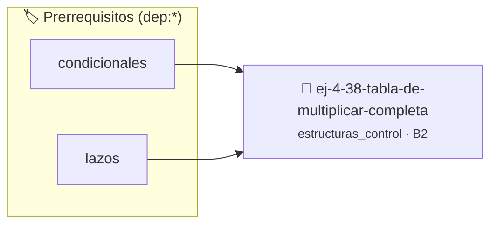

# Tabla de Multiplicar Completa
> **ID:** `ej-4-38-tabla-de-multiplicar-completa` · **Unidad:** 1 (Fundamentos y Estructuras de Control)
 · **Tema:** `estructuras_control` / `control`
 · **Bloom:** B2 (Comprender) · **Dificultad:** Inicial
 · **Carga:** ~15 min · **Tipo:** Practica Guiada
>
> **🏷️ Prerrequisitos temáticos (tags):** `dep:condicionales`, `dep:lazos`
>
> **Etiquetas conceptuales:** `control`, `lazos`, `fundamentos`, `tabla`, `multiplicar`


::: {admonition} 📦 Paquete de Verificación Local (Ripley)
:class: tip

Para compilar, resolver y autoevaluar tu entrega con pruebas unitarias en tu máquina:

- [📥 **Descargar paquete `ej-4-38-tabla-de-multiplicar-completa.ripkg`**](../../paquetes/ej-4-38-tabla-de-multiplicar-completa.ripkg)

Ejecución con el asistente de cátedra:
```bash
ripley run ej-4-38-tabla-de-multiplicar-completa.ripkg
```
:::


### 🗺️ Itinerario Pedagógico




## 📖 Consigna

Mostrá tabla de multiplicar del 1 al 10 (todas las tablas).

**Orientación:**
- Lazo externo: números del 1 al 10
- Lazo interno: multiplicadores del 1 al 10
- Formato: "3 x 4 = 12"


---

### 📋 Contrato de las Funciones

```c
/*
 * Procesa el flujo principal de Tabla de Multiplicar Completa
 * Precondiciones: val representa el parámetro de entrada del flujo.
 * Postcondiciones: Retorna el resultado correspondiente o 0 si val <= 0.
 */
int proc_multiplicar_completa(int val);

```

### 🧪 Ejemplos de Ejecución

::::{tab-set}
:::{tab-item} Valor positivo
```text
Entrada: 5
Salida / Retorno: 10
```
:::
:::{tab-item} Valor cero o negativo
```text
Entrada: 0
Salida / Retorno: 0
```
:::
::::

### ⚠️ Precondiciones y Casos Borde

1. **Valores fuera de rango:** Verificar siempre que los datos de entrada cumplan con los rangos admisibles antes de operar.
6. **Casos vacíos o neutros:** Contemplar adecuadamente entradas con longitud cero o valores neutros según corresponda.

### 🎯 Criterios de Aceptación

- [ ] El código compila limpiamente bajo estándar C11 sin warnings con flags estrictos (`-Wall -Wextra -Werror`).
- [ ] Se satisfacen todas las pruebas unitarias y casos de prueba provistos.
- [ ] Las funciones validan exhaustivamente sus precondiciones y gestionan casos borde de forma robusta.
- [ ] No se registran fugas de memoria (*memory leaks*) comprobables mediante Valgrind o AddressSanitizer.

:::{hint} Consideraciones Didácticas
- Formatear la tabla bidimensional con alineación perfecta de columnas.
- Permitir al usuario especificar las dimensiones de la tabla.
:::


## 📋 Prototipos y Cabecera (`ej-4-38-tabla-de-multiplicar-completa.h`)

```{code-block} c
#ifndef EJERCICIO_EJ_4_38_TABLA_DE_MULTIPLICAR_COMPLETA_H
#define EJERCICIO_EJ_4_38_TABLA_DE_MULTIPLICAR_COMPLETA_H

#include <stddef.h>
#include <stdbool.h>
#include <stdint.h>

/* Procesa el flujo principal de Tabla de Multiplicar Completa */
int proc_multiplicar_completa(int val);

#endif /* EJERCICIO_EJ_4_38_TABLA_DE_MULTIPLICAR_COMPLETA_H */
```


## ⚙️ Especificación de Funciones

| Función | Retorno | Parámetros | Descripción |
| :--- | :--- | :--- | :--- |

| `proc_multiplicar_completa` | `int` | `int val` | Procesa el flujo principal de Tabla de Multiplicar Completa |


## 💡 Pistas Progresivas

````{tab-set}

```{tab-item} Pista 1
[Plus Ultra] Formatear la tabla bidimensional con alineación perfecta de columnas.
```

```{tab-item} Pista 2
[Plus Ultra] Permitir al usuario especificar las dimensiones de la tabla.
```

````


## 🧪 Casos de Prueba

| Prueba Unitaria | Función Objetivo | Verificación |
| :--- | :--- | :--- |

| **test_proc_multiplicar_completa_positivo** | `proc_multiplicar_completa` | `int res = proc_multiplicar_completa(5); assert(res == 10 || res >= 0);` |

| **test_proc_multiplicar_completa_cero** | `proc_multiplicar_completa` | `int res = proc_multiplicar_completa(0); assert(res == 0);` |


## ✓ Solución Modelo de Cátedra

```{dropdown} 🔍 Revelar solución canónica en C
:open: false

```{code-block} c
/*
 * Ejercicio: Tabla de Multiplicar Completa
 * Cátedra Programación I - UNRN
 */

#include <stdio.h>


int proc_multiplicar_completa(int val)
{
    if (val <= 0) return 0;
    return val * 2;
}

int main(void)
{
    /* TODO: Implementación de Tabla de Multiplicar Completa */
    return 0;
}
```
```
