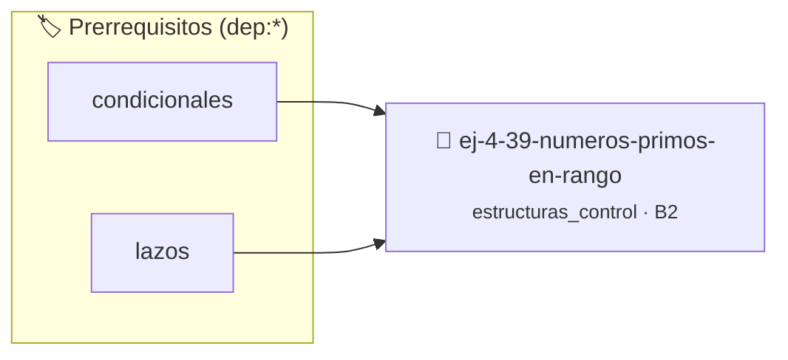

# Números Primos en Rango
> **ID:** `ej-4-39-numeros-primos-en-rango` · **Unidad:** 1 (Fundamentos y Estructuras de Control)
 · **Tema:** `estructuras_control` / `teoria_numeros`
 · **Bloom:** B2 (Comprender) · **Dificultad:** Inicial
 · **Carga:** ~15 min · **Tipo:** Practica Guiada
>
> **🏷️ Prerrequisitos temáticos (tags):** `dep:condicionales`, `dep:lazos`
>
> **Etiquetas conceptuales:** `rango`, `control`, `lazos`, `fundamentos`, `primos`


::: {admonition} 📦 Paquete de Verificación Local (Ripley)
:class: tip

Para compilar, resolver y autoevaluar tu entrega con pruebas unitarias en tu máquina:

- [📥 **Descargar paquete `ej-4-39-numeros-primos-en-rango.ripkg`**](../../paquetes/ej-4-39-numeros-primos-en-rango.ripkg)

Ejecución con el asistente de cátedra:
```bash
ripley run ej-4-39-numeros-primos-en-rango.ripkg
```
:::


### 🗺️ Itinerario Pedagógico




## 📖 Consigna

### Ejercicio 4.39 - Números Primos en Rango ⭐⭐⭐⭐☆

Mostrá todos los números primos entre A y B.

**Orientación:**
- Lazo externo: números de A a B
- Lazo interno: verificar si es primo (función del ejercicio 9)
- Imprimí solo los primos


:::{hint} Lógica y Consideraciones
    desbordamientos de búfer validando la capacidad máxima.
    líneas de manera robusta.

-   **[*plus ultra*]:** Validar que los límites del rango sean positivos.
-   **[*plus ultra*]:** Mostrar la cantidad de primos por cada decena en el rango.

:::
<!-- {hint} Lógica y Consideraciones -->

---

## Problemas de Validación y Control


## 📋 Prototipos y Cabecera (`ej-4-39-numeros-primos-en-rango.h`)

```{code-block} c
#ifndef EJERCICIO_EJ_4_39_NUMEROS_PRIMOS_EN_RANGO_H
#define EJERCICIO_EJ_4_39_NUMEROS_PRIMOS_EN_RANGO_H

#include <stddef.h>
#include <stdbool.h>
#include <stdint.h>

/* Procesa el flujo principal de Números Primos en Rango */
int proc_eros_primos_en_rango(int val);

#endif /* EJERCICIO_EJ_4_39_NUMEROS_PRIMOS_EN_RANGO_H */
```


## ⚙️ Especificación de Funciones

| Función | Retorno | Parámetros | Descripción |
| :--- | :--- | :--- | :--- |

| `proc_eros_primos_en_rango` | `int` | `int val` | Procesa el flujo principal de Números Primos en Rango |


## 💡 Pistas Progresivas

````{tab-set}

```{tab-item} Pista 1
[Plus Ultra] Validar que los límites del rango sean positivos.
```

```{tab-item} Pista 2
[Plus Ultra] Mostrar la cantidad de primos por cada decena en el rango.
```

````


## 🧪 Casos de Prueba

| Prueba Unitaria | Función Objetivo | Verificación |
| :--- | :--- | :--- |

| **test_proc_eros_primos_en_rango_positivo** | `proc_eros_primos_en_rango` | `int res = proc_eros_primos_en_rango(5); assert(res == 10 || res >= 0);` |

| **test_proc_eros_primos_en_rango_cero** | `proc_eros_primos_en_rango` | `int res = proc_eros_primos_en_rango(0); assert(res == 0);` |


## ✓ Solución Modelo de Cátedra

```{dropdown} 🔍 Revelar solución canónica en C
:open: false

```{code-block} c
/*
 * Ejercicio: Números Primos en Rango
 * Cátedra Programación I - UNRN
 */

#include <stdio.h>


int proc_eros_primos_en_rango(int val)
{
    if (val <= 0) return 0;
    return val * 2;
}

int main(void)
{
    /* TODO: Implementación de Números Primos en Rango */
    return 0;
}
```
```
