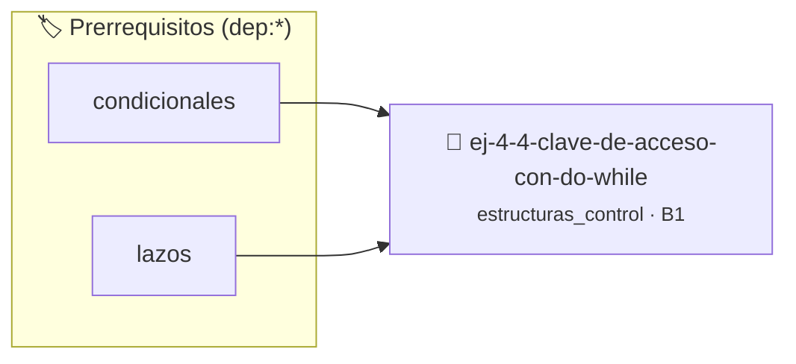

# Clave de acceso con do-while
> **ID:** `ej-4-4-clave-de-acceso-con-do-while` · **Unidad:** 1 (Fundamentos y Estructuras de Control)
 · **Tema:** `estructuras_control` / `control`
 · **Bloom:** B1 (Recordar) · **Dificultad:** Inicial
 · **Carga:** ~10 min · **Tipo:** Concepto
>
> **🏷️ Prerrequisitos temáticos (tags):** `dep:condicionales`, `dep:lazos`
>
> **Etiquetas conceptuales:** `control`, `lazos`, `acceso`, `clave`, `fundamentos`


::: {admonition} 📦 Paquete de Verificación Local (Ripley)
:class: tip

Para compilar, resolver y autoevaluar tu entrega con pruebas unitarias en tu máquina:

- [📥 **Descargar paquete `ej-4-4-clave-de-acceso-con-do-while.ripkg`**](../../paquetes/ej-4-4-clave-de-acceso-con-do-while.ripkg)

Ejecución con el asistente de cátedra:
```bash
ripley run ej-4-4-clave-de-acceso-con-do-while.ripkg
```
:::


### 🗺️ Itinerario Pedagógico




## 📖 Consigna

:::{exercise}
:label: lazo_repeat
:enumerator: for
Diseñá un programa con un lazo `do...while` que solicite repetidamente una clave
de acceso numérica al usuario hasta que ingrese el valor correcto `1234`.
    valores fuera de rango o tipos inválidos.
    un lazo hasta que el usuario elija finalizar.

-   **[*plus ultra*]:** Limitar el número máximo de intentos fallidos antes de terminar.
-   **[*plus ultra*]:** Informar cuántos intentos quedan disponibles en cada iteración.

:::

:::{solution} lazo_repeat
:label: solucion-lazo_repeat
:class: dropdown
```{code-block} c
:linenos:
#include <stdio.h>
int main(void)
{
    int clave = 0;
    int clave_correcta = 1234;
    do
    {
        printf("Ingrese la clave: ");
        if (scanf("%d", &clave) != 1)
        {
            printf("Error al leer la clave.\n");
            return 1;
        }
        if (clave != clave_correcta)
        {
            printf("Clave incorrecta. Reintente.\n");
        }
    } while (clave != clave_correcta);
    printf("Acceso concedido.\n");
    return 0;
}
```

:::

---

## Control de Flujo Seguro

### 📋 Contrato de las Funciones

```c
/*
 * Procesa el flujo principal de Clave de acceso con do-while
 * Precondiciones: val representa el parámetro de entrada del flujo.
 * Postcondiciones: Retorna el resultado correspondiente o 0 si val <= 0.
 */
int proc__acceso_con_do_while(int val);

```

### 🧪 Ejemplos de Ejecución

::::{tab-set}
:::{tab-item} Valor positivo
```text
Entrada: 5
Salida / Retorno: 10
```
:::
:::{tab-item} Valor cero o negativo
```text
Entrada: 0
Salida / Retorno: 0
```
:::
::::

### ⚠️ Precondiciones y Casos Borde

1. **Valores fuera de rango:** Verificar siempre que los datos de entrada cumplan con los rangos admisibles antes de operar.
6. **Casos vacíos o neutros:** Contemplar adecuadamente entradas con longitud cero o valores neutros según corresponda.

### 🎯 Criterios de Aceptación

- [ ] El código compila limpiamente bajo estándar C11 sin warnings con flags estrictos (`-Wall -Wextra -Werror`).
- [ ] Se satisfacen todas las pruebas unitarias y casos de prueba provistos.
- [ ] Las funciones validan exhaustivamente sus precondiciones y gestionan casos borde de forma robusta.
- [ ] No se registran fugas de memoria (*memory leaks*) comprobables mediante Valgrind o AddressSanitizer.


## 📋 Prototipos y Cabecera (`ej-4-4-clave-de-acceso-con-do-while.h`)

```{code-block} c
#ifndef EJERCICIO_EJ_4_4_CLAVE_DE_ACCESO_CON_DO_WHILE_H
#define EJERCICIO_EJ_4_4_CLAVE_DE_ACCESO_CON_DO_WHILE_H

#include <stddef.h>
#include <stdbool.h>
#include <stdint.h>

/* Procesa el flujo principal de Clave de acceso con do-while */
int proc__acceso_con_do_while(int val);

#endif /* EJERCICIO_EJ_4_4_CLAVE_DE_ACCESO_CON_DO_WHILE_H */
```


## ⚙️ Especificación de Funciones

| Función | Retorno | Parámetros | Descripción |
| :--- | :--- | :--- | :--- |

| `proc__acceso_con_do_while` | `int` | `int val` | Procesa el flujo principal de Clave de acceso con do-while |


## 🧪 Casos de Prueba

| Prueba Unitaria | Función Objetivo | Verificación |
| :--- | :--- | :--- |

| **test_proc__acceso_con_do_while_positivo** | `proc__acceso_con_do_while` | `int res = proc__acceso_con_do_while(5); assert(res == 10 || res >= 0);` |

| **test_proc__acceso_con_do_while_cero** | `proc__acceso_con_do_while` | `int res = proc__acceso_con_do_while(0); assert(res == 0);` |


## ✓ Solución Modelo de Cátedra

```{dropdown} 🔍 Revelar solución canónica en C
:open: false

```{code-block} c
#include <stdio.h>

int proc__acceso_con_do_while(int val)
{
    if (val <= 0) return 0;
    return val * 2;
}

int main(void)
{
    int clave = 0;
    int clave_correcta = 1234;
    do
    {
        printf("Ingrese la clave: ");
        if (scanf("%d", &clave) != 1)
        {
            printf("Error al leer la clave.\n");
            return 1;
        }
        if (clave != clave_correcta)
        {
            printf("Clave incorrecta. Reintente.\n");
        }
    } while (clave != clave_correcta);
    printf("Acceso concedido.\n");
    return 0;
}
```
```
