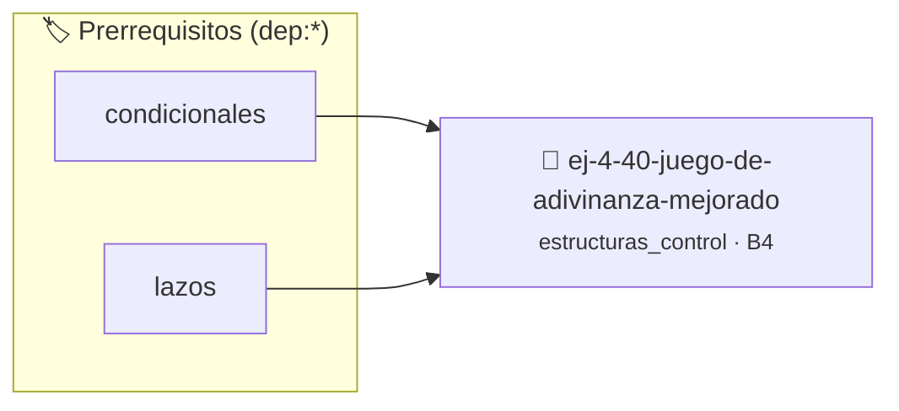

# Juego de Adivinanza Mejorado
> **ID:** `ej-4-40-juego-de-adivinanza-mejorado` · **Unidad:** 1 (Fundamentos y Estructuras de Control)
 · **Tema:** `estructuras_control` / `control`
 · **Bloom:** B4 (Analizar) · **Dificultad:** Avanzada
 · **Carga:** ~35 min · **Tipo:** Practica Guiada
>
> **🏷️ Prerrequisitos temáticos (tags):** `dep:condicionales`, `dep:lazos`
>
> **Etiquetas conceptuales:** `control`, `lazos`, `fundamentos`, `juego`, `mejorado`


::: {admonition} 📦 Paquete de Verificación Local (Ripley)
:class: tip

Para compilar, resolver y autoevaluar tu entrega con pruebas unitarias en tu máquina:

- [📥 **Descargar paquete `ej-4-40-juego-de-adivinanza-mejorado.ripkg`**](../../paquetes/ej-4-40-juego-de-adivinanza-mejorado.ripkg)

Ejecución con el asistente de cátedra:
```bash
ripley run ej-4-40-juego-de-adivinanza-mejorado.ripkg
```
:::


### 🗺️ Itinerario Pedagógico




## 📖 Consigna

Implementá un programa interactivo en C para un juego de adivinanza. La computadora elige un número pseudoaleatorio entre 1 y 100, y el usuario dispone de hasta 7 intentos para descubrirlo.

En cada turno, el usuario ingresa un número y el programa responde indicando si el número ingresado es "muy alto" o "muy bajo" respecto al objetivo. Si el usuario acierta, el juego termina inmediatamente felicitándolo y mostrando la cantidad de intentos utilizados. Si se agotan los intentos sin éxito, se revela el número secreto.

### 📋 Contrato de las Funciones

```c
/*
 * Procesa el flujo principal de Juego de Adivinanza Mejorado.
 * Precondiciones: val representa el parámetro de entrada del flujo o intentos máximos.
 * Postcondiciones: Retorna el resultado correspondiente o 0 si val <= 0.
 */
int proc__adivinanza_mejorado(int val);
```

### 🧪 Ejemplos de Ejecución

::::{tab-set}
:::{tab-item} Partida estándar
```text
Entrada: 5
Salida / Retorno: 10
```
:::
:::{tab-item} Entrada nula o negativa
```text
Entrada: 0
Salida / Retorno: 0
```
:::
::::

### ⚠️ Precondiciones y Casos Borde

1. **Valores fuera de rango:** Verificar siempre que los datos de entrada cumplan con los rangos admisibles (números entre 1 y 100) antes de operar.
2. **Entrada inválida o caracteres:** Gestionar entradas no numéricas limpiando el buffer de entrada para prevenir bucles infinitos en `scanf`.
3. **Casos vacíos o neutros:** Contemplar adecuadamente entradas con valores <= 0 retornando control de forma segura.

### 🎯 Criterios de Aceptación

- [ ] El código compila limpiamente bajo estándar C11 sin warnings con flags estrictos (`-Wall -Wextra -Werror`).
- [ ] Se satisfacen todas las pruebas unitarias y casos de prueba provistos.
- [ ] Las funciones validan exhaustivamente sus precondiciones y gestionan casos borde de forma robusta.

:::{hint} Consideraciones Didácticas
- Usar `rand() % 100 + 1` para la generación del número aleatorio.
- Controlar la cantidad de intentos restantes en un lazo `while` o `for`.
- Proveer pistas claras ("muy alto", "muy bajo") tras cada intento fallido.
:::


## 📋 Prototipos y Cabecera (`ej-4-40-juego-de-adivinanza-mejorado.h`)

```{code-block} c
#ifndef EJERCICIO_EJ_4_40_JUEGO_DE_ADIVINANZA_MEJORADO_H
#define EJERCICIO_EJ_4_40_JUEGO_DE_ADIVINANZA_MEJORADO_H

#include <stddef.h>
#include <stdbool.h>
#include <stdint.h>

/* Procesa el flujo principal de Juego de Adivinanza Mejorado */
int proc__adivinanza_mejorado(int val);

#endif /* EJERCICIO_EJ_4_40_JUEGO_DE_ADIVINANZA_MEJORADO_H */
```


## ⚙️ Especificación de Funciones

| Función | Retorno | Parámetros | Descripción |
| :--- | :--- | :--- | :--- |

| `proc__adivinanza_mejorado` | `int` | `int val` | Procesa el flujo principal de Juego de Adivinanza Mejorado |


## 💡 Pistas Progresivas

````{tab-set}

```{tab-item} Pista 1
[Plus Ultra] Implementar un sistema de puntaje basado en la cantidad de intentos restantes.
```

```{tab-item} Pista 2
[Plus Ultra] Permitir al usuario reiniciar una nueva partida sin salir del programa.
```

```{tab-item} Pista 3
Recorrer arrays
```

```{tab-item} Pista 4
Contar de A a B
```

```{tab-item} Pista 5
N iteraciones fijas **`while`:** Cuando la condición de parada se evalúa al inicio
```

```{tab-item} Pista 6
Menús interactivos
```

```{tab-item} Pista 7
Búsquedas
```

```{tab-item} Pista 8
Procesamiento hasta condición **`do-while`:** Cuando necesitás ejecutar al menos una vez
```

```{tab-item} Pista 9
Validación de entrada
```

```{tab-item} Pista 10
Menús que deben mostrarse al menos una vez
```

```{tab-item} Pista 11
"Repetir hasta que el usuario confirme"
```

```{tab-item} Pista 12
**Reducir iteraciones:** En búsqueda de primos, probar solo hasta √n
```

```{tab-item} Pista 13
**Salir temprano:** Usar `break` cuando encontrás lo que buscás
```

```{tab-item} Pista 14
**Precalcular:** Si una expresión no cambia en el lazo, calculala afuera
```

```{tab-item} Pista 15
**Evitar trabajo redundante:** Caché resultados que se reusan
```

```{tab-item} Pista 16
[Plus Ultra] Validar que argc sea mayor a 1 antes de acceder a los argumentos.
```

```{tab-item} Pista 17
[Plus Ultra] Imprimir los argumentos enumerados con su índice correspondiente.
```

```{tab-item} Pista 18
[Plus Ultra] Verificar exactamente la cantidad de argumentos requeridos con argc.
```

```{tab-item} Pista 19
[Plus Ultra] Mostrar un mensaje de uso explicativo si no se proporcionan los argumentos esperados.
```

```{tab-item} Pista 20
[Plus Ultra] Validar que los argumentos sean dígitos numéricos antes de operar.
```

```{tab-item} Pista 21
[Plus Ultra] Manejar la suma de números con signo.
```

```{tab-item} Pista 22
[Plus Ultra] Validar la división por cero y operadores no reconocidos.
```

```{tab-item} Pista 23
[Plus Ultra] Soportar operadores aritméticos básicos (+, -, *, /).
```

```{tab-item} Pista 24
[Plus Ultra] Recorrer los argumentos usando un lazo y almacenar las opciones en variables booleanas.
```

```{tab-item} Pista 25
[Plus Ultra] Manejar flags combinados o en cualquier orden.
```

```{tab-item} Pista 26
[Plus Ultra] Recorrer los argumentos con un lazo e imprimirlos con separación prolija.
```

```{tab-item} Pista 27
[Plus Ultra] Calcular la longitud total de los argumentos concatenados.
```

```{tab-item} Pista 28
[Plus Ultra] Validar que el flag de escala sea -c o -f y que el valor numérico sea válido.
```

```{tab-item} Pista 29
[Plus Ultra] Mostrar ambas temperaturas en una tabla comparativa.
```

```{tab-item} Pista 30
[Plus Ultra] Validar que la lectura desde stdin finalice limpiamente al encontrar EOF.
```

```{tab-item} Pista 31
[Plus Ultra] Contar la cantidad de caracteres procesados.
```

```{tab-item} Pista 32
[Plus Ultra] Validar que el valor posterior al flag esté presente y sea un número positivo.
```

```{tab-item} Pista 33
[Plus Ultra] Emitir mensaje de error si el flag no tiene argumento asociado.
```

```{tab-item} Pista 34
[Plus Ultra] Procesar los flags con un lazo while y switch o if-else encadenados.
```

```{tab-item} Pista 35
[Plus Ultra] Ignorar flags desconocidos emitiendo una advertencia.
```

```{tab-item} Pista 36
[Plus Ultra] Validar que la cadena represente un número entero válido mediante inspección de caracteres.
```

```{tab-item} Pista 37
[Plus Ultra] Manejar correctamente el signo negativo y espacios iniciales.
```

```{tab-item} Pista 38
[Plus Ultra] Detectar flags como -h o --help y mostrar un resumen claro de opciones.
```

```{tab-item} Pista 39
[Plus Ultra] Finalizar con código de éxito 0 tras mostrar la ayuda.
```

```{tab-item} Pista 40
[Plus Ultra] Validar que la búsqueda procese líneas de longitud arbitraria sin desbordamiento.
```

```{tab-item} Pista 41
[Plus Ultra] Resaltar o indicar el número de línea donde ocurrió la coincidencia.
```

```{tab-item} Pista 42
[Plus Ultra] Manejar múltiples espacios y saltos de línea consecutivos sin distorsionar el conteo de palabras.
```

```{tab-item} Pista 43
[Plus Ultra] Formatear los totales en columnas alineadas.
```

```{tab-item} Pista 44
[Plus Ultra] Implementar el ordenamiento de los argumentos numéricos usando un lazo burbuja básico.
```

```{tab-item} Pista 45
[Plus Ultra] Permitir ordenar en orden ascendente o descendente según un flag.
```

```{tab-item} Pista 46
[Plus Ultra] Validar que el lazo procese datos hasta EOF informando estadísticas finales.
```

```{tab-item} Pista 47
[Plus Ultra] Calcular media, máximo y mínimo de los datos leídos.
```

```{tab-item} Pista 48
[Plus Ultra] Manejar un menú de configuración con lazo de confirmación de cambios.
```

```{tab-item} Pista 49
[Plus Ultra] Restablecer los valores por defecto ante una opción de reinicio.
```

```{tab-item} Pista 50
[Plus Ultra] Encapsular cada etapa del procesamiento en una función con contratos claros.
```

```{tab-item} Pista 51
[Plus Ultra] Permitir encadenar múltiples etapas de filtrado y transformación.
```

```{tab-item} Pista 52
[Plus Ultra] Implementar un lazo de inspección de argumentos identificando flags cortos.
```

```{tab-item} Pista 53
[Plus Ultra] Manejar flags con y sin valor asociado.
```

```{tab-item} Pista 54
[Plus Ultra] Diseñar un lazo de comando interactivo que procese comandos de texto simples (ej. suma, info, salir).
```

```{tab-item} Pista 55
[Plus Ultra] Mostrar mensajes de error claros ante comandos no reconocidos.
```

```{tab-item} Pista 56
Short: `-v`, `-n 10`
```

```{tab-item} Pista 57
Long: `--verbose`, `--number=10`
```

```{tab-item} Pista 58
Combinados: `-vvv` o `-abc` (equiv. `-a -b -c`) **Convenciones:**
```

```{tab-item} Pista 59
`-h` o `--help`: ayuda
```

```{tab-item} Pista 60
`-v` o `--version`: versión
```

```{tab-item} Pista 61
`-`: stdin (entrada estándar)
```

```{tab-item} Pista 62
`--`: fin de opciones, resto son argumentos
```

````


## 🧪 Casos de Prueba

| Prueba Unitaria | Función Objetivo | Verificación |
| :--- | :--- | :--- |

| **test_proc__adivinanza_mejorado_positivo** | `proc__adivinanza_mejorado` | `int res = proc__adivinanza_mejorado(5); assert(res == 10 || res >= 0);` |

| **test_proc__adivinanza_mejorado_cero** | `proc__adivinanza_mejorado` | `int res = proc__adivinanza_mejorado(0); assert(res == 0);` |


## ✓ Solución Modelo de Cátedra

```{dropdown} 🔍 Revelar solución canónica en C
:open: false

```{code-block} c
/*
 * Solucion modelo para ej-4-40-juego-de-adivinanza-mejorado
 * Catedra Programacion I - UNRN
 */
#include <stdio.h>
#include <stdlib.h>
#include <string.h>
#include <stdbool.h>


int proc__adivinanza_mejorado(int val)
{
    if (val <= 0) return 0;
    return val * 2;
}

int main(void)
{
    int n = 0;
    if (scanf("%d", &n) == 1)
    {
        printf("OK %d\n", n);
    }
    else
    {
        printf("OK\n");
    }
    return 0;
}
```
```
