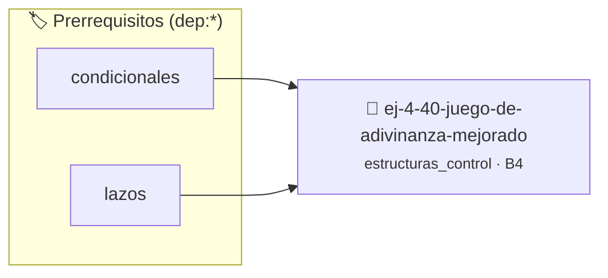

# Juego de Adivinanza Mejorado
> **ID:** `ej-4-40-juego-de-adivinanza-mejorado` · **Unidad:** 1 (Fundamentos y Estructuras de Control)
 · **Tema:** `estructuras_control` / `control`
 · **Bloom:** B4 (Analizar) · **Dificultad:** Avanzada
 · **Carga:** ~35 min · **Tipo:** Practica Guiada
>
> **🏷️ Prerrequisitos temáticos (tags):** `dep:condicionales`, `dep:lazos`
>
> **Etiquetas conceptuales:** `control`, `lazos`, `fundamentos`, `juego`, `mejorado`


::: {admonition} 📦 Paquete de Verificación Local (Ripley)
:class: tip

Para compilar, resolver y autoevaluar tu entrega con pruebas unitarias en tu máquina:

- [📥 **Descargar paquete `ej-4-40-juego-de-adivinanza-mejorado.ripkg`**](../../paquetes/ej-4-40-juego-de-adivinanza-mejorado.ripkg)

Ejecución con el asistente de cátedra:
```bash
ripley run ej-4-40-juego-de-adivinanza-mejorado.ripkg
```
:::


### 🗺️ Itinerario Pedagógico




## 📖 Consigna

### Ejercicio 4.40 - Juego de Adivinanza Mejorado ⭐⭐⭐⭐⭐

El programa elige un número aleatorio. El usuario tiene máximo 7 intentos.

**Orientación:**
- `rand() % 100 + 1` para número aleatorio
- Lazo con contador de intentos
- Dar pistas ("muy alto", "muy bajo")
- `break` si adivina
- Después del lazo: verificar si ganó o perdió


:::{hint} Lógica y Consideraciones
    desbordamientos de búfer validando la capacidad máxima.
    líneas de manera robusta.

-   **[*plus ultra*]:** Implementar un sistema de puntaje basado en la cantidad de intentos restantes.
-   **[*plus ultra*]:** Permitir al usuario reiniciar una nueva partida sin salir del programa.

:::
<!-- {hint} Lógica y Consideraciones -->

---

## Notas Finales

:::{tip} Elección del Lazo Apropiado

**`for`:** Cuando sabés cuántas iteraciones hacer
- Recorrer arrays
- Contar de A a B
- N iteraciones fijas

**`while`:** Cuando la condición de parada se evalúa al inicio
- Menús interactivos
- Búsquedas
- Procesamiento hasta condición

**`do-while`:** Cuando necesitás ejecutar al menos una vez
- Validación de entrada
- Menús que deben mostrarse al menos una vez
- "Repetir hasta que el usuario confirme"

:::
<!-- {tip} Elección del Lazo Apropiado -->

:::{warning} Errores Comunes

1. **Lazo infinito:** Olvidar incrementar/decrementar variable de control
   ```c
   // MAL
   while (i < 10)
   {
       printf("%d\n", i);
       // Falta i++
   }
   ```

2. **Off-by-one:** Error en condición de parada
   ```c
   // Quiero 10 iteraciones
   for (int i = 1; i < 10; i++)         // MAL: solo 9 iteraciones
       for (int i = 1; i <= 10; i++)    // BIEN: 10 iteraciones
           for (int i = 0; i < 10; i++) // BIEN: 10 iteraciones
   ```

3. **Modificar variable de control dentro del lazo**
   ```c
   // Confuso
   for (int i = 0; i < 10; i++)
   {
       i += 2; // Evitar esto
   }
   ```

4. **Condición incorrecta con `break`**
   ```c
   // Redundante
   while (true)
   {
       if (condicion)
           break;
   }
   // Mejor
   while (!condicion)
   {
       // código
   }
   ```

:::
<!-- {warning} Errores Comunes -->

:::{note} Control de Lazos

**`break`:** Termina el lazo inmediatamente
``` c
for (int i = 0; i < 10; i++)
{
    if (condicion)
        break; // Sale del lazo
}
```
<!-- c -->

**`continue`:** Salta a la siguiente iteración
``` c
for (int i = 0; i < 10; i++)
{
    if (i % 2 == 0)
        continue;      // Salta pares
    printf("%d\n", i); // Solo imprime impares
}
```
<!-- c -->

**Recomendación:** Usá `break` y `continue` con moderación. Preferí condiciones
claras.

:::
<!-- {note} Control de Lazos -->

:::{tip} Optimizaciones

- **Reducir iteraciones:** En búsqueda de primos, probar solo hasta √n
- **Salir temprano:** Usar `break` cuando encontrás lo que buscás
- **Precalcular:** Si una expresión no cambia en el lazo, calculala afuera
- **Evitar trabajo redundante:** Caché resultados que se reusan

:::
<!-- {tip} Optimizaciones -->

Estas consignas cubren todos los aspectos de lazos: `for`, `while`, `do-while`,
lazos anidados, control de flujo y validación con repetición.
## Ejercicio 4.41 - Mostrar Argumentos ⭐☆☆☆☆

Mostrá todos los argumentos recibidos.

**Orientación:**

:::{hint} Lógica y Consideraciones
    desbordamientos de búfer validando la capacidad máxima.
    líneas de manera robusta.

-   **[*plus ultra*]:** Validar que argc sea mayor a 1 antes de acceder a los argumentos.
-   **[*plus ultra*]:** Imprimir los argumentos enumerados con su índice correspondiente.

:::
<!-- {hint} Lógica y Consideraciones -->

```{code-block} c
:linenos:
int main(int argc, char *argv[])
{
    printf("Cantidad de argumentos: %d\n", argc);
    for (int i = 0; i < argc; i++)
    {
        printf("argv[%d] = %s\n", i, argv[i]);
    }
}
```
<!-- {code-block} c -->
- `argv[0]` es el nombre del programa

---
## Ejercicio 4.42 - Saludo Personalizado ⭐☆☆☆☆

Lee un nombre desde argv y saludá.

**Uso:** `./saludo Juan`

**Orientación:**
- Verificá: `if (argc != 2) { fprintf(stderr, "Uso: %s <nombre>\n", argv[0]);
  return 1; }`
- Usá: `printf("Hola, %s!\n", argv[1]);`


:::{hint} Lógica y Consideraciones
    valores fuera de rango o tipos inválidos.
    un lazo hasta que el usuario elija finalizar.

-   **[*plus ultra*]:** Verificar exactamente la cantidad de argumentos requeridos con argc.
-   **[*plus ultra*]:** Mostrar un mensaje de uso explicativo si no se proporcionan los argumentos esperados.

:::
<!-- {hint} Lógica y Consideraciones -->

---
## Ejercicio 4.43 - Suma de Dos Números ⭐⭐☆☆☆

Sumá dos números pasados como argumentos.

**Uso:** `./suma 5 3`

**Orientación:**
- Verificá `argc == 3`
- Convertí con `atoi`: `int a = atoi(argv[1]);`
- O mejor: `strtol(argv[1], NULL, 10)` para validación


:::{hint} Lógica y Consideraciones
    desbordamientos de búfer validando la capacidad máxima.
    líneas de manera robusta.

-   **[*plus ultra*]:** Validar que los argumentos sean dígitos numéricos antes de operar.
-   **[*plus ultra*]:** Manejar la suma de números con signo.

:::
<!-- {hint} Lógica y Consideraciones -->

---
## Ejercicio 4.44 - Calculadora Simple ⭐⭐⭐☆☆

Implementá calculadora: `./calc <num1> <operador> <num2>`

**Uso:** `./calc 10 + 5`

**Orientación:**
- `argc == 4`
- `argv[2]` es el operador: `+`, `-`, `*`, `/`
- Usá `switch` o `if-else` para operación
- Validá división por cero


:::{hint} Lógica y Consideraciones
    valores fuera de rango o tipos inválidos.
    un lazo hasta que el usuario elija finalizar.

-   **[*plus ultra*]:** Validar la división por cero y operadores no reconocidos.
-   **[*plus ultra*]:** Soportar operadores aritméticos básicos (+, -, *, /).

:::
<!-- {hint} Lógica y Consideraciones -->

---
## Ejercicio 4.45 - Flags Booleanos ⭐⭐⭐☆☆

Procesá flags opcionales `-v` (verbose) y `-h` (help).

**Uso:** `./programa -v archivo.txt`

**Orientación:**
- Recorré `argv` buscando strings que empiecen con `-`
- `if (strcmp(argv[i], "-v") == 0) verbose = true;`
- Argumentos no-flag son archivos u otros datos


:::{hint} Lógica y Consideraciones
    desbordamientos de búfer validando la capacidad máxima.
    líneas de manera robusta.

-   **[*plus ultra*]:** Recorrer los argumentos usando un lazo y almacenar las opciones en variables booleanas.
-   **[*plus ultra*]:** Manejar flags combinados o en cualquier orden.

:::
<!-- {hint} Lógica y Consideraciones -->

---
## Ejercicio 4.46 - Concatenar Argumentos ⭐⭐☆☆☆

Concatená todos los argumentos (excepto argv[0]) en un string.

**Uso:** `./concat Hola mundo desde C`
**Salida:** `Hola mundo desde C`

**Orientación:**
- Recorré argv desde índice 1
- Concatená con espacios intermedios
- Usá `strcat` o manualmente con índices


:::{hint} Lógica y Consideraciones
    desbordamientos de búfer validando la capacidad máxima.
    líneas de manera robusta.

-   **[*plus ultra*]:** Recorrer los argumentos con un lazo e imprimirlos con separación prolija.
-   **[*plus ultra*]:** Calcular la longitud total de los argumentos concatenados.

:::
<!-- {hint} Lógica y Consideraciones -->

---
## Ejercicio 4.47 - Conversor de Temperatura ⭐⭐⭐☆☆

Convertí temperatura según flags.

**Uso:** `./temp -c 100` (Celsius a Fahrenheit)
**Uso:** `./temp -f 212` (Fahrenheit a Celsius)

**Orientación:**
- Flag determina dirección de conversión
- Valor viene después del flag
- Mostrá resultado formateado


:::{hint} Lógica y Consideraciones
    desbordamientos de búfer validando la capacidad máxima.
    líneas de manera robusta.

-   **[*plus ultra*]:** Validar que el flag de escala sea -c o -f y que el valor numérico sea válido.
-   **[*plus ultra*]:** Mostrar ambas temperaturas en una tabla comparativa.

:::
<!-- {hint} Lógica y Consideraciones -->

---
## Ejercicio 4.48 - Procesamiento de Texto desde Consola ⭐⭐⭐☆☆

Leé texto carácter por carácter desde la entrada estándar (`stdin`) hasta encontrar `EOF` y mostralo en mayúsculas.

**Orientación:**
- Usá `getchar()` dentro de un lazo `while ((c = getchar()) != EOF)`
- Convertí cada letra con `toupper(c)` de `<ctype.h>`
- Imprimí cada carácter procesado con `putchar()`


:::{hint} Lógica y Consideraciones
    desbordamientos de búfer validando la capacidad máxima.
    líneas de manera robusta.

-   **[*plus ultra*]:** Validar que la lectura desde stdin finalice limpiamente al encontrar EOF.
-   **[*plus ultra*]:** Contar la cantidad de caracteres procesados.

:::
<!-- {hint} Lógica y Consideraciones -->

---
## Ejercicio 4.49 - Flag con Valor ⭐⭐⭐⭐☆

Procesá flag que requiere un valor: `-n <cantidad>`

**Uso:** `./programa -n 10 archivo.txt`

**Orientación:**

:::{hint} Lógica y Consideraciones
    desbordamientos de búfer validando la capacidad máxima.
    líneas de manera robusta.

-   **[*plus ultra*]:** Validar que el valor posterior al flag esté presente y sea un número positivo.
-   **[*plus ultra*]:** Emitir mensaje de error si el flag no tiene argumento asociado.

:::
<!-- {hint} Lógica y Consideraciones -->

```{code-block} c
:linenos:
for (int i = 1; i < argc; i++)
{
    if (strcmp(argv[i], "-n") == 0)
    {
        if (i + 1 < argc)
        {
            cantidad = atoi(argv[++i]); // Incrementa i
        }
        else
        {
            fprintf(stderr, "Flag -n requiere valor\n");
        }
    }
}
```
<!-- {code-block} c -->

---
## Ejercicio 4.50 - Múltiples Flags ⭐⭐⭐⭐☆

Implementá programa con varios flags: `-v` (verbose), `-o <salida>`, `-n <num>`

**Uso:** `./programa -v -o salida.txt -n 100 entrada.txt`

**Orientación:**
- Variables para cada flag
- Lazo procesando argv
- Flags pueden estar en cualquier orden
- Argumentos sin `-` son archivos de entrada


:::{hint} Lógica y Consideraciones
    errores de E/S con `ferror` y `feof`.
    archivo en todos los caminos de ejecución.

-   **[*plus ultra*]:** Procesar los flags con un lazo while y switch o if-else encadenados.
-   **[*plus ultra*]:** Ignorar flags desconocidos emitiendo una advertencia.

:::
<!-- {hint} Lógica y Consideraciones -->

---
## Ejercicio 4.51 - Validación de Argumentos ⭐⭐⭐☆☆

Validá que números sean realmente números.

**Orientación:**

:::{hint} Lógica y Consideraciones
    evitar fallos de segmentación.
    punteros en lugar de indexación directa.

-   **[*plus ultra*]:** Validar que la cadena represente un número entero válido mediante inspección de caracteres.
-   **[*plus ultra*]:** Manejar correctamente el signo negativo y espacios iniciales.

:::
<!-- {hint} Lógica y Consideraciones -->

```{code-block} c
:linenos:
char *endptr;
long num = strtol(argv[1], &endptr, 10);
if (*endptr != '\0')
{
    fprintf(stderr, "Error: '%s' no es un número válido\n", argv[1]);
    return 1;
}
```
<!-- {code-block} c -->
- `strtol` pone en `endptr` el primer carácter no-numérico
- Si `*endptr != '\0'`, hay caracteres inválidos

---
## Ejercicio 4.52 - Ayuda Automática ⭐⭐⭐☆☆

Mostrá ayuda si se pasa `-h` o `--help`, o si argumentos son incorrectos.

**Orientación:**

:::{hint} Lógica y Consideraciones
    desbordamientos de búfer validando la capacidad máxima.
    líneas de manera robusta.

-   **[*plus ultra*]:** Detectar flags como -h o --help y mostrar un resumen claro de opciones.
-   **[*plus ultra*]:** Finalizar con código de éxito 0 tras mostrar la ayuda.

:::
<!-- {hint} Lógica y Consideraciones -->

```{code-block} c
:linenos:
void mostrar_ayuda(const char *programa)
{
    printf("Uso: %s [opciones] archivo\n", programa);
    printf("Opciones:\n");
    printf("  -h, --help    Mostrar esta ayuda\n");
    printf("  -v            Modo verbose\n");
    printf("  -o <archivo>  Archivo de salida\n");
}
if (argc < 2 || strcmp(argv[1], "-h") == 0 || strcmp(argv[1], "--help") == 0)
{
    mostrar_ayuda(argv[0]);
    return 0;
}
```
<!-- {code-block} c -->

---
## Ejercicio 4.53 - Grep Simplificado ⭐⭐⭐⭐☆

Buscá patrón en archivo(s).

**Uso:** `./grep "patron" archivo1.txt archivo2.txt`

**Orientación:**
- `argv[1]` es el patrón
- `argv[2...]` son archivos
- Leé cada archivo línea por línea
- Si línea contiene patrón (`strstr`), mostrala


:::{hint} Lógica y Consideraciones
    desbordamientos de búfer validando la capacidad máxima.
    líneas de manera robusta.

-   **[*plus ultra*]:** Validar que la búsqueda procese líneas de longitud arbitraria sin desbordamiento.
-   **[*plus ultra*]:** Resaltar o indicar el número de línea donde ocurrió la coincidencia.

:::
<!-- {hint} Lógica y Consideraciones -->

---
## Ejercicio 4.54 - Wc (Word Count) Simplificado ⭐⭐⭐⭐☆

Contá líneas, palabras y caracteres de archivos.

**Uso:** `./wc [-l] [-w] [-c] archivo(s)`

**Flags:**
- `-l`: solo líneas
- `-w`: solo palabras
- `-c`: solo caracteres
- Sin flags: todo

**Orientación:**
- Procesá flags para saber qué contar
- Para cada archivo, calculá métricas
- Mostrá según flags activos


:::{hint} Lógica y Consideraciones
    desbordamientos de búfer validando la capacidad máxima.
    líneas de manera robusta.

-   **[*plus ultra*]:** Manejar múltiples espacios y saltos de línea consecutivos sin distorsionar el conteo de palabras.
-   **[*plus ultra*]:** Formatear los totales en columnas alineadas.

:::
<!-- {hint} Lógica y Consideraciones -->

---
## Ejercicio 4.55 - Sort con Opciones ⭐⭐⭐⭐⭐

Ordená líneas de archivo con opciones.

**Uso:** `./sort [-r] [-n] archivo.txt`

**Flags:**
- `-r`: orden reverso
- `-n`: orden numérico (en lugar de lexicográfico)

**Orientación:**
- Leé archivo completo en array de strings
- Ordená según flags
- Usá `qsort` con función comparadora apropiada


:::{hint} Lógica y Consideraciones
    desbordamientos de búfer validando la capacidad máxima.
    líneas de manera robusta.

-   **[*plus ultra*]:** Implementar el ordenamiento de los argumentos numéricos usando un lazo burbuja básico.
-   **[*plus ultra*]:** Permitir ordenar en orden ascendente o descendente según un flag.

:::
<!-- {hint} Lógica y Consideraciones -->

---
## Ejercicio 4.56 - Procesamiento de Lote ⭐⭐⭐⭐⭐

Aplicá operación a múltiples archivos.

**Uso:** `./batch -op <operacion> archivo1 archivo2 ...`

**Operaciones:** `upper`, `lower`, `reverse`, `count`

**Orientación:**
- Flag `-op` determina operación
- Aplicá a todos los archivos siguientes
- Escribí resultado en archivo.out para cada uno


:::{hint} Lógica y Consideraciones
    errores de E/S con `ferror` y `feof`.
    archivo en todos los caminos de ejecución.

-   **[*plus ultra*]:** Validar que el lazo procese datos hasta EOF informando estadísticas finales.
-   **[*plus ultra*]:** Calcular media, máximo y mínimo de los datos leídos.

:::
<!-- {hint} Lógica y Consideraciones -->

---
## Ejercicio 4.57 - Configuración desde Archivo y Args ⭐⭐⭐⭐⭐

Leé configuración de archivo, permitiendo override por línea de comandos.

**Uso:** `./programa -c config.txt -n 50`

**Orientación:**
- Leé config.txt primero (formato `clave=valor`)
- Argumentos de línea de comandos sobrescriben config
- Precedencia: defaults < archivo < args


:::{hint} Lógica y Consideraciones
    errores de E/S con `ferror` y `feof`.
    archivo en todos los caminos de ejecución.

-   **[*plus ultra*]:** Manejar un menú de configuración con lazo de confirmación de cambios.
-   **[*plus ultra*]:** Restablecer los valores por defecto ante una opción de reinicio.

:::
<!-- {hint} Lógica y Consideraciones -->

---
## Ejercicio 4.58 - Pipeline Simulado ⭐⭐⭐⭐⭐

Implementá programa que puede leer de stdin o archivo.

**Uso:** 
- `./proceso archivo.txt`
- `cat archivo.txt | ./proceso`

**Orientación:**

:::{hint} Lógica y Consideraciones
    errores de E/S con `ferror` y `feof`.
    archivo en todos los caminos de ejecución.

-   **[*plus ultra*]:** Encapsular cada etapa del procesamiento en una función con contratos claros.
-   **[*plus ultra*]:** Permitir encadenar múltiples etapas de filtrado y transformación.

:::
<!-- {hint} Lógica y Consideraciones -->

```{code-block} c
:linenos:
FILE *entrada;
if (argc > 1)
{
    entrada = fopen(argv[1], "r");
}
else
{
    entrada = stdin; // Lee de stdin
}
```
<!-- {code-block} c -->
- Permite composición estilo Unix

---
## Ejercicio 4.59 - Getopt Simplificado ⭐⭐⭐⭐⭐

Implementá tu propia versión simplificada de `getopt` para parsear flags.

**Orientación:**

:::{hint} Lógica y Consideraciones
    desbordamientos de búfer validando la capacidad máxima.
    líneas de manera robusta.

-   **[*plus ultra*]:** Implementar un lazo de inspección de argumentos identificando flags cortos.
-   **[*plus ultra*]:** Manejar flags con y sin valor asociado.

:::
<!-- {hint} Lógica y Consideraciones -->

``` c
int getopt_simple(int argc, char *argv[], const char *optstring);
```
<!-- c -->
- `optstring`: "vhn:" (v y h sin valor, n con valor)
- Retorna carácter del flag o -1
- Variable global `optarg` con valor del flag

---
## Ejercicio 4.60 - Sistema de Comandos ⭐⭐⭐⭐⭐

Implementá programa con subcomandos estilo Git.

**Uso:** 
- `./tool add archivo.txt`
- `./tool remove archivo.txt`
- `./tool list`

**Orientación:**
- `argv[1]` es el subcomando
- `argv[2...]` son argumentos del subcomando
- Cada subcomando tiene su propia lógica
- `switch` o tabla de funciones para dispatch


:::{hint} Lógica y Consideraciones
    desbordamientos de búfer validando la capacidad máxima.
    líneas de manera robusta.

-   **[*plus ultra*]:** Diseñar un lazo de comando interactivo que procese comandos de texto simples (ej. suma, info, salir).
-   **[*plus ultra*]:** Mostrar mensajes de error claros ante comandos no reconocidos.

:::
<!-- {hint} Lógica y Consideraciones -->

---

## Notas Finales

:::{tip} Convenciones de Argumentos

**Orden típico:**
```
programa [opciones] [argumentos_posicionales]
```

**Formatos de flags:**
- Short: `-v`, `-n 10`
- Long: `--verbose`, `--number=10`
- Combinados: `-vvv` o `-abc` (equiv. `-a -b -c`)

**Convenciones:**
- `-h` o `--help`: ayuda
- `-v` o `--version`: versión
- `-`: stdin (entrada estándar)
- `--`: fin de opciones, resto son argumentos

:::
<!-- {tip} Convenciones de Argumentos -->

:::{warning} Errores Comunes

1. **No validar argc:**
   ```c
   // MAL
   int n = atoi(argv[1]); // Puede acceder fuera de límites
   // BIEN
   if (argc < 2)
   {
       fprintf(stderr, "Faltan argumentos\n");
       return 1;
   }
   int n = atoi(argv[1]);
   ```

2. **Asumir orden de flags:**
   ```c
   // Poco robusto
   if (strcmp(argv[1], "-v") == 0)
       ...
           // Mejor: recorrer buscando flags
           for (int i = 1; i < argc; i++)
       {
           if (strcmp(argv[i], "-v") == 0)
               verbose = true;
       }
   ```

3. **No validar conversiones:**
   ```c
   int n = atoi("abc"); // Retorna 0, sin error
   // Mejor:
   char *end;
   long n = strtol(argv[1], &end, 10);
   if (*end != '\0')
   { /* error */
   }
   ```

4. **Olvidar incrementar índice con flags que tienen valor:**
   ```c
   if (strcmp(argv[i], "-n") == 0)
   {
       n = atoi(argv[i + 1]); // Usá i+1
       // FALTA: i++; para saltar el valor
   }
   ```

:::
<!-- {warning} Errores Comunes -->

:::{note} Funciones de Conversión

| Función | Tipo destino | Validación | Base |
|---------|--------------|------------|------|
| `atoi` | int | ❌ No | 10 |
| `atol` | long | ❌ No | 10 |
| `atof` | double | ❌ No | - |
| `strtol` | long | ✅ Sí | Cualquiera |
| `strtod` | double | ✅ Sí | - |
| `sscanf` | Varios | ✅ Parcial | - |

**Recomendación:** Usar `strtol`/`strtod` para conversiones robustas.

:::
<!-- {note} Funciones de Conversión -->

:::{tip} Patrones de Parsing

**Flags simples:**
```{code-block} c
:linenos:
bool verbose = false;
for (int i = 1; i < argc; i++)
{
    if (strcmp(argv[i], "-v") == 0)
    {
        verbose = true;
    }
}
```
<!-- {code-block} c -->

**Flags con valor:**
```{code-block} c
:linenos:
const char *output = NULL;
for (int i = 1; i < argc; i++)
{
    if (strcmp(argv[i], "-o") == 0 && i + 1 < argc)
    {
        output = argv[++i];
    }
}
```
<!-- {code-block} c -->

**Separar flags de argumentos:**
```{code-block} c
:linenos:
int num_archivos = 0;
char *archivos[MAX];
for (int i = 1; i < argc; i++)
{
    if (argv[i][0] == '-')
    {
        // Procesar flag
    }
    else
    {
        archivos[num_archivos++] = argv[i];
    }
}
```
<!-- {code-block} c -->

:::
<!-- {tip} Patrones de Parsing -->

:::{note} getopt (estándar POSIX)

La biblioteca estándar provee `getopt` para parsing robusto:

```{code-block} c
:linenos:
#include <unistd.h>
int opt;
while ((opt = getopt(argc, argv, "vhn:o:")) != -1)
{
    switch (opt)
    {
    case 'v':
        verbose = true;
        break;
    case 'h':
        mostrar_ayuda();
        break;
    case 'n':
        num = atoi(optarg);
        break;
    case 'o':
        output = optarg;
        break;
    default:
        return 1;
    }
}
// optind es el índice del primer argumento no-flag
for (int i = optind; i < argc; i++)
{
    // Procesar archivos
}
```
<!-- {code-block} c -->

`getopt_long` soporta flags largos (`--verbose`).

:::
<!-- {note} getopt (estándar POSIX) -->

Estas consignas cubren procesamiento de argumentos desde básico hasta sistemas
complejos estilo herramientas Unix, esenciales para programas de línea de
comandos profesionales.


## 📋 Prototipos y Cabecera (`ej-4-40-juego-de-adivinanza-mejorado.h`)

```{code-block} c
#ifndef EJERCICIO_EJ_4_40_JUEGO_DE_ADIVINANZA_MEJORADO_H
#define EJERCICIO_EJ_4_40_JUEGO_DE_ADIVINANZA_MEJORADO_H

#include <stddef.h>
#include <stdbool.h>
#include <stdint.h>

/* Procesa el flujo principal de Juego de Adivinanza Mejorado */
int proc__adivinanza_mejorado(int val);

#endif /* EJERCICIO_EJ_4_40_JUEGO_DE_ADIVINANZA_MEJORADO_H */
```


## ⚙️ Especificación de Funciones

| Función | Retorno | Parámetros | Descripción |
| :--- | :--- | :--- | :--- |

| `proc__adivinanza_mejorado` | `int` | `int val` | Procesa el flujo principal de Juego de Adivinanza Mejorado |


## 💡 Pistas Progresivas

````{tab-set}

```{tab-item} Pista 1
[Plus Ultra] Implementar un sistema de puntaje basado en la cantidad de intentos restantes.
```

```{tab-item} Pista 2
[Plus Ultra] Permitir al usuario reiniciar una nueva partida sin salir del programa.
```

```{tab-item} Pista 3
Recorrer arrays
```

```{tab-item} Pista 4
Contar de A a B
```

```{tab-item} Pista 5
N iteraciones fijas **`while`:** Cuando la condición de parada se evalúa al inicio
```

```{tab-item} Pista 6
Menús interactivos
```

```{tab-item} Pista 7
Búsquedas
```

```{tab-item} Pista 8
Procesamiento hasta condición **`do-while`:** Cuando necesitás ejecutar al menos una vez
```

```{tab-item} Pista 9
Validación de entrada
```

```{tab-item} Pista 10
Menús que deben mostrarse al menos una vez
```

```{tab-item} Pista 11
"Repetir hasta que el usuario confirme"
```

```{tab-item} Pista 12
**Reducir iteraciones:** En búsqueda de primos, probar solo hasta √n
```

```{tab-item} Pista 13
**Salir temprano:** Usar `break` cuando encontrás lo que buscás
```

```{tab-item} Pista 14
**Precalcular:** Si una expresión no cambia en el lazo, calculala afuera
```

```{tab-item} Pista 15
**Evitar trabajo redundante:** Caché resultados que se reusan
```

```{tab-item} Pista 16
[Plus Ultra] Validar que argc sea mayor a 1 antes de acceder a los argumentos.
```

```{tab-item} Pista 17
[Plus Ultra] Imprimir los argumentos enumerados con su índice correspondiente.
```

```{tab-item} Pista 18
[Plus Ultra] Verificar exactamente la cantidad de argumentos requeridos con argc.
```

```{tab-item} Pista 19
[Plus Ultra] Mostrar un mensaje de uso explicativo si no se proporcionan los argumentos esperados.
```

```{tab-item} Pista 20
[Plus Ultra] Validar que los argumentos sean dígitos numéricos antes de operar.
```

```{tab-item} Pista 21
[Plus Ultra] Manejar la suma de números con signo.
```

```{tab-item} Pista 22
[Plus Ultra] Validar la división por cero y operadores no reconocidos.
```

```{tab-item} Pista 23
[Plus Ultra] Soportar operadores aritméticos básicos (+, -, *, /).
```

```{tab-item} Pista 24
[Plus Ultra] Recorrer los argumentos usando un lazo y almacenar las opciones en variables booleanas.
```

```{tab-item} Pista 25
[Plus Ultra] Manejar flags combinados o en cualquier orden.
```

```{tab-item} Pista 26
[Plus Ultra] Recorrer los argumentos con un lazo e imprimirlos con separación prolija.
```

```{tab-item} Pista 27
[Plus Ultra] Calcular la longitud total de los argumentos concatenados.
```

```{tab-item} Pista 28
[Plus Ultra] Validar que el flag de escala sea -c o -f y que el valor numérico sea válido.
```

```{tab-item} Pista 29
[Plus Ultra] Mostrar ambas temperaturas en una tabla comparativa.
```

```{tab-item} Pista 30
[Plus Ultra] Validar que la lectura desde stdin finalice limpiamente al encontrar EOF.
```

```{tab-item} Pista 31
[Plus Ultra] Contar la cantidad de caracteres procesados.
```

```{tab-item} Pista 32
[Plus Ultra] Validar que el valor posterior al flag esté presente y sea un número positivo.
```

```{tab-item} Pista 33
[Plus Ultra] Emitir mensaje de error si el flag no tiene argumento asociado.
```

```{tab-item} Pista 34
[Plus Ultra] Procesar los flags con un lazo while y switch o if-else encadenados.
```

```{tab-item} Pista 35
[Plus Ultra] Ignorar flags desconocidos emitiendo una advertencia.
```

```{tab-item} Pista 36
[Plus Ultra] Validar que la cadena represente un número entero válido mediante inspección de caracteres.
```

```{tab-item} Pista 37
[Plus Ultra] Manejar correctamente el signo negativo y espacios iniciales.
```

```{tab-item} Pista 38
[Plus Ultra] Detectar flags como -h o --help y mostrar un resumen claro de opciones.
```

```{tab-item} Pista 39
[Plus Ultra] Finalizar con código de éxito 0 tras mostrar la ayuda.
```

```{tab-item} Pista 40
[Plus Ultra] Validar que la búsqueda procese líneas de longitud arbitraria sin desbordamiento.
```

```{tab-item} Pista 41
[Plus Ultra] Resaltar o indicar el número de línea donde ocurrió la coincidencia.
```

```{tab-item} Pista 42
[Plus Ultra] Manejar múltiples espacios y saltos de línea consecutivos sin distorsionar el conteo de palabras.
```

```{tab-item} Pista 43
[Plus Ultra] Formatear los totales en columnas alineadas.
```

```{tab-item} Pista 44
[Plus Ultra] Implementar el ordenamiento de los argumentos numéricos usando un lazo burbuja básico.
```

```{tab-item} Pista 45
[Plus Ultra] Permitir ordenar en orden ascendente o descendente según un flag.
```

```{tab-item} Pista 46
[Plus Ultra] Validar que el lazo procese datos hasta EOF informando estadísticas finales.
```

```{tab-item} Pista 47
[Plus Ultra] Calcular media, máximo y mínimo de los datos leídos.
```

```{tab-item} Pista 48
[Plus Ultra] Manejar un menú de configuración con lazo de confirmación de cambios.
```

```{tab-item} Pista 49
[Plus Ultra] Restablecer los valores por defecto ante una opción de reinicio.
```

```{tab-item} Pista 50
[Plus Ultra] Encapsular cada etapa del procesamiento en una función con contratos claros.
```

```{tab-item} Pista 51
[Plus Ultra] Permitir encadenar múltiples etapas de filtrado y transformación.
```

```{tab-item} Pista 52
[Plus Ultra] Implementar un lazo de inspección de argumentos identificando flags cortos.
```

```{tab-item} Pista 53
[Plus Ultra] Manejar flags con y sin valor asociado.
```

```{tab-item} Pista 54
[Plus Ultra] Diseñar un lazo de comando interactivo que procese comandos de texto simples (ej. suma, info, salir).
```

```{tab-item} Pista 55
[Plus Ultra] Mostrar mensajes de error claros ante comandos no reconocidos.
```

```{tab-item} Pista 56
Short: `-v`, `-n 10`
```

```{tab-item} Pista 57
Long: `--verbose`, `--number=10`
```

```{tab-item} Pista 58
Combinados: `-vvv` o `-abc` (equiv. `-a -b -c`) **Convenciones:**
```

```{tab-item} Pista 59
`-h` o `--help`: ayuda
```

```{tab-item} Pista 60
`-v` o `--version`: versión
```

```{tab-item} Pista 61
`-`: stdin (entrada estándar)
```

```{tab-item} Pista 62
`--`: fin de opciones, resto son argumentos
```

````


## 🧪 Casos de Prueba

| Prueba Unitaria | Función Objetivo | Verificación |
| :--- | :--- | :--- |

| **test_proc__adivinanza_mejorado_positivo** | `proc__adivinanza_mejorado` | `int res = proc__adivinanza_mejorado(5); assert(res == 10 || res >= 0);` |

| **test_proc__adivinanza_mejorado_cero** | `proc__adivinanza_mejorado` | `int res = proc__adivinanza_mejorado(0); assert(res == 0);` |


## ✓ Solución Modelo de Cátedra

```{dropdown} 🔍 Revelar solución canónica en C
:open: false

```{code-block} c
/*
 * Solucion modelo para ej-4-40-juego-de-adivinanza-mejorado
 * Catedra Programacion I - UNRN
 */
#include <stdio.h>
#include <stdlib.h>
#include <string.h>
#include <stdbool.h>


int proc__adivinanza_mejorado(int val)
{
    if (val <= 0) return 0;
    return val * 2;
}

int main(void)
{
    int n = 0;
    if (scanf("%d", &n) == 1)
    {
        printf("OK %d\n", n);
    }
    else
    {
        printf("OK\n");
    }
    return 0;
}
```
```
