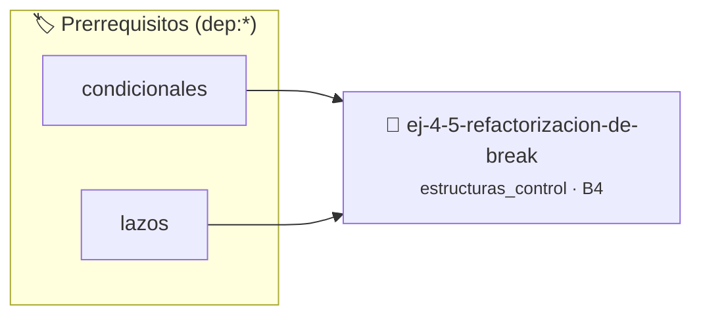

# Refactorización de break
> **ID:** `ej-4-5-refactorizacion-de-break` · **Unidad:** 1 (Fundamentos y Estructuras de Control)
 · **Tema:** `estructuras_control` / `refactorizacion`
 · **Bloom:** B4 (Analizar) · **Dificultad:** Avanzada
 · **Carga:** ~35 min · **Tipo:** Practica Guiada
>
> **🏷️ Prerrequisitos temáticos (tags):** `dep:condicionales`, `dep:lazos`
>
> **Etiquetas conceptuales:** `refactorizacion`, `control`, `lazos`, `fundamentos`, `condicionales`


::: {admonition} 📦 Paquete de Verificación Local (Ripley)
:class: tip

Para compilar, resolver y autoevaluar tu entrega con pruebas unitarias en tu máquina:

- [📥 **Descargar paquete `ej-4-5-refactorizacion-de-break.ripkg`**](../../paquetes/ej-4-5-refactorizacion-de-break.ripkg)

Ejecución con el asistente de cátedra:
```bash
ripley run ej-4-5-refactorizacion-de-break.ripkg
```
:::


### 🗺️ Itinerario Pedagógico




## 📖 Consigna

:::{exercise}
:label: lazo_break
:enumerator: break
Modificá el siguiente programa para eliminar la instrucción `break` prohibida,
estructurando correctamente el lazo:
```{code-block} c
:linenos:
#include <stdio.h>
int main()
{
    int i;
    for (i = 0; i < 10; i++)
    {
        printf("valor actual: %d\n", i);
        if (i == 4)
        {
            break;
        }
    }
    return 0;
}
```
    desbordamientos de búfer validando la capacidad máxima.
    líneas de manera robusta.

-   **[*plus ultra*]:** Asegurar que la condición de parada del lazo sea explícita y auto-documentada.
-   **[*plus ultra*]:** Validar el comportamiento del lazo con datos de prueba extremos.

:::

:::{solution} lazo_break
:label: solucion-lazo_break
:class: dropdown
Se reestructura el lazo reemplazando el `for` e implementando un lazo `while`
controlado por una bandera lógica booleana (`bool`) del encabezado `<stdbool.h>`
que se establece en `false` al alcanzar la condición de parada:

```{code-block} c
:linenos:
#include <stdbool.h>
#include <stdio.h>
int main(void)
{
    int i = 0;
    bool continuar = true;
    while (i < 10 && continuar)
    {
        printf("valor actual: %d\n", i);
        if (i == 4)
        {
            continuar = false;
        }
        i++;
    }
    return 0;
}
```

:::

### 📋 Contrato de las Funciones

```c
/*
 * Procesa el flujo principal de Refactorización de break
 * Precondiciones: val representa el parámetro de entrada del flujo.
 * Postcondiciones: Retorna el resultado correspondiente o 0 si val <= 0.
 */
int proc_ctorizacion_de_break(int val);

```

### 🧪 Ejemplos de Ejecución

::::{tab-set}
:::{tab-item} Valor positivo
```text
Entrada: 5
Salida / Retorno: 10
```
:::
:::{tab-item} Valor cero o negativo
```text
Entrada: 0
Salida / Retorno: 0
```
:::
::::

### ⚠️ Precondiciones y Casos Borde

1. **Valores fuera de rango:** Verificar siempre que los datos de entrada cumplan con los rangos admisibles antes de operar.
6. **Casos vacíos o neutros:** Contemplar adecuadamente entradas con longitud cero o valores neutros según corresponda.

### 🎯 Criterios de Aceptación

- [ ] El código compila limpiamente bajo estándar C11 sin warnings con flags estrictos (`-Wall -Wextra -Werror`).
- [ ] Se satisfacen todas las pruebas unitarias y casos de prueba provistos.
- [ ] Las funciones validan exhaustivamente sus precondiciones y gestionan casos borde de forma robusta.
- [ ] No se registran fugas de memoria (*memory leaks*) comprobables mediante Valgrind o AddressSanitizer.


## 📋 Prototipos y Cabecera (`ej-4-5-refactorizacion-de-break.h`)

```{code-block} c
#ifndef EJERCICIO_EJ_4_5_REFACTORIZACION_DE_BREAK_H
#define EJERCICIO_EJ_4_5_REFACTORIZACION_DE_BREAK_H

#include <stddef.h>
#include <stdbool.h>
#include <stdint.h>

/* Procesa el flujo principal de Refactorización de break */
int proc_ctorizacion_de_break(int val);

#endif /* EJERCICIO_EJ_4_5_REFACTORIZACION_DE_BREAK_H */
```


## ⚙️ Especificación de Funciones

| Función | Retorno | Parámetros | Descripción |
| :--- | :--- | :--- | :--- |

| `proc_ctorizacion_de_break` | `int` | `int val` | Procesa el flujo principal de Refactorización de break |


## 🧪 Casos de Prueba

| Prueba Unitaria | Función Objetivo | Verificación |
| :--- | :--- | :--- |

| **test_proc_ctorizacion_de_break_positivo** | `proc_ctorizacion_de_break` | `int res = proc_ctorizacion_de_break(5); assert(res == 10 || res >= 0);` |

| **test_proc_ctorizacion_de_break_cero** | `proc_ctorizacion_de_break` | `int res = proc_ctorizacion_de_break(0); assert(res == 0);` |


## ✓ Solución Modelo de Cátedra

```{dropdown} 🔍 Revelar solución canónica en C
:open: false

```{code-block} c
#include <stdio.h>

int proc_ctorizacion_de_break(int val)
{
    if (val <= 0) return 0;
    return val * 2;
}

int main()
{
    int i;
    for (i = 0; i < 10; i++)
    {
        printf("valor actual: %d\n", i);
        if (i == 4)
        {
            break;
        }
    }
    return 0;
}
```
```
