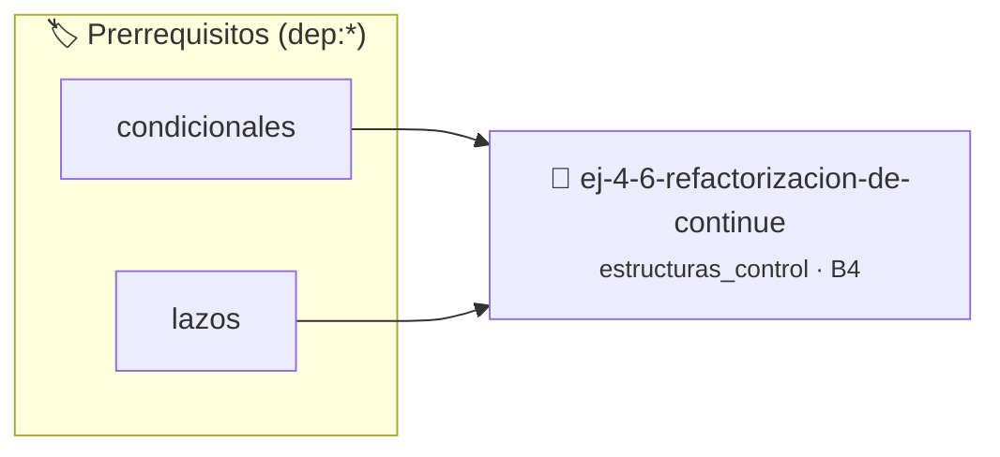

# Refactorización de continue
> **ID:** `ej-4-6-refactorizacion-de-continue` · **Unidad:** 1 (Fundamentos y Estructuras de Control)
 · **Tema:** `estructuras_control` / `refactorizacion`
 · **Bloom:** B4 (Analizar) · **Dificultad:** Avanzada
 · **Carga:** ~35 min · **Tipo:** Practica Guiada
>
> **🏷️ Prerrequisitos temáticos (tags):** `dep:condicionales`, `dep:lazos`
>
> **Etiquetas conceptuales:** `refactorizacion`, `control`, `lazos`, `fundamentos`, `continue`


::: {admonition} 📦 Paquete de Verificación Local (Ripley)
:class: tip

Para compilar, resolver y autoevaluar tu entrega con pruebas unitarias en tu máquina:

- [📥 **Descargar paquete `ej-4-6-refactorizacion-de-continue.ripkg`**](../../paquetes/ej-4-6-refactorizacion-de-continue.ripkg)

Ejecución con el asistente de cátedra:
```bash
ripley run ej-4-6-refactorizacion-de-continue.ripkg
```
:::


### 🗺️ Itinerario Pedagógico




## 📖 Consigna

### Ejercicio 4.6 - Refactorización de continue ⭐⭐☆☆☆

:::{exercise}
:label: lazo_continue
:enumerator: continue
Modificá el siguiente código para eliminar la instrucción `continue` prohibida:
```{code-block} c
:linenos:
#include <stdio.h>
int main()
{
    for (int i = 0; i <= 10; i++)
    {
        if (i % 2 == 0)
        {
            continue;
        }
        printf("i = %d\n", i);
    }
    return 0;
}
```
<!-- {code-block} c -->
    desbordamientos de búfer validando la capacidad máxima.
    líneas de manera robusta.

-   **[*plus ultra*]:** Refactorizar el lazo usando if-else para evitar bifurcaciones no estructuradas.
-   **[*plus ultra*]:** Verificar que la lógica sea equivalente mediante pruebas unitarias.

:::
<!-- {exercise} -->

:::{solution} lazo_continue
:label: solucion-lazo_continue
:class: dropdown
Se reestructura el lazo de forma segura eliminando la instrucción `continue` y
encerrando el cuerpo restante del lazo dentro de una condición positiva que
filtra los elementos que se desean procesar (en este caso, los impares):

```{code-block} c
:linenos:
#include <stdio.h>
int main(void)
{
    for (int i = 0; i <= 10; i++)
    {
        if (i % 2 != 0)
        {
            printf("i = %d\n", i);
        }
    }
    return 0;
}
```
<!-- {code-block} c -->

:::
<!-- {solution} lazo_continue -->


## 📋 Prototipos y Cabecera (`ej-4-6-refactorizacion-de-continue.h`)

```{code-block} c
#ifndef EJERCICIO_EJ_4_6_REFACTORIZACION_DE_CONTINUE_H
#define EJERCICIO_EJ_4_6_REFACTORIZACION_DE_CONTINUE_H

#include <stddef.h>
#include <stdbool.h>
#include <stdint.h>

/* Procesa el flujo principal de Refactorización de continue */
int proc_rizacion_de_continue(int val);

#endif /* EJERCICIO_EJ_4_6_REFACTORIZACION_DE_CONTINUE_H */
```


## ⚙️ Especificación de Funciones

| Función | Retorno | Parámetros | Descripción |
| :--- | :--- | :--- | :--- |

| `proc_rizacion_de_continue` | `int` | `int val` | Procesa el flujo principal de Refactorización de continue |


## 🧪 Casos de Prueba

| Prueba Unitaria | Función Objetivo | Verificación |
| :--- | :--- | :--- |

| **test_proc_rizacion_de_continue_positivo** | `proc_rizacion_de_continue` | `int res = proc_rizacion_de_continue(5); assert(res == 10 || res >= 0);` |

| **test_proc_rizacion_de_continue_cero** | `proc_rizacion_de_continue` | `int res = proc_rizacion_de_continue(0); assert(res == 0);` |


## ✓ Solución Modelo de Cátedra

```{dropdown} 🔍 Revelar solución canónica en C
:open: false

```{code-block} c
#include <stdio.h>

int proc_rizacion_de_continue(int val)
{
    if (val <= 0) return 0;
    return val * 2;
}

int main()
{
    for (int i = 0; i <= 10; i++)
    {
        if (i % 2 == 0)
        {
            continue;
        }
        printf("i = %d\n", i);
    }
    return 0;
}
```
```
